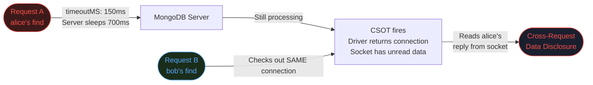

<div align="center">

# CVE-2026-119179

### MongoDB Node.js Driver — CSOT Connection Pool Desynchronization


</div>

---

## Overview

When a client-side operation timeout (CSOT) expires during a MongoDB query, the Node.js driver may return the network connection to the pool while the server's reply is still outstanding on the socket. The next operation that checks out that connection reads the stale reply from a previous request — causing one user to receive another user's data.

| Field | Value |
|---|---|
| **CVE** | CVE-2026-119179 |
| **CVSS 4.0** | `8.3 High` — `AV:N/AC:L/AT:P/PR:N/UI:N/VC:H/VI:L/VA:L` |
| **CVSS 3.1** | `7.0 High` — `AV:N/AC:H/PR:N/UI:N/S:U/C:H/I:L/A:L` |
| **CWE** | CWE-226 / CWE-488 (Sensitive Information Not Removed from Resource) |
| **Affected** | `mongodb` >= 6.11.0 < 6.22.0 and >= 7.0.0 < 7.8.0 |
| **Fixed** | 6.22.0 and 7.8.0 |
| **Jira** | NODE-7929, NODE-7958 |
| **Auth Required** | None |
| **Disclosed** | 2026-11-18 |

---

## Vulnerability Details

CSOT applies a single deadline to the whole operation including connection checkout and server execution. When the deadline fires while the server is mid-reply, the vulnerable driver ends the operation but **does not tear down the socket**. The connection is returned to the pool with unread bytes still present.

The MongoDB wire protocol has no per-request IDs — the driver trusts that a reply read from a socket belongs to the request it just wrote there. With a pool size of `1`, the effect is deterministic: request B reads request A's reply.

---

## Attack Flow



---

## PoC Usage

> **Warning:** Lab environment with throwaway MongoDB server only.

### Setup

```bash
# Start a local MongoDB server
docker compose up -d

# Install vulnerable driver
npm install mongodb@7.0.0
```

### Run against vulnerable driver

```bash
node poc.js
```

Expected output — vulnerable driver (7.0.0):
```
[+] attempt 1: LEAK - request B for user bob received 2 document(s) of user alice (secret-1, secret-2)
      {"_id":"secret-1","owner":"alice","iban":"TR33 0006 1005 1978 6457 8413 26"}
      {"_id":"secret-2","owner":"alice","note":"internal acquisition memo"}

[!] VULNERABLE - cross-request data disclosure in 1/5 attempts
    (fix: upgrade to mongodb 6.22.0+ / 7.8.0+)
```

### Run against fixed driver

```bash
npm install mongodb@7.8.0
node poc.js
```

Expected output — fixed driver (7.8.0):
```
[-] attempt 1: no leak (B got 2 doc(s), A ended with MongoOperationTimeoutError)
[+] NOT VULNERABLE - the connection was discarded on timeout
```

### Remote / Docker-hosted server

```bash
MONGO_URI='mongodb://10.0.0.12:27017' ATTEMPTS=10 node poc.js
```

### Tunables (environment variables)

| Variable | Default | Description |
|---|---|---|
| `TIMEOUT_MS` | `150` | Client-side operation timeout in ms |
| `SERVER_SLEEP` | `700` | Server-side delay injected via `$where` in ms |
| `GAP_MS` | `80` | Wait between request A and B in ms |
| `ATTEMPTS` | `5` | Number of leak attempts before giving up |
| `MONGO_URI` | — | MongoDB connection string |

> **Exit codes:** `0` = leak observed, `1` = no leak, `2` = setup failure

---

## Detection

| Indicator | Notes |
|---|---|
| Results with wrong `owner` field | Application-level: response does not match the query filter |
| `MongoOperationTimeoutError` spikes | High CSOT timeout rates indicate timing-sensitive workload |
| Connection pool exhaustion followed by unusual data | Monitor pool checkout/return events |

---

## Impact

Any application that enables CSOT and serves multiple users from one connection pool — which covers almost every web app using this driver with timeouts enabled. The attacker needs only to send ordinary requests and wait for a timeout to line up; no authentication or elevated privileges required.

---

## Remediation

Upgrade `mongodb` to **6.22.0+** or **7.8.0+**.

| Action | Detail |
|---|---|
| Upgrade driver | `npm install mongodb@7.8.0` or `npm install mongodb@6.22.0` |
| Disable CSOT temporarily | Remove `timeoutMS` on sensitive read paths until patched |
| Monitor request shapes | Alert on results that do not match the expected query filter |

---

## References

- NODE-7929: https://jira.mongodb.org/browse/NODE-7929
- NODE-7958: https://jira.mongodb.org/browse/NODE-7958
- CVE Record: https://www.cve.org/CVERecord?id=CVE-2026-119179
- Driver Releases: https://github.com/mongodb/node-mongodb-native/releases

---

> **Disclaimer:** For authorized security research and controlled lab use only. MIT License.