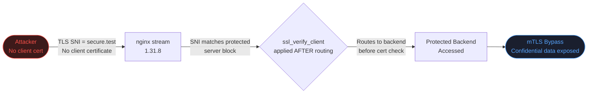

<div align="center">

# CVE-2026-120967

### nginx — Stream SNI Client Certificate Verification Bypass


</div>

---

## Overview

nginx's stream SSL module applies `ssl_verify_client` checks too late in the handshake pipeline when multiple virtual servers share the same listen socket and are differentiated by SNI. A client that sends the SNI hostname of a certificate-protected server block but omits the client certificate can bypass mutual TLS and reach the protected backend.

| Field | Value |
|---|---|
| **CVE** | CVE-2026-120967 |
| **CVSS 3.1** | `4.8 Medium` — `AV:N/AC:H/PR:N/UI:N/S:U/C:H/I:N/A:N` |
| **CWE** | CWE-295 (Improper Certificate Validation) |
| **Component** | `ngx_stream_ssl_module` (SNI routing) |
| **Affected** | nginx 1.25.5 – 1.31.8 |
| **Fixed** | nginx 1.30.7 / 1.31.9 |
| **Auth Required** | None |
| **Disclosed** | 2026-11-18 |

---

## Vulnerability Details

When two stream servers share the same socket address and differ only by `ssl_server_name`, nginx selects the server block based on the TLS SNI extension. In affected versions the `ssl_verify_client` check associated with the selected server block is applied **after** the stream routing decision has already been committed. A client that sends `SNI = secure.test` but omits the client certificate is routed to the protected backend without triggering the certificate verification failure.

**Lab layout:**
```
nginx:1.31.8  stream  :9443
  server { ssl_server_name default.invalid; ... }          ← no mTLS
  server { ssl_server_name secure.test;                    ← mTLS required
           ssl_verify_client on;
           ssl_client_certificate ca.pem; ... }
         ↓
backend (raw TCP) — replies "secret" to any request
```

---

## Attack Flow



---

## PoC Usage

> **Warning:** Docker Compose lab environment only.

### Setup

```bash
docker compose up --build -d
sleep 5
```

### Run the bypass

```bash
python3 poc.py
```

Expected output — vulnerable nginx:
```
[+] BYPASS CONFIRMED — backend reached without client certificate!
    SNI: secure.test  cert: none  response: "secret"
[!] VULNERABLE — ssl_verify_client bypassed via SNI routing race
```

### Options

```bash
python3 poc.py --host 127.0.0.1 --port 9443
```

| Flag | Description |
|---|---|
| `--host HOST` | nginx host (default: `127.0.0.1`) |
| `--port PORT` | Stream port (default: `9443`) |
| `--sni NAME` | SNI hostname to send (default: `secure.test`) |
| `--no-cert` | Skip client certificate (default — this is the bypass) |
| `--with-cert` | Provide a valid client cert (baseline — should succeed) |

### Baseline — legitimate access with client certificate

```bash
python3 poc.py --with-cert
# Expected: HTTP 200, backend reached with valid cert
```

### Expected output — patched build

```bash
# nginx 1.31.9
python3 poc.py
# TLS error: certificate verify failed
# [+] NOT vulnerable — ssl_verify_client enforced before routing
```

---

## Detection

| Indicator | Notes |
|---|---|
| TLS handshake succeeded on mTLS port without `SSL_client_cert` log field | nginx access log: check for missing `$ssl_client_cert` |
| Backend reached from unexpected clients | Backend access log: connections without valid client identity |
| SNI `secure.test` in TLS handshake without client cert | Network capture: ClientHello with SNI but no Certificate handshake message |

---

## Impact

An attacker on a network that can reach the nginx stream port can bypass mutual TLS authentication and connect to any backend that relies solely on nginx's `ssl_verify_client on` for access control.

---

## Remediation

Upgrade to **nginx 1.30.7** or **1.31.9**. The fix ensures `ssl_verify_client` is enforced before the routing decision is committed.

| Action | Detail |
|---|---|
| Upgrade nginx | 1.30.7 (stable) or 1.31.9 (mainline) |
| Workaround | Move mTLS servers to dedicated listen sockets (not shared with non-mTLS) |
| Backend validation | Add mutual TLS validation at the backend layer as defense-in-depth |

---

## References

- nginx Security Advisories: https://nginx.org/en/security_advisories.html
- CWE-295: https://cwe.mitre.org/data/definitions/295.html
- CVE Record: https://www.cve.org/CVERecord?id=CVE-2026-120967

---

> **Disclaimer:** For authorized security research and controlled lab use only. MIT License.