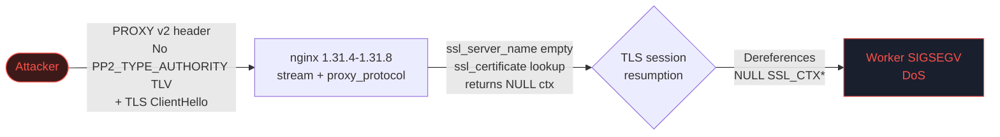

<div align="center">

# CVE-2026-120993

### nginx — NULL Pointer Dereference via PROXY Protocol v2 + Dynamic Certificates


</div>

---

## Overview

nginx's stream SSL module crashes (SIGSEGV) when a PROXY protocol v2 header that omits the server-name TLV is combined with a variable-based `ssl_certificate` directive and TLS session resumption. The missing TLV leaves `$ssl_server_name` empty, causing a NULL `SSL_CTX *` to be dereferenced during the resumption path.

| Field | Value |
|---|---|
| **CVE** | CVE-2026-120993 |
| **CVSS 3.1** | `5.3 Medium` — `AV:N/AC:H/PR:N/UI:N/S:U/C:N/I:N/A:H` |
| **CWE** | CWE-476 (NULL Pointer Dereference) |
| **Component** | `ngx_stream_ssl_module` + PROXY protocol v2 |
| **Affected** | nginx 1.31.4 – 1.31.8 |
| **Fixed** | nginx 1.31.9 |
| **Auth Required** | None |
| **Disclosed** | 2026-11-18 |

---

## Vulnerability Details

When `proxy_protocol` and a variable-based `ssl_certificate` are both active on a stream listener, nginx reads `$ssl_server_name` from PROXY protocol v2 TLVs (specifically `PP2_TYPE_AUTHORITY` / `PP2_TYPE_SSL`). A PROXY v2 header that omits these TLVs leaves `$ssl_server_name` empty. The dynamic certificate lookup resolves to an empty path, returning a NULL `SSL_CTX *`. During TLS session resumption nginx dereferences this NULL pointer, causing a worker crash (SIGSEGV).

**Lab layout:**
```
client (poc.py) → PROXY v2 (no SNI TLV) + TLS :9443
                → nginx:1.31.8 stream SSL + proxy_protocol
                → backend:9000 (raw TCP)
health check: :8080/health
```

---

## Attack Flow



---

## PoC Usage

> **Warning:** Docker Compose lab environment only.

### Setup

```bash
docker compose up --build -d
sleep 5
```

### Trigger the NULL deref

```bash
python3 poc.py
```

Expected output — vulnerable nginx:
```
[*] sending PROXY v2 (no SNI TLV) + TLS ClientHello to 127.0.0.1:9443
[+] connection established
[*] sending session resumption request...
[*] health check: 127.0.0.1:8080 — TIMEOUT
[!] VULNERABLE — nginx worker stopped responding (NULL deref crash)
```

### Variants

```bash
# Default: PROXY v2 without SNI TLV + TLS resumption
python3 poc.py

# PROXY v2 with SNI TLV (baseline — should not crash)
python3 poc.py --mode with-sni

# Repeated stress (confirm reproducibility)
python3 poc.py --count 10
```

### Available flags

| Flag | Description |
|---|---|
| `--host HOST` | nginx host (default: `127.0.0.1`) |
| `--port PORT` | Stream port (default: `9443`) |
| `--health-port PORT` | Health check port (default: `8080`) |
| `--mode no-sni\|with-sni` | PROXY v2 TLV mode (default: `no-sni`) |
| `--count N` | Number of trigger attempts |

### Expected output — patched build (nginx 1.31.9)

```bash
sed -i 's/nginx:1.31.8/nginx:1.31.9/' nginx/Dockerfile
docker compose build --no-cache nginx && docker compose up -d
python3 poc.py
# nginx handles missing TLV gracefully
# [+] NOT vulnerable — health check passed after all attempts
```

### Monitor for crashes

```bash
docker compose logs nginx | grep -E "worker process|signal 11|segfault"
```

---

## Detection

| Indicator | Notes |
|---|---|
| nginx worker crash signal 11 | `nginx error.log`: "worker process exited on signal 11" |
| PROXY v2 connections without SNI TLV | Network capture: PROXY v2 header missing `PP2_TYPE_AUTHORITY` |
| Dynamic cert path resolving to empty string | nginx debug log: empty `ssl_certificate` after variable expansion |

---

## Impact

Unauthenticated remote Denial of Service. A single crafted PROXY v2 connection crashes the nginx worker. Any load balancer that forwards PROXY protocol headers to nginx on a dynamic-cert stream listener is vulnerable.

---

## Remediation

Upgrade to **nginx 1.31.9**. The fix validates the `SSL_CTX *` before proceeding with session resumption.

| Action | Detail |
|---|---|
| Upgrade nginx | 1.31.9 (mainline) |
| Validate PROXY v2 TLVs | Add upstream load balancer rules to require `PP2_TYPE_AUTHORITY` |
| Monitor worker restarts | Alert on nginx workers exiting with signal 11 |

---

## References

- nginx Security Advisories: https://nginx.org/en/security_advisories.html
- CWE-476: https://cwe.mitre.org/data/definitions/476.html
- CVE Record: https://www.cve.org/CVERecord?id=CVE-2026-120993

---

> **Disclaimer:** For authorized security research and controlled lab use only. MIT License.