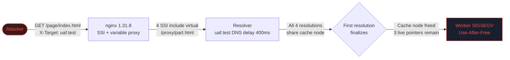

<div align="center">

# CVE-2026-123634

### nginx — Resolver Use-After-Free via Concurrent SSI Subrequests


</div>

---

## Overview

A use-after-free in nginx's resolver occurs when an SSI or `mirror` subrequest resolves the same variable-based proxy hostname as an in-flight parent request. When one of the concurrent resolutions finalizes, its cache node is freed while the other resolutions still hold raw pointers to it, causing a worker crash on the next dereference.

| Field | Value |
|---|---|
| **CVE** | CVE-2026-123634 |
| **CVSS 3.1** | `8.1 High` — `AV:N/AC:H/PR:N/UI:N/S:U/C:H/I:H/A:H` |
| **CVSS 4.0** | `9.2 Critical` — `CVSS:4.0/AV:N/AC:L/AT:P/PR:N/UI:N/VC:H/VI:H/VA:H` |
| **CWE** | CWE-416 (Use After Free) |
| **Affected** | nginx 0.6.18 – 1.31.8 |
| **Fixed** | nginx 1.30.7 / 1.31.9 |
| **Advisory** | https://my.f5.com/manage/s/article/K000163925 |
| **Auth Required** | None |
| **Disclosed** | 2026-11-18 |

---

## Vulnerability Details

**Three preconditions must hold simultaneously:**
1. nginx acts as a proxy
2. The proxied server name contains variables (e.g. `proxy_pass http://$backend$uri`) — every request goes through the resolver
3. An SSI/mirror subrequest targets a location that resolves the **same** name

The lab adds a 400ms delayed DNS responder to make overlapping resolutions deterministic. When 4 SSI includes fire in parallel for the same hostname, all 4 resolver contexts share one cache node. When one request finalizes, the node is freed while the other 3 still reference it.

---

## Attack Flow



---

## PoC Usage

> **Warning:** Lab environment only. The lab includes a delayed DNS responder.

### Setup

```bash
docker compose up -d --build
```

Lab components:
- nginx 1.31.8 with SSI + variable `proxy_pass`
- Delayed DNS responder (400ms) for deterministic races
- `/page/index.html` — SSI page that fires 4 concurrent proxy includes

### Trigger the UAF

```bash
python3 poc.py -n 300
```

Expected output — vulnerable nginx:
```
[*] sending 300 requests with concurrent SSI subrequests...
[*] request 47: ConnectionResetError — worker crashed
[+] VULNERABLE — resolver UAF confirmed after 47 requests
    docker compose logs nginx | grep -iE 'signal 11|segfault'
```

### Options

```bash
# Fewer requests (slow host)
python3 poc.py -n 100

# Verbose — show each request's outcome
python3 poc.py -n 300 -v

# Custom target hostname
python3 poc.py -n 300 --target-host uaf.test
```

### Available flags

| Flag | Description |
|---|---|
| `-n N` | Total requests to send (default: `300`) |
| `-v` | Verbose output |
| `--host HOST` | nginx host (default: `127.0.0.1`) |
| `--port PORT` | HTTP port (default: `80`) |
| `--target-host NAME` | Variable proxy target hostname (default: `uaf.test`) |

### Expected output — patched build

```bash
sed -i 's/nginx:1.31.8/nginx:1.31.9/' nginx/Dockerfile
docker compose build --no-cache nginx && docker compose up -d
python3 poc.py -n 300
# No crashes — resolver cache node lifetimes properly tracked
```

---

## Detection

| Indicator | Notes |
|---|---|
| nginx worker crash signal 11 | `nginx error.log`: "worker process exited on signal 11" |
| Concurrent DNS resolutions for the same name | nginx resolver debug log: multiple lookups for identical hostname |
| SSI includes firing against variable-proxy location | nginx access log: parallel sub-requests in short time window |

---

## Impact

Unauthenticated remote Denial of Service (worker crash). With ASLR disabled or bypassed, the freed cache node memory may allow remote code execution. The UAF has existed since nginx 0.6.18 — any deployment with variable-based proxy and SSI is vulnerable.

---

## Remediation

Upgrade to **nginx 1.30.7** or **1.31.9**.

| Action | Detail |
|---|---|
| Upgrade nginx | 1.30.7 (stable) or 1.31.9 (mainline) |
| Avoid variable proxy + SSI | Use static `proxy_pass` where possible |
| Monitor worker crashes | Alert on nginx workers exiting with signal 11 |

---

## References

- Advisory K000163925: https://my.f5.com/manage/s/article/K000163925
- nginx Security Advisories: https://nginx.org/en/security_advisories.html
- CVE Record: https://www.cve.org/CVERecord?id=CVE-2026-123634

---

> **Disclaimer:** For authorized security research and controlled lab use only. MIT License.