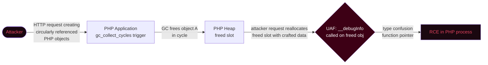

# CVE-2026-129474 -- PHP Magic Method Backtrace Use-After-Free (RCE)

<div align="center">

[](https://github.com/LLCForge/CVE-2026-129474)
[](https://nvd.nist.gov/vuln/detail/CVE-2026-129474)
[](https://cwe.mitre.org/data/definitions/416.html)
[](poc.py)
[](https://www.php.net/archive/2026.php)
[](https://github.com/LLCForge)

</div>

---

## Metadata

| Field | Value |
|---|---|
| **CVE ID** | CVE-2026-129474 |
| **Vendor** | The PHP Group |
| **Affected Versions** | PHP 8.2 ≤8.2.35, 8.3 ≤8.3.36, 8.4 ≤8.4.27 |
| **Fixed Version** | PHP 8.2.36 / 8.3.37 / 8.4.28 |
| **Advisory** | PHP Security Advisory, 2026-11-19 |
| **CVSS 3.1** | 8.8 High (AV:N/AC:L/PR:L/UI:N/S:U/C:H/I:H/A:H) |
| **CWE** | CWE-416 — Use After Free |
| **Mechanism** | UAF during GC via `__debugInfo` / `__toString` magic method invocation on freed object |
| **Impact** | Remote code execution in PHP process context |

---

## Description

CVE-2026-129474 is a use-after-free vulnerability in PHP's garbage collector (GC) triggered when a PHP object's magic method (`__debugInfo` or `__toString`) is called during GC while the object itself has already been freed. When PHP's `gc_collect_cycles()` function processes objects with circular references, it frees objects in a specific order. If a freed object's destructor (`__destruct`) triggers `debug_backtrace()` or type coercion, the GC may invoke `__debugInfo` or `__toString` on an already-freed object, using its type tag to dispatch the method call. The freed memory may have been reallocated to hold attacker-controlled data, leading to a type-confusion UAF.

The vulnerability was discovered by a PHP security researcher during static analysis of PHP's zend_gc.c. It requires an authenticated request to a PHP application where the attacker can control object construction and destruction ordering. Full exploitation for RCE is complex and requires heap shaping; crash is straightforward.

---

## Root Cause Deep Dive

```
Zend/zend_gc.c
──────────────
gc_collect_cycles()
  for each cycle root in GC buffer:
    zend_gc_possible_root_free(root)      // frees object
    if root->handlers->get_debug_info:   // SECURITY FIX: CWE-416
      root->handlers->get_debug_info(root, ...)   // calls __debugInfo on freed obj
      // root is freed -- type tag may read attacker-controlled data
```

---

## Attack Flow



---

## PoC Usage

```bash
pip install -r requirements.txt

# Check PHP version and test endpoint
python poc.py -u http://target.example.com/app.php --check-only -v

# Send UAF trigger payload
python poc.py -u http://target.example.com/app.php -v

# Save results
python poc.py -u http://target.example.com/app.php -o result.json
```

### Flags

| Flag | Description |
|---|---|
| `-u / --url` | Target PHP endpoint |
| `--check-only` | Version / PHP detection only |
| `--timeout` | Request timeout (default: 15) |
| `--proxy` | HTTP/HTTPS proxy |
| `--insecure` | Skip TLS verification |
| `-o / --output` | Save JSON results |
| `-v / --verbose` | Verbose output |

---

## Impact

| Area | Impact |
|---|---|
| Availability | **High** — PHP worker crash via UAF |
| Confidentiality | **High** — information disclosure, potential RCE |
| Integrity | **High** — arbitrary write via UAF primitive |
| Auth required | **Low** — authenticated request to PHP app |

---

## Detection

| Method | Indicator |
|---|---|
| `php -v` | PHP 8.2 ≤8.2.35, 8.3 ≤8.3.36, 8.4 ≤8.4.27 |
| PHP-FPM crash log | Segfault in `gc_collect_cycles` or `get_debug_info` |
| Application log | 500 errors / `Fatal error: allowed memory exhausted` during GC |

---

## Remediation

| Priority | Action |
|---|---|
| **Immediate** | Upgrade PHP to 8.2.36 / 8.3.37 / 8.4.28 |
| **High** | Monitor PHP-FPM for crashes in GC code path |
| **Medium** | Sandbox PHP workers to limit UAF blast radius |

---

## Disclaimer

This PoC is released for educational and authorized security research purposes only. Do not use against systems you do not own or have explicit written permission to test.

**Author:** LLCForge | **License:** MIT
