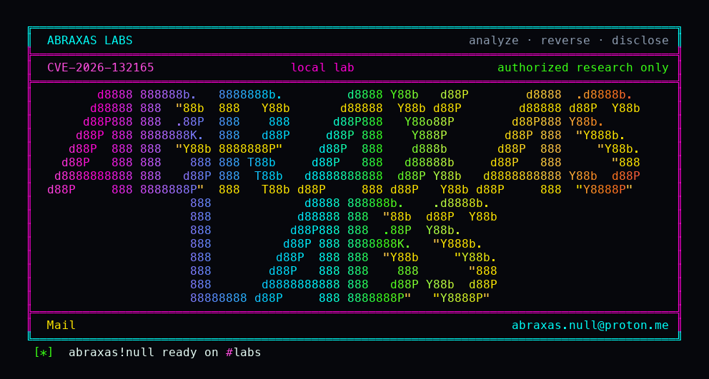

<p align="center">
  
</p>

# drupal-install-takeover

Someone on the internet can open a Drupal site's installer with no password. If that site was finished, but Drupal never stored the installer state as done, the installer starts again where it left off. The next page asks for a new site admin. Saving it replaces user 1. The old admin password stops working. The articles, files, and database stay where they were. This lab does that on Drupal 11.4.12. The same request on 11.4.13 says the site is already installed and leaves the admin alone.

The stuck state is uncommon. A normal site that finished the installer and recorded "done" does not take this path. The lab plants that stuck state after a real install so the anonymous request can be shown on its own.

**Class:** Site takeover
**Reach:** Remote

**Drupal** 11.4.12 (`drupal:11.4.12-apache`) vs patched 11.4.13 - [SA-CORE-2026-017](https://www.drupal.org/sa-core-2026-017)

I installed the standard profile, left `install_time` set, and stored `install_task` as `install_install_profile` instead of `done`. That is the same shape as a finished site whose installer never recorded the last step. Anonymous `POST /core/install.php` then hits the configure-site form. On 11.4.12, user 1 becomes `cve132165` and a login with the new password returns HTTP 200. On 11.4.13 the page is "Drupal already installed" and user 1 is still `origadmin`.

| | |
|---|---|
| ID | [CVE-2026-132165](https://www.cve.org/CVERecord?id=CVE-2026-132165) |
| Advisory | [SA-CORE-2026-017](https://www.drupal.org/sa-core-2026-017) |
| Class | **Site takeover** |
| Reach | **Remote** (unauthenticated HTTP) |
| Score | **Critical: 18/25** AC:Complex/A:None/CI:All/II:All/E:Proof/TD:Uncommon (Drupal Security Team) |
| Product | [Drupal core](https://www.drupal.org/project/drupal) |
| Affected | Drupal before 10.6.22, 11.0.0 through 11.3.21, 11.4.0 through 11.4.12 (lab pin **11.4.12**) |
| Fixed | 10.6.22 / 11.3.22 / 11.4.13 (18 Nov 2026) |
| Auth | none, once the installer state is already stuck |
| License | [GNU Affero GPL v3.0](LICENSE) |
| Lab | `127.0.0.1` only |

Drupal 8, 9, 10.5.x, and 11.2.x and below are end of life and have no fix on those branches.

## What an attacker can do

| Method | Sink | Privilege |
|---|---|---|
| Unauthenticated `POST /core/install.php` on a finished site whose `install_task` is not `done` and whose `install_time` is set | `install_configure_form` writes user 1 | **Integrity (lab-proven):** replaces the maintenance account name, mail, and password. Login as `cve132165` returns HTTP 200. Existing content stays. |
| Same request on 11.4.13 | installer throws already-installed when `install_time` is set | **Closed (lab-proven):** "Drupal already installed". User 1 stays `origadmin`. |
| Finished site with `install_task` equal to `done` | `install_verify_completed_task()` | **Closed.** The installer refuses before the form. |
| Web server cannot write or change permissions on `settings.php` | some other installer paths | **Partly closed (advisory).** This lab's path does not rewrite `settings.php`. The account form still runs when settings are already valid. |
| Command execution, a new PHP file, or a reverse shell | n/a | **Not shown.** Replacing the admin is the lab result. What that admin can upload later depends on the site and was not part of this run. |

**Lab-proven vs inferred:** the account replacement, the login, and the patched refusal are lab-proven on official `drupal:11.4.12-apache` and `drupal:11.4.13-apache`. The stuck installer state was planted in the lab after a normal install. A remote bug that creates that state was not shown. Code execution after the new admin logs in was not shown.

**Requires:** `install.php` reachable, a finished site, `install_time` set, and `install_task` left on a step before the configure-site form. Loopback only. The lab uses the standard profile and sqlite.

## Lab

```bash
python3 drupal-install-takeover-Abraxas-Labs.py
```

or `cd lab && ./run.sh`. Loopback `127.0.0.1:18230` (11.4.12) vs `127.0.0.1:18231` (11.4.13). Compose project `cve-2026-132165`. Witness account `cve132165`. Last line:

```
SUCCESS CVE-2026-132165 takeover=yes rce=no
```

Authorized lab only. It talks to loopback.

## The fix

Update to Drupal 11.4.13, or 11.3.22 / 10.6.22. Until then, block `/core/install.php` in the web server. The 11.4.13 installer refuses to continue when the site already recorded an install time.

## References

- [SA-CORE-2026-017](https://www.drupal.org/sa-core-2026-017)
- [CVE-2026-132165](https://www.cve.org/CVERecord?id=CVE-2026-132165)
- [Drupal core](https://www.drupal.org/project/drupal) 11.4.12 vs [11.4.13](https://www.drupal.org/project/drupal/releases/11.4.13)
- [Securing the installer](https://www.drupal.org/docs/administering-a-drupal-site/security-in-drupal/securing-the-installer-installphp)

Abraxas Labs
abraxas.null@proton.me
