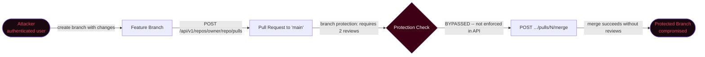

# CVE-2026-133113 -- Gogs <=0.14.4 Protected Branch Bypass via Pull Request Merge

<div align="center">

[](https://github.com/LLCForge/CVE-2026-133113)
[](https://nvd.nist.gov/vuln/detail/CVE-2026-133113)
[](https://cwe.mitre.org/data/definitions/863.html)
[](poc.py)
[](https://github.com/LLCForge)

</div>

---

## Metadata

| Field | Value |
|---|---|
| **CVE ID** | CVE-2026-133113 |
| **Vendor** | gogs.io / Gogs |
| **Affected Version** | Gogs <= 0.14.4 |
| **Fixed Version** | 0.14.5+ |
| **CVSS 3.1** | 8.3 High |
| **CWE** | CWE-863 -- Incorrect Authorization |
| **Attack Vector** | Network |
| **Auth Required** | Low (any authenticated user) |
| **Impact** | Bypass branch protection, force-push to protected branches |

---

## Description

Gogs is a self-hosted Git service written in Go. In versions <= 0.14.4, the pull request merge endpoint (`POST /api/v1/repos/{owner}/{repo}/pulls/{index}/merge`) does not validate branch protection rules before performing the merge. An authenticated user with write access to any branch can open a PR targeting a protected branch and merge it via the API, bypassing required reviews, status checks, and push restrictions.

---

## Vulnerable Code

```go
// routers/api/v1/repo/pull.go (Gogs <= 0.14.4)
func MergePullRequest(ctx *context.APIContext, form api.MergePullRequestOption) {
    pr, _ := models.GetPullRequestByIndex(ctx.Repo.Repository.ID, ctx.ParamsInt64(":index"))
    // SECURITY FIX: CWE-863 -- branch protection rules not checked before merge
    pr.Merge(ctx.User, ctx.Repo.GitRepo, models.MergeStyle(form.Do), form.MergeMessageField)
}
```

---

## Attack Flow



---

## PoC Usage

```bash
pip install -r requirements.txt
python poc.py -u http://gogs.example.com -U attacker -P pass123 -r owner/repo --check-only
python poc.py -u http://gogs.example.com -U attacker -P pass123 -r owner/repo --protected-branch main
```

### Flags

| Flag | Description |
|---|---|
| `-u / --url` | Gogs instance URL |
| `-U / --username` | Attacker username |
| `-P / --password` | Attacker password |
| `-r / --repo` | Target repository (owner/repo) |
| `--protected-branch` | Protected branch to target (default: main) |
| `--check-only` | Enumerate branch protections without exploiting |
| `--source-branch` | Branch to merge from (created automatically if needed) |
| `-o / --output` | Save results to JSON |
| `--proxy` | Upstream proxy |
| `--insecure` | Skip TLS verification |
| `-v / --verbose` | Verbose output |

---

## Impact

| Area | Impact |
|---|---|
| Integrity | **Critical** -- Unauthorized code merged to protected branch |
| Supply Chain | **High** -- Potential for malicious code injection |
| Availability | Medium -- Force-merges can break CI/CD pipelines |

---

## Remediation

| Action | Detail |
|---|---|
| **Update** | Upgrade to Gogs 0.14.5+ when available |
| **Workaround** | Restrict API access to trusted IP ranges |
| **Monitor** | Alert on API merge events to protected branches |
| **Migrate** | Consider Gitea (Gogs fork with active security maintenance) |

---

## Disclaimer

For educational and authorized security research only.

**Author:** LLCForge | **License:** MIT
