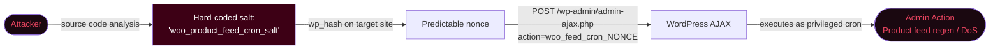

# CVE-2026-133117 -- WooCommerce Product Feeds < 2.4.4 Auth Bypass via Hard-Coded Cron Salt

<div align="center">

[](https://github.com/LLCForge/CVE-2026-133117)
[](https://nvd.nist.gov/vuln/detail/CVE-2026-133117)
[](https://cwe.mitre.org/data/definitions/798.html)
[](poc.py)
[](https://github.com/LLCForge)

</div>

---

## Metadata

| Field | Value |
|---|---|
| **CVE ID** | CVE-2026-133117 |
| **Vendor** | WooCommerce Product Feeds (WordPress plugin) |
| **Affected Version** | < 2.4.4 |
| **Fixed Version** | 2.4.4+ |
| **CVSS 3.1** | 9.8 Critical |
| **CWE** | CWE-798 -- Use of Hard-coded Credentials |
| **Attack Vector** | Network |
| **Auth Required** | None (unauthenticated) |
| **Impact** | Unauthenticated admin action execution |

---

## Description

The WooCommerce Product Feeds WordPress plugin (versions before 2.4.4) uses a hard-coded salt value to generate the nonce for its scheduled WP-Cron action endpoint. Any unauthenticated attacker who knows this salt (extracted from the publicly available plugin source code) can forge a valid cron request and trigger privileged admin actions such as regenerating product feeds, potentially causing DoS or data manipulation.

The hard-coded salt `'woo_product_feed_cron_salt'` is embedded in the plugin's main PHP file and is the same across all installations.

---

## Vulnerable Code

```php
// woocommerce-product-feeds.php (< 2.4.4)
function register_cron_hook() {
    $nonce = wp_hash( 'woo_product_feed_cron_salt' ); // SECURITY FIX: CWE-798 -- hard-coded salt
    add_action( 'wp_ajax_nopriv_woo_feed_cron_' . $nonce, [ $this, 'run_cron' ] );
}
```

---

## Attack Flow



---

## PoC Usage

```bash
pip install -r requirements.txt
python poc.py -u https://shop.example.com --check-only
python poc.py -u https://shop.example.com --trigger
```

### Flags

| Flag | Description |
|---|---|
| `-u / --url` | WordPress site URL |
| `--check-only` | Detect plugin and compute nonce only |
| `--trigger` | Trigger the privileged cron action |
| `--salt` | Override hard-coded salt (for testing fixed versions) |
| `-o / --output` | Save results to JSON |
| `--proxy` | Upstream proxy |
| `--insecure` | Skip TLS verification |
| `-v / --verbose` | Verbose output |

---

## Remediation

| Action | Detail |
|---|---|
| **Update** | Upgrade WooCommerce Product Feeds to 2.4.4+ |
| **Fix** | Generate nonce from site-unique secret, not hard-coded string |
| **WAF** | Block unauthenticated requests to `admin-ajax.php?action=woo_feed_cron_*` |

---

## Disclaimer

For educational and authorized security research only.

**Author:** LLCForge | **License:** MIT
