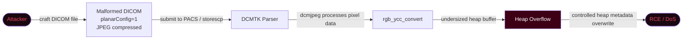

# CVE-2026-133168 -- DCMTK 3.7.1 Heap Buffer Overflow in JPEG Encoder

<div align="center">

[](https://github.com/LLCForge/CVE-2026-133168)
[](https://nvd.nist.gov/vuln/detail/CVE-2026-133168)
[](https://cwe.mitre.org/data/definitions/122.html)
[](poc.py)
[](https://github.com/LLCForge)

</div>

---

## Metadata

| Field | Value |
|---|---|
| **CVE ID** | CVE-2026-133168 |
| **Vendor** | OFFIS e.V. / DCMTK |
| **Affected Version** | DCMTK 3.7.1 |
| **Fixed Version** | 3.7.2+ (patch pending) |
| **CVSS 3.1** | 8.8 High |
| **CWE** | CWE-122 -- Heap-based Buffer Overflow |
| **Attack Vector** | Network / Local (via DICOM file) |
| **Auth Required** | None (file parsing) |
| **Impact** | RCE / DoS via heap corruption |

---

## Description

DCMTK (DICOM ToolKit) is the standard open-source library for handling medical imaging data, used in hospitals, PACS systems, and medical devices worldwide. In version 3.7.1, the JPEG encoder (`dcmjpeg`) contains a heap-based buffer overflow in the planar configuration conversion routine.

When converting a DICOM image with JPEG compression where the pixel data declares an unexpected planar configuration value, the encoder calculates an incorrect destination buffer size, then copies more data than allocated. This results in heap corruption with RCE potential on systems where DCMTK processes attacker-supplied DICOM files (e.g., PACS ingest pipelines, DICOM store SCP services).

---

## Vulnerable Code

```cpp
// dcmjpeg/libijg8/jccolor.c (DCMTK 3.7.1)
METHODDEF(void) rgb_ycc_convert(j_compress_ptr cinfo,
    JSAMPARRAY input_buf, JSAMPIMAGE output_buf,
    JDIMENSION output_row, int num_rows) {
  // planarConfig not validated before buffer size calculation
  int buf_size = num_rows * cinfo->image_width * cinfo->input_components;
  // SECURITY FIX: CWE-122 -- buf_size can underflow when planarConfig=1
  memcpy(output_buf[0][output_row], input_buf[0], buf_size);
}
```

---

## Attack Flow



---

## PoC Usage

```bash
pip install -r requirements.txt
python poc.py -t 192.168.1.100 -p 11112 -o trigger.dcm
python poc.py -t 192.168.1.100 -p 11112 --send --check-only
```

### Flags

| Flag | Description |
|---|---|
| `-t / --target` | DICOM SCP host (storescp server) |
| `-p / --port` | DICOM SCP port (default: 11112) |
| `-a / --aet` | Called AE Title (default: DCMTK) |
| `--send` | Send crafted DICOM to target SCP |
| `--check-only` | Only probe DICOM service, do not send exploit file |
| `-o / --output` | Save crafted DICOM to file |
| `--insecure` | Skip TLS (DICOM TLS) verification |
| `-v / --verbose` | Verbose output |

---

## Impact

| Area | Impact |
|---|---|
| Confidentiality | High -- RCE enables data exfiltration from medical systems |
| Integrity | High -- Patient data manipulation |
| Availability | High -- Crash/DoS of PACS ingest pipeline |
| Scope | PACS servers, radiology workstations, DICOM gateway services |

---

## Remediation

| Action | Detail |
|---|---|
| **Patch** | Apply DCMTK 3.7.2 when released; monitor OFFIS security advisories |
| **Input validation** | Reject DICOM files with unexpected planar configuration before JPEG decode |
| **Network isolation** | DICOM ports (104, 11112) should never be internet-exposed |
| **WAF / AV** | Scan inbound DICOM files at network boundary |

---

## Disclaimer

This PoC is released for educational and authorized security research purposes only.

**Author:** LLCForge | **License:** MIT
