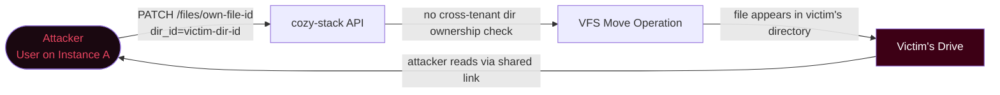

# CVE-2026-133172 -- cozy-stack < 1.6.69 Auth Bypass via Shared Drive Move

<div align="center">

[](https://github.com/LLCForge/CVE-2026-133172)
[](https://nvd.nist.gov/vuln/detail/CVE-2026-133172)
[](https://cwe.mitre.org/data/definitions/284.html)
[](poc.py)
[](https://github.com/LLCForge)

</div>

---

## Metadata

| Field | Value |
|---|---|
| **CVE ID** | CVE-2026-133172 |
| **Vendor** | Cozy Cloud / cozy-stack |
| **Affected Version** | cozy-stack < 1.6.69 |
| **Fixed Version** | 1.6.69+ |
| **CVSS 3.1** | 8.5 High |
| **CWE** | CWE-284 -- Improper Access Control |
| **Attack Vector** | Network |
| **Auth Required** | Low (authenticated user) |
| **Impact** | Cross-tenant file read/exfiltration via Shared Drive |

---

## Description

cozy-stack is the backend server for the Cozy personal cloud platform. In versions before 1.6.69, the file move endpoint for Shared Drives does not properly validate cross-tenant access. An authenticated user can move a file from their own shared drive to a target path that is owned by a different user's drive, effectively reading and exfiltrating files from other tenants' storage.

---

## Vulnerable Code

```go
// web/files/files.go (cozy-stack < 1.6.69)
func ModifyMetadataByIDHandler(c echo.Context) error {
    inst := middlewares.GetInstance(c)
    // ...
    if patch.DirID != nil {
        // SECURITY FIX: CWE-284 -- target dir_id not validated against caller's instance
        _, err = vfs.GetDirByID(inst.VFS(), *patch.DirID)
    }
}
```

---

## Attack Flow



---

## PoC Usage

```bash
pip install -r requirements.txt
python poc.py -u https://alice.cozy.example.com -t TOKEN --check-only
python poc.py -u https://alice.cozy.example.com -t TOKEN --victim-dir VICTIM_DIR_ID --file-id OWN_FILE_ID
```

### Flags

| Flag | Description |
|---|---|
| `-u / --url` | Cozy instance URL |
| `-t / --token` | OAuth bearer token |
| `--file-id` | File ID in attacker's drive to move |
| `--victim-dir` | Target directory ID in victim's drive |
| `--check-only` | Verify endpoint exists, no exploitation |
| `--enumerate` | Try common dir IDs |
| `-o / --output` | Save results to JSON |
| `--proxy` | Upstream proxy |
| `--insecure` | Skip TLS verification |
| `-v / --verbose` | Verbose output |

---

## Remediation

| Action | Detail |
|---|---|
| **Update** | Upgrade cozy-stack to 1.6.69+ |
| **Verify** | Confirm target `dir_id` belongs to caller's instance before move |

---

## Disclaimer

For educational and authorized security research only.

**Author:** LLCForge | **License:** MIT
