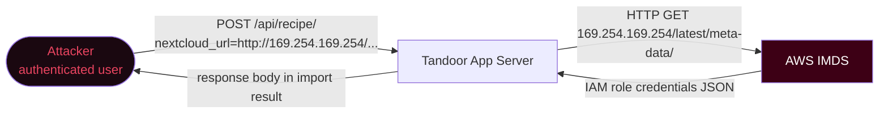

# CVE-2026-133235 -- Tandoor Recipes < 2.7.4 SSRF via Nextcloud WebDAV

<div align="center">

[](https://github.com/LLCForge/CVE-2026-133235)
[](https://nvd.nist.gov/vuln/detail/CVE-2026-133235)
[](https://cwe.mitre.org/data/definitions/918.html)
[](poc.py)
[](https://github.com/LLCForge)

</div>

---

## Metadata

| Field | Value |
|---|---|
| **CVE ID** | CVE-2026-133235 |
| **Vendor** | TandoorRecipes / tandoor-recipes |
| **Affected Version** | Tandoor Recipes < 2.7.4 |
| **Fixed Version** | 2.7.4+ |
| **CVSS 3.1** | 8.6 High |
| **CWE** | CWE-918 -- Server-Side Request Forgery |
| **Attack Vector** | Network |
| **Auth Required** | Low (authenticated user) |
| **Impact** | Internal network scan, cloud IMDS credential theft |

---

## Description

Tandoor Recipes is a popular self-hosted recipe management application. It supports importing recipes from Nextcloud via WebDAV integration. In versions before 2.7.4, the WebDAV client URL is taken directly from user input without validation or allowlisting. An authenticated user can supply an internal URL as the Nextcloud server address, causing the application server to issue HTTP requests to arbitrary internal hosts -- enabling full SSRF.

Particularly impactful in cloud deployments where AWS IMDS (`169.254.169.254`) or GCP metadata server can be reached, leaking IAM credentials.

---

## Vulnerable Code

```python
# cookbook/helper/recipe_url_import.py (Tandoor < 2.7.4)
def import_from_nextcloud(url, username, password):
    # SECURITY FIX: CWE-918 -- URL not validated against allowlist
    response = requests.get(url, auth=(username, password), timeout=30)
    return response.text
```

---

## Attack Flow



---

## PoC Usage

```bash
pip install -r requirements.txt
python poc.py -u http://tandoor.example.com -U user -P pass --check-only
python poc.py -u http://tandoor.example.com -U user -P pass --imds aws -o creds.json
```

### Flags

| Flag | Description |
|---|---|
| `-u / --url` | Tandoor instance URL |
| `-U / --username` | Tandoor username |
| `-P / --password` | Tandoor password |
| `--ssrf-url` | Custom internal URL to probe |
| `--imds` | Cloud IMDS: `aws`, `gcp`, `azure` |
| `--scan-internal` | Scan common internal services |
| `--check-only` | Verify SSRF exists without probing internals |
| `-o / --output` | Save results to JSON |
| `--proxy` | Upstream proxy |
| `--insecure` | Skip TLS verification |
| `-v / --verbose` | Verbose output |

---

## Impact

| Area | Impact |
|---|---|
| Cloud Credentials | **Critical** -- IMDS grants IAM key/token leakage |
| Internal Network | **High** -- Full internal host/service enumeration |
| Data | Medium -- Internal API responses returned to attacker |

---

## Remediation

| Action | Detail |
|---|---|
| **Update** | Upgrade to Tandoor Recipes 2.7.4+ |
| **Allowlist** | Restrict Nextcloud URL to configured server hostname |
| **Network** | Block IMDS from app server at cloud security group level |

---

## Disclaimer

For educational and authorized security research only.

**Author:** LLCForge | **License:** MIT
