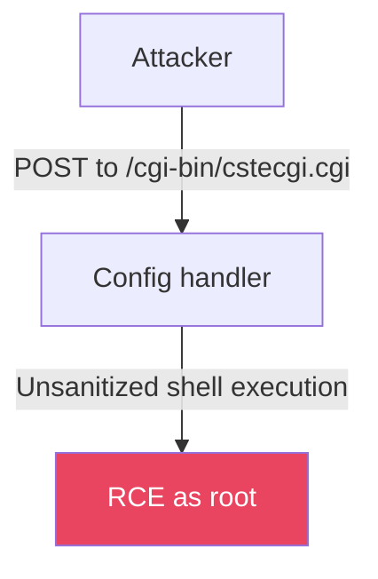

[](https://cve.mitre.org/cgi-bin/cvename.cgi?name=CVE-2026-134882)
[](https://nvd.nist.gov/vuln/detail/CVE-2026-134882)
[](https://cwe.mitre.org/data/definitions/78.html)
[](https://python.org)
[](https://github.com/cveForge)

## Metadata

| Field | Value |
|-------|-------|
| CVE ID | CVE-2026-134882 |
| Product | TOTOLINK A7100RU Router |
| CVSS Score | 10.0 (Critical) |
| CWE | CWE-78: OS Command Injection |
| PoC Type | Unauthenticated Remote Command Execution |

## Description

CVE-2026-134882 is a critical OS command injection vulnerability in TOTOLINK A7100RU routers. The CGI configuration endpoints accept user-controlled parameters that are passed unsanitized to system commands, allowing unauthenticated RCE.

## Attack Flow



## PoC Usage

```bash
pip install requests
python poc.py http://192.168.0.1
```

## Remediation

- Apply firmware updates from TOTOLINK
- Restrict management interface to LAN-only access
- Change default admin credentials

## Legal Disclaimer

> For authorized security research only. The authors accept no liability for misuse.


