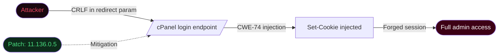

<p align="center">
  
</p>

<div align="center">

[](https://www.cve.org/CVERecord?id=CVE-2026-41940)
[](https://nvd.nist.gov/vuln/detail/CVE-2026-41940)
[-orange?style=for-the-badge&labelColor=0d1117)](https://cwe.mitre.org/data/definitions/74.html)
[](poc.py)
[](https://nvd.nist.gov/vuln/detail/CVE-2026-41940)
[](https://github.com/cveForge)

</div>

---

## Metadata

| Field | Value |
|-------|-------|
| **CVE ID** | CVE-2026-41940 |
| **Product** | cPanel & WHM |
| **Affected Version** | < 11.136.0.5 |
| **Vulnerability Type** | Pre-Auth CRLF Session Injection / Auth Bypass |
| **CVSS 3.1 Score** | 9.8 (Critical) |
| **CWE** | CWE-74 — Injection (CRLF) |
| **Patch** | 11.136.0.5 |

---

## Description

A pre-authentication CRLF injection vulnerability in cPanel & WHM's login endpoint allows an unauthenticated attacker to inject arbitrary HTTP headers and forge a valid session cookie. By injecting `\r\n` sequences into the login redirect parameter, the attacker can set a `cpsession` cookie with a chosen value and bypass authentication entirely.

---

## Root Cause Analysis

**CWE-74 (Injection (CRLF))** — The login handler reflects user-supplied redirect URL parameters into HTTP response headers without stripping carriage return and line feed characters, enabling an attacker to terminate the current header and inject new ones including `Set-Cookie`.

---

## Attack Flow



---

## PoC Usage

```bash
pip install requests
python poc.py -H https://target.com:2083 -v
```

### Arguments

| Flag | Description |
|------|-------------|
| `-H` / `--host` | Target cPanel URL (with port) |
| `--timeout` | Timeout in seconds (default: 10) |
| `-v` / `--verbose` | Verbose output |
| `--proxy` | HTTP proxy |

---

## Detection

- Monitor cPanel access logs for `%0d%0a` or `%0D%0A` in redirect params
- Alert on successful logins without prior authentication flow
- Inspect cPanel session creation events for anomalous sources
- Enable cPanel two-factor authentication

---

## Remediation

1. Update cPanel & WHM to **11.136.0.5** or later
2. Force 2FA for all cPanel accounts immediately
3. Rotate all existing session tokens
4. Block requests with CRLF patterns at the reverse proxy level

---

## Legal Disclaimer

This tool is developed exclusively for **authorized penetration testing** and **security research**. Use against systems without explicit permission is illegal. The user assumes all legal responsibility.

---

**Author:** cveForge | **License:** MIT | **Organization:** [cveForge](https://github.com/cveForge)

<p align="center">
  <sub><code>process exited with code 0</code> &nbsp;•&nbsp; <i>researched by <a href="https://github.com/cveForge">cveForge</a></i></sub>
</p>
<p align="center">
  
</p>
