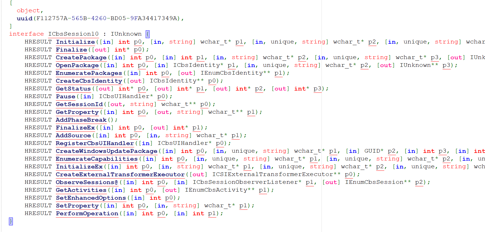
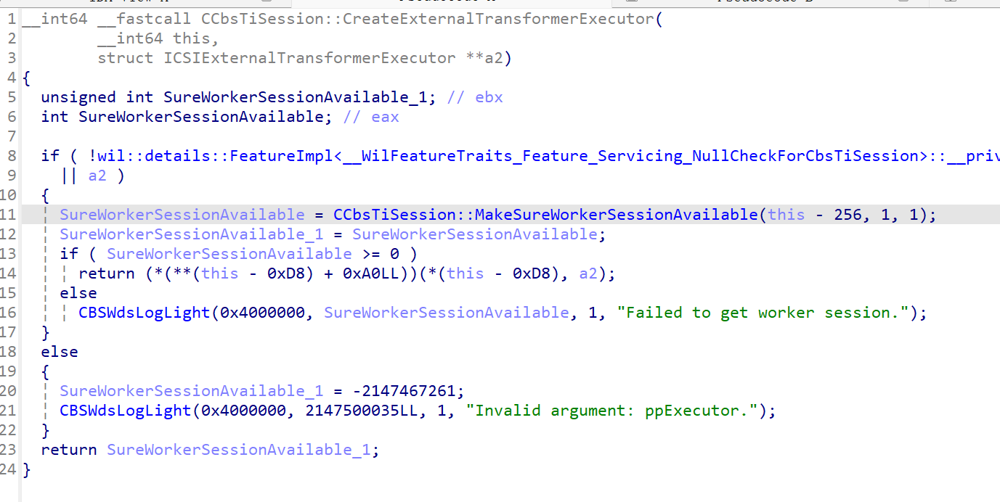
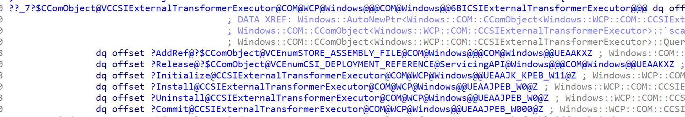

# TrustFall - CVE-2026-88235

TrustFall is a high-severity vulnerability we found in Windows `TrustedInstaller.exe`, tracked by Microsoft as [CVE-2026-88235](https://msrc.microsoft.com/update-guide/vulnerability/CVE-2026-88235). With it, any local user can tamper with the file system and the registry as SYSTEM and achieve local privilege escalation.

# Credit
h4urek from Fudan Univeristy(@[h4urek](https://twitter.com/h4urek))  
crispr from Fudan Univeristy(@[crispr](https://twitter.com/crispr_x))


## Background

Windows updates, optional components, language packs, and driver rollbacks are handled by CBS (Component-Based Servicing), hosted by `TrustedInstaller.exe` (the Windows Modules Installer) and executed by `TiWorker.exe` in the **LocalSystem** context. Because servicing must replace files under `System32`, `WinSxS`, and `HKLM`, the worker holds SeBackup/SeRestore and can write through ACLs by design.

To support offline image servicing, CBS exposes part of this capability through the `Component Based Servicing Session` COM object, which implements interfaces such as `ICbsSession7/8/9/10`. **Launching and accessing these interfaces does not require administrator rights; Interactive Users can do it.** They let a caller create and manage a CBS session, enumerate packages and capabilities, and request servicing operations.

## Root Cause

The CBS Session COM class has Server Type `LocalServer32` and is hosted by `TrustedInstaller.exe`. Its access control grants `INTERACTIVE` `Execute` and `ExecuteLocal`, and its launch permission grants `INTERACTIVE` `ActivateLocal`. As a result, any logged-in user can activate and access this COM class, and the object runs inside the LocalSystem TrustedInstaller service.

The class implements `ICbsSession`, `ICbsSession7/8/9/10`, and other interfaces. `CreateExternalTransformerExecutor` on `ICbsSession10` is the entry point discussed here. By design it should only serve trusted servicing components: DISM, Windows Update, deployment tools. But those tools and ordinary users reach the same COM class, and the class does not distinguish callers.



The client first obtains the `ICbsSession10` COM object and calls `Initialize` to initialize the session. It then calls `CreateExternalTransformerExecutor` to create an executor and launch `TiWorker.exe`.



### The Executor Interface

The executor is implemented by `wcp.dll`. wcp is the internal execution layer of the servicing stack: it maintains servicing state, parses transformer manifests, resolves a manifest into a concrete transformer, and executes the corresponding operation. It reads the caller-supplied manifest and uses it to select a transformer and build the change queue. `ICSIExternalTransformerExecutor` exposes four methods:

- `Initialize`: sets up the execution environment, including the reference image, rollback hive, and offline store;
- `Install`: parses the manifest and queues the transform for installation;
- `Uninstall`: queues the transform for removal;
- `Commit`: executes the queue to completion.



### Initialize: The Caller Builds the "Offline Environment"

`Initialize` takes all of its inputs from the caller:

- `flags` carries mode bits that select the install direction and whether to load a rollback hive;
- `referenceVersion` is the "before" version used for comparison with the manifest version; an older value lets the update check pass;
- `referenceImage` points to the "before" component database; wcp only requires a loadable hive and does not validate its contents;
- `fileStorage` is the root of the offline store, entirely caller-specified;
- `registryStorage` is optional.

Inside the executor, `Initialize` sets up the working context. It validates the target system, stores `flags` and `referenceVersion`, and, when the rollback bit is set, loads the `Rollback` hive from `fileStorage` through `AutoHive::LoadFromWin32PathForOfflineHive`. When `referenceImage` is provided, it appends `System32\config\COMPONENTS`, loads that hive through `AutoHive::Load`, and binds it as the reference component database. It then creates a pseudo Windows directory tree and an offline store under `fileStorage`, or opens an existing store depending on `flags`, and moves the executor to the Initialized phase.

What it does not do is inspect the content of those hives or the identity of the caller. The reference image and file storage only need to contain loadable registry hives; whether they are genuine `COMPONENTS` or rollback databases is never checked, and nothing confirms that the caller is authorized to service the image. The "offline environment" is entirely caller-supplied.

### Install: The Manifest Is the Instruction

`Install(manifestPath, transformId)` parses the caller-supplied XML and records the transform for execution. The manifest structure is simple:

- `assemblyIdentity`: basic package identity; only format validity matters;
- `Transforms Id`: matches the `transformId` passed to `Install`;
- `SettingsVersion`: the version used by servicing logic, which determines install versus rollback;
- `TransformInvoke Plugin`: selects the transformer, here `CopyData`;
- `Param`: operation parameters, including `SourcePath`, `DestinationPath`, and `DestinationName`.

For example, the manifest below asks the executor to copy `hack.dll` into `System32` under the name `phoneinfo.dll`:

```xml
<assembly xmlns="urn:schemas-microsoft-com:asm.v3" manifestVersion="1.0" isolated="false">
  <assemblyIdentity name="poc" version="1.0.0.0"
                    processorArchitecture="amd64"
                    publicKeyToken="31bf3856ad364e35" language="neutral"/>
  <Transforms Id="poc" SettingsVersion="3294967366">
    <TransformInvoke Plugin="CopyData">
      <Param Name="PathType" Value="File"/>
      <Param Name="SourcePath" Value="C:\Users\lowpriv\hack.dll"/>
      <Param Name="DestinationPath" Value="C:\Windows\System32"/>
      <Param Name="DestinationName" Value="phoneinfo.dll"/>
    </TransformInvoke>
  </Transforms>
</assembly>
```

The parsing has no signature check, no source check, and no directory restriction; the plugin name, source path, destination path, and destination name are all caller-controlled.

### Commit: Executing the Transform

`Install` only records the manifest; the actual work happens when the client calls `Commit`. At that point the executor takes the pending transform, decides which direction it should run, and dispatches it to the plugin named in the manifest.

The direction check compares the manifest's `SettingsVersion` with the current servicing version of the system. A higher manifest version means the transform runs forward and reaches the plugin's install path; an equal version means the transform is skipped because the component is already in the correct state; a lower version means the transform runs in reverse and reaches the rollback path. Setting `SettingsVersion` higher than the current version therefore forces the transform onto the forward path.

The `Plugin` name in each `TransformInvoke` selects the handler. The native plugins live in `PrimitiveTransformers.dll`, and each implements a different operation: `CopyData` copies files, directories, registry keys, and registry values; `MoveData` moves the same object types and removes the source; `CleanupCache` and `ResetMutableState` cover cache and servicing-state operations, with per-user variants for user contexts. For `CopyData`, the forward path ends in a file copy inside `TiWorker.exe`, running as LocalSystem.

This is where the vulnerability becomes dangerous. The manifest is fully attacker-controlled, so the attacker chooses the plugin, the operation, and every source and destination path. `CopyData` alone already provides arbitrary file write; `MoveData` adds arbitrary move and delete; the registry variants cover registry keys and values, including entire key trees. None of these parameters is validated against the caller's privileges or confined to the "offline image," so one manifest can change far more than a single file.

## PoC

The PoC drives the native transformers directly. `copy` hands a `CopyData` manifest to the executor, `move` uses `MoveData`, and `cleanup` uses `CleanupCache`. Each operation runs inside `TiWorker.exe` as LocalSystem, so a normal user can copy or move a file, directory, registry key, or registry value, and delete a file, directory, or registry key, all through the servicing process.

How to run:

```powershell
poc.exe copy    --src <src-path> --dst <dst-path>
poc.exe move    --src <src-path> --dst <dst-path>
poc.exe cleanup --path <path> [--type File|Directory|Registry]

# example: drop a payload into System32
poc.exe copy --src C:\Users\lowpriv\payload.dll --dst C:\Windows\System32\phoneinfo.dll
```

For `copy` and `move`, `--type` also accepts `Directory`, `RegistryKey`, and `RegistryKeyValue`. For the step from arbitrary file write to privilege escalation, see [WerTrigger](https://github.com/sailay1996/WerTrigger).

## Video
https://github.com/user-attachments/assets/ce2bc5e8-60e0-4ac9-a5de-a070581e8a78

## Conclusion

The TrustFall vulnerability is essentially an authorization failure. Any ordinary user can access the CBS Session class, and `CreateExternalTransformerExecutor` hands that user an executor without verifying their identity. The caller can supply a complete "offline" environment through `Initialize` and a manifest through `Install`, after which `Commit` executes the corresponding operations inside `TiWorker.exe` with LocalSystem privileges. Throughout the flow, the system never verifies whether the caller is a trusted servicing component, nor whether the target is truly an offline image.

The security impact follows directly. With a single manifest, a user with limited privileges can use TrustedInstaller to copy, move, or delete files and directories with LocalSystem privileges, and even copy, move, or overwrite registry keys and values, all of which go far beyond the API's original design boundaries. File copy is only the simplest use of this primitive; in practice, the mechanism can reach a much wider range of the file system and the registry.
