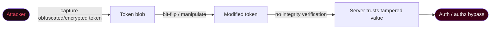

# CVE-2026-95517 -- Reliance on Obfuscation of Security-Relevant Inputs Without Integrity Checking

<div align="center">

[](https://github.com/LLCForge/CVE-2026-95517)
[](https://github.com/advisories/GHSA-mqvp-jwc5-xgv2)
[](https://cwe.mitre.org/data/definitions/649.html)
[](poc.py)
[](https://github.com/LLCForge)

</div>

---

## Metadata

| Field | Value |
|---|---|
| **CVE ID** | CVE-2026-95517 |
| **Product** | See advisory GHSA-mqvp-jwc5-xgv2 |
| **CVSS** | 9.1 Critical |
| **CWE** | CWE-649 -- Reliance on Obfuscation/Encryption Without Integrity Checking |
| **Attack Vector** | Network |
| **Auth Required** | None / Low |
| **Impact** | Tampering of security-relevant inputs (auth/authorization) |

---

## Description

Security-relevant inputs are protected only by obfuscation or encryption without an
integrity check (e.g. HMAC/signature). An attacker who can modify the ciphertext or
obfuscated blob can tamper with the underlying values -- for example flipping bits in
an encrypted token -- because the application does not detect the modification,
potentially bypassing authentication or authorization decisions.

---

## Vulnerable Code

```python
# Conceptual: encrypted token used for auth, but no MAC/signature verification
plaintext = aes_cbc_decrypt(key, request_token)   # CWE-649: no integrity check
user = parse_identity(plaintext)                   # attacker bit-flipped ciphertext
grant_access(user)
```

---

## Attack Flow



---

## PoC Usage

```bash
pip install -r requirements.txt
python poc.py -u https://TARGET --check-only -v
python poc.py -u https://TARGET --token <captured_token> --flip 0 -v
python poc.py -u https://TARGET --token <captured_token> --scan-flips -o result.json
```

### Flags

| Flag | Description |
|---|---|
| `-u / --url` | Target base URL |
| `--token` | Captured obfuscated/encrypted token |
| `--cookie-name` | Name of the token cookie/header (default: `session`) |
| `--flip` | Byte index to flip |
| `--scan-flips` | Try flipping each byte and observe response changes |
| `--check-only` | Baseline only |
| `-o / --output` | Save results to JSON file |
| `--proxy` / `--insecure` / `-v` | Proxy / skip TLS / verbose |

---

## Impact

| Area | Impact |
|---|---|
| Confidentiality | **Critical** |
| Integrity | **Critical** -- tampered security inputs accepted |
| Availability | **Medium** |
| Scope | Any flow relying on the unauthenticated token |

---

## Detection

| Method | Indicator |
|---|---|
| Behaviour | Modified tokens accepted / cause auth changes |
| Code audit | Encryption/obfuscation of security inputs without MAC |

---

## Remediation

| Action | Detail |
|---|---|
| **Update** | Apply vendor fix |
| **Integrity** | Use authenticated encryption (AES-GCM) or HMAC over tokens |
| **Validate** | Reject any token failing integrity verification |

---

## Disclaimer

This PoC is released for educational and authorized security research purposes only.
Do not use against systems you do not own or have explicit written permission to test.

**Author:** LLCForge | **License:** MIT
